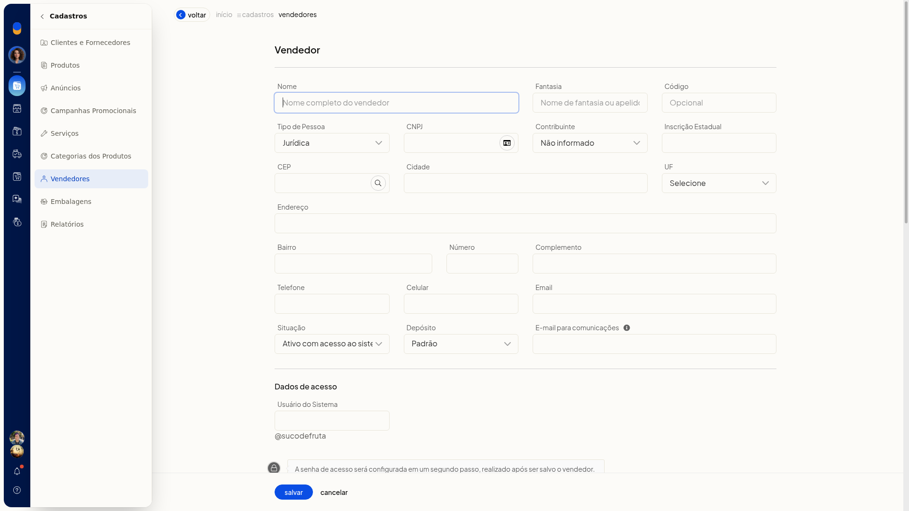
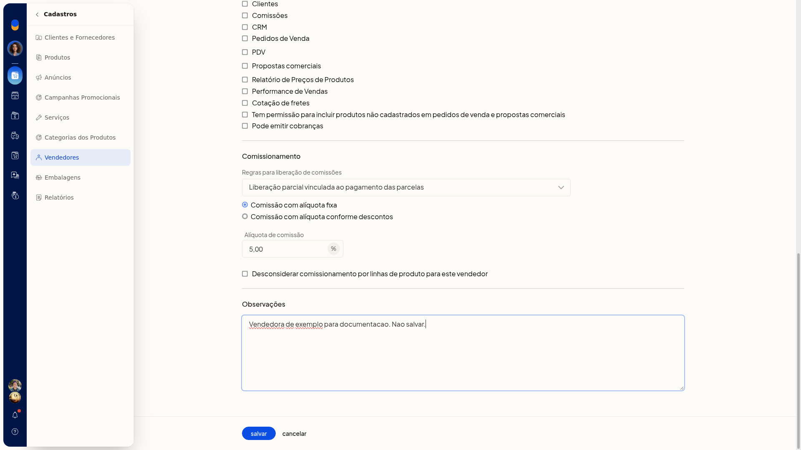
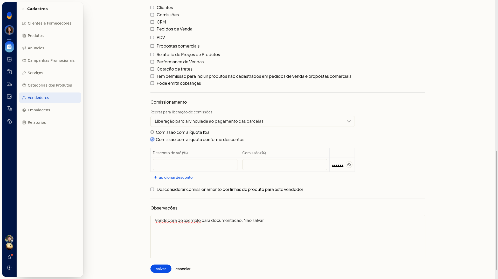
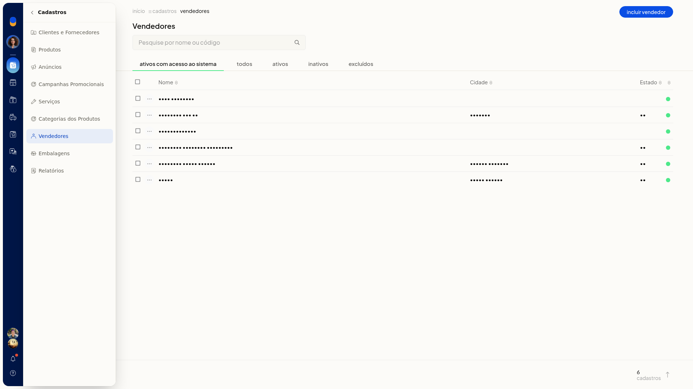
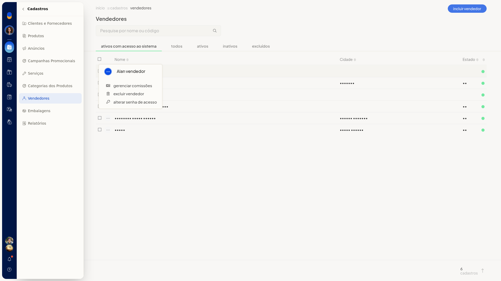

# Gerenciar comissões do vendedor

No ERP da Olist, o comissionamento do vendedor define a alíquota e a regra de liberação da comissão. Você pode usar uma alíquota fixa ou faixas conforme o desconto.

O ajuste fica no cadastro do vendedor, em **Cadastros > Vendedores**. Na lista, a linha do vendedor também oferece **Gerenciar comissões**.

## Importante
- **Desconsiderar comissionamento por linhas de produto para este vendedor** só aparece se a empresa usa linhas de produto.

## Instruções
### No cadastro do vendedor

1. Acesse **Cadastros > Vendedores**.
2. Clique em **incluir vendedor**.

   

3. Em **Comissionamento**, mantenha **Comissão com alíquota fixa** ou selecione **Comissão com alíquota conforme descontos**. Esses campos não são obrigatórios.
4. Na alíquota fixa, preencha **Alíquota de comissão**.
5. Em **Regras para liberação de comissões**, selecione uma opção. O padrão é **Liberação parcial vinculada ao pagamento das parcelas**. As demais são **Liberação integral no faturamento**, **Liberação integral após o pagamento da primeira parcela** e **Liberação de 50% no faturamento e o restante vinculado ao pagamento das parcelas**.

   

6. Se escolher **Comissão com alíquota conforme descontos**, preencha **Desconto de até (%)** e **Comissão (%)**.
7. Clique em **Adicionar desconto** para incluir outra faixa.

   

8. Clique em **salvar** para gravar o vendedor com o comissionamento definido.

### Na lista de vendedores

1. Acesse **Cadastros > Vendedores**.
2. Localize o vendedor em **Pesquise por nome ou código** ou nas abas **ativos com acesso ao sistema**, **todos**, **ativos**, **inativos** e **excluídos**.

   

3. No menu de contexto da linha, clique em **Gerenciar comissões**.

   
