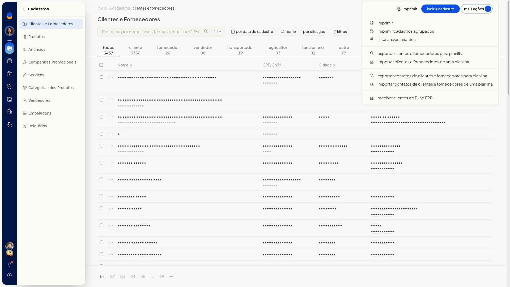
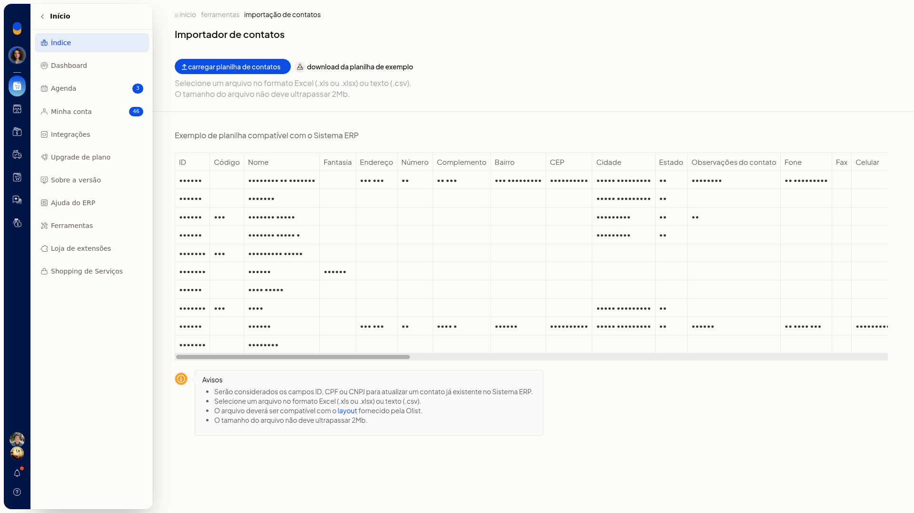
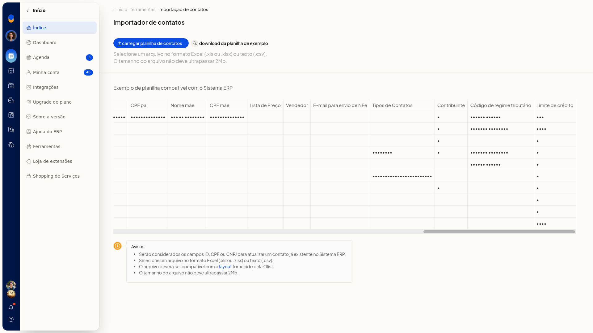

# Importar clientes e fornecedores por planilha

No ERP da Olist, você inclui vários contatos de uma vez a partir de uma planilha. Em **Clientes e Fornecedores**, a importação cria cadastros novos e atualiza contatos que já existem quando a planilha traz o mesmo ID ou CPF/CNPJ.

## Importante
- O arquivo precisa ser Excel ou CSV, de até 2 Mb, no layout da planilha de exemplo do **Importador de contatos**.
- ID ou CPF/CNPJ na planilha atualizam um contato já existente.
- Em **Tipos de Contatos**, separe os rótulos com barra vertical.

## Instruções
1. Acesse **Cadastros > Clientes e Fornecedores**.
2. Clique em **Mais ações**.

   

3. Clique em **importar clientes e fornecedores de uma planilha**.

   

4. Baixe a planilha de exemplo.
5. Preencha o arquivo com as colunas do exemplo: ID, Código, Nome, Fantasia, Endereço, Número, Complemento, Bairro, CEP, Cidade, Estado, Observações do contato, Fone, Fax, Celular, E-mail, Web Site, Tipo pessoa, CNPJ / CPF, IE / RG, IE isento, Situação, Observações, Estado civil, Profissão, Sexo, Data nascimento, Naturalidade, Nome pai, CPF pai, Nome mãe, CPF mãe, Lista de Preço, Vendedor, E-mail para envio de NFe, Tipos de Contatos, Contribuinte, Código de regime tributário e Limite de crédito.

   

6. Clique em **carregar planilha de contatos** para efetivar a importação.
