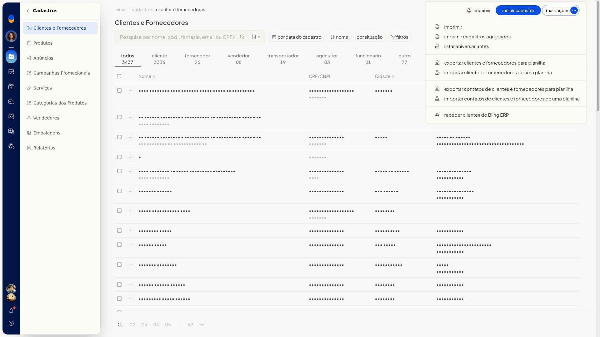
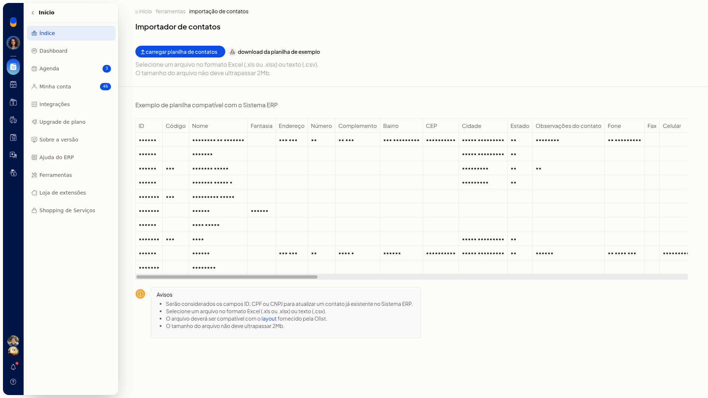
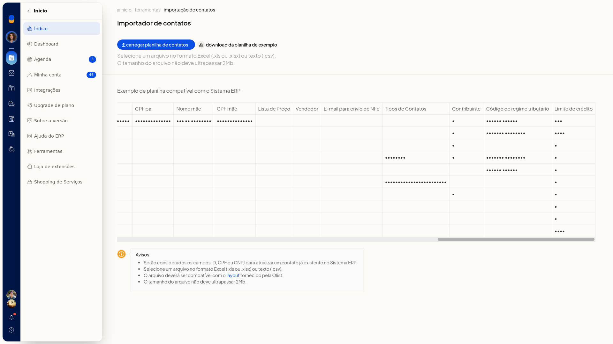

# Importar contatos de uma planilha

No ERP da Olist, você importa contatos a partir de uma planilha e inclui vários cadastros de uma vez. Se a planilha trouxer ID ou CPF/CNPJ de um contato que já existe, esse cadastro é atualizado.

A importação fica em **Cadastros > Clientes e Fornecedores**, no **Importador de contatos**.

## Pré-requisitos
- Arquivo Excel ou CSV de até 2 Mb, no layout da planilha de exemplo do **Importador de contatos**.

## Importante
- A planilha precisa seguir o layout da planilha de exemplo.
- ID ou CPF/CNPJ na planilha atualizam um contato já existente.

## Instruções
1. Acesse **Cadastros > Clientes e Fornecedores**.
2. Clique em **Mais ações**.

   

3. Clique em **importar clientes e fornecedores de uma planilha**.

   

4. Baixe a planilha de exemplo.
5. Preencha a planilha no layout do exemplo, em Excel ou CSV, com até 2 Mb.

As colunas do exemplo são:

- ID
- Código
- Nome
- Fantasia
- Endereço
- Número
- Complemento
- Bairro
- CEP
- Cidade
- Estado
- Observações do contato
- Fone
- Fax
- Celular
- E-mail
- Web Site
- Tipo pessoa
- CNPJ / CPF
- IE / RG
- IE isento
- Situação
- Observações
- Estado civil
- Profissão
- Sexo
- Data nascimento
- Naturalidade
- Nome pai
- CPF pai
- Nome mãe
- CPF mãe
- Lista de Preço
- Vendedor
- E-mail para envio de NFe
- Tipos de Contatos
- Contribuinte
- Código de regime tributário
- Limite de crédito

6. Clique em **carregar planilha de contatos** para efetivar a importação. ID ou CPF/CNPJ na planilha atualizam contatos já existentes.

## Informações adicionais
### Tipos de Contatos na planilha de exemplo

Na coluna **Tipos de Contatos**, os rótulos ficam separados por barra vertical.
