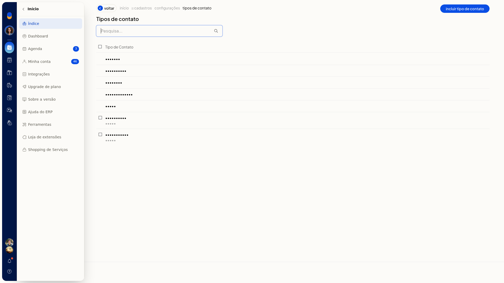
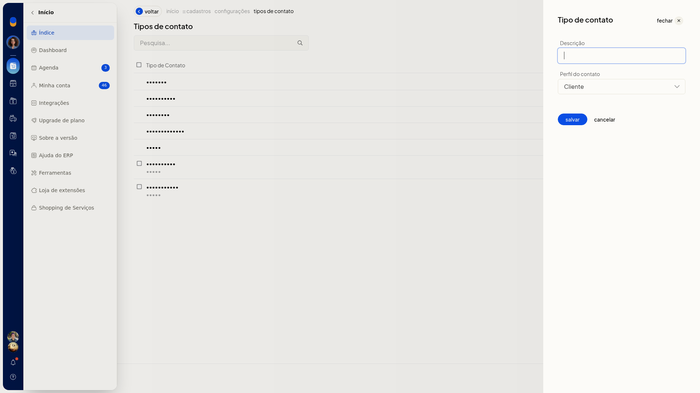
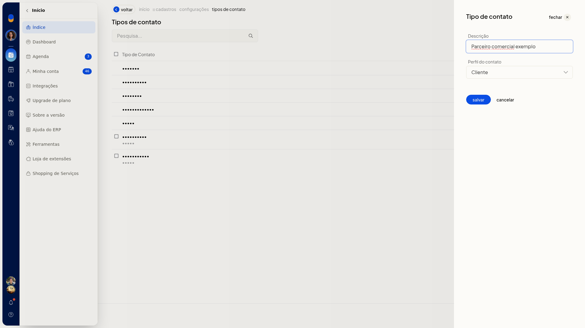

# Incluir um tipo de contato

No ERP da Olist, o tipo de contato classifica pessoas e empresas com as quais a loja se relaciona. Você inclui um tipo com descrição e perfil para usá-lo nas abas da lista de contatos e como tipo de contato padrão.

## Instruções
1. Acesse **Configurações > Configurações ERP > Cadastros > Tipos de contato**.

   

2. Clique em **Incluir tipo de contato**.

   

3. Preencha **Descrição**. O campo não é obrigatório.
4. Selecione **Perfil do contato**. As opções são Cliente, Fornecedor, Vendedor, Transportador, Funcionário e Outro. Ao abrir o painel, a opção selecionada é Cliente.

   

5. Clique em **salvar** para gravar o tipo de contato. **Cancelar** fecha o painel e volta à lista sem incluir o tipo.

## Informações adicionais
### Tipos padrão e personalizados na lista

- Cliente, Fornecedor, Vendedor, Transportador e Outro aparecem sem caixa de seleção.
- Tipos personalizados, como Agricultor e Funcionário, aparecem com caixa de seleção e o subtítulo Outro.
- O tipo criado em **Tipos de contato** passa a aparecer nas abas da lista de **Clientes e Fornecedores** e em **Tipo de contato padrão**.
