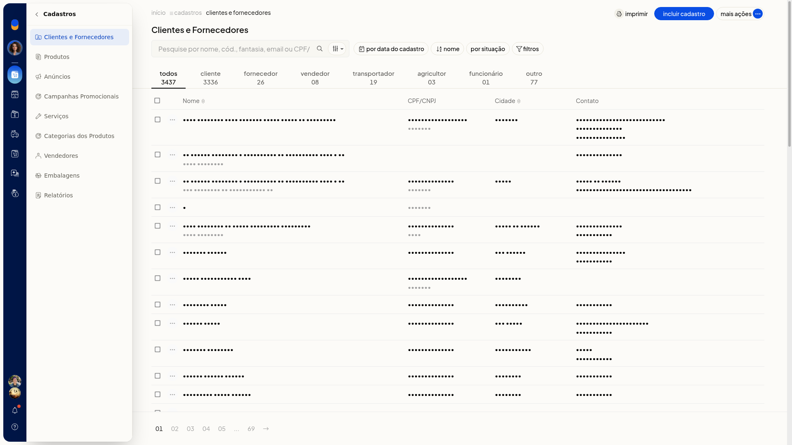
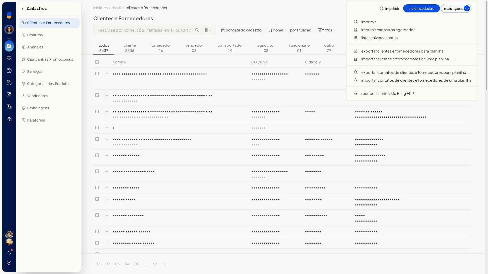

# Listar aniversariantes dos contatos

No ERP da Olist, os contatos da loja ficam em **Clientes e Fornecedores**. A partir dessa lista, você consulta os aniversariantes dos contatos.

## Instruções
1. Acesse **Cadastros > Clientes e Fornecedores**.

   

2. Clique em **Mais ações**.

   

3. Clique em **listar aniversariantes**.
