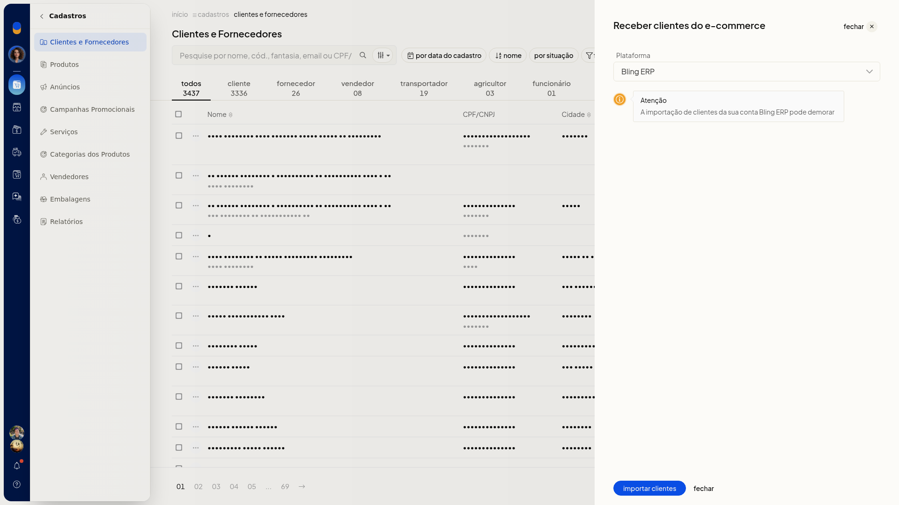

# Receber clientes do Bling ERP

No ERP da Olist, você traz os clientes da sua conta Bling ERP para a lista de **Clientes e Fornecedores**. A importação começa em **Cadastros > Clientes e Fornecedores**, em **Mais ações**.

## Pré-requisitos
- A integração precisa aparecer no campo **Plataforma**. Se **Bling ERP** não estiver na lista, a importação não fica disponível.

## Importante
- A importação de clientes da sua conta Bling ERP pode demorar.

## Instruções
1. Acesse **Cadastros > Clientes e Fornecedores**.
2. Clique em **Mais ações**.
3. Clique em **receber clientes do Bling ERP**.
4. Em **Plataforma**, selecione **Bling ERP**. Para sair sem importar, clique em **fechar**.

   

5. Clique em **importar clientes**. A importação começa e pode demorar.
