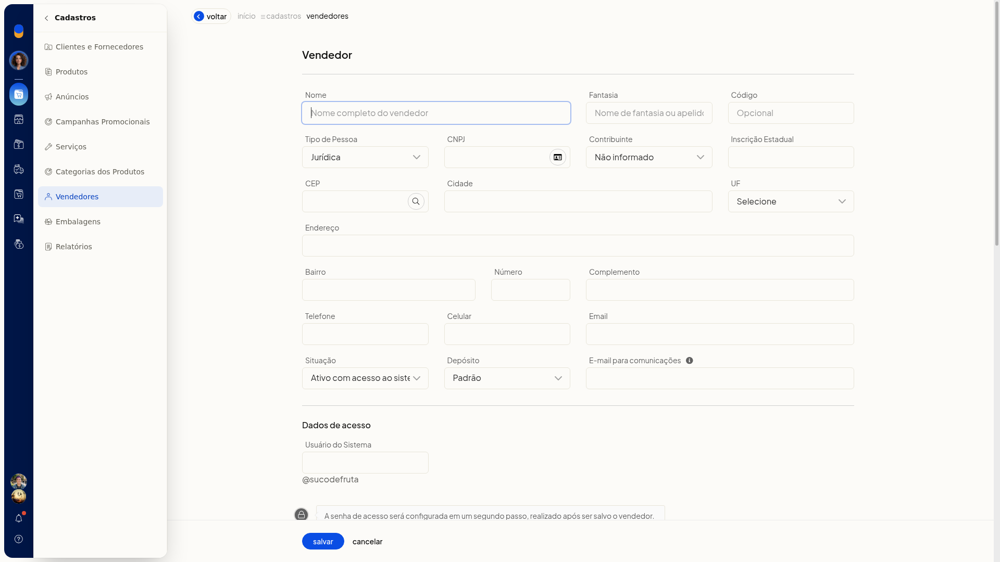
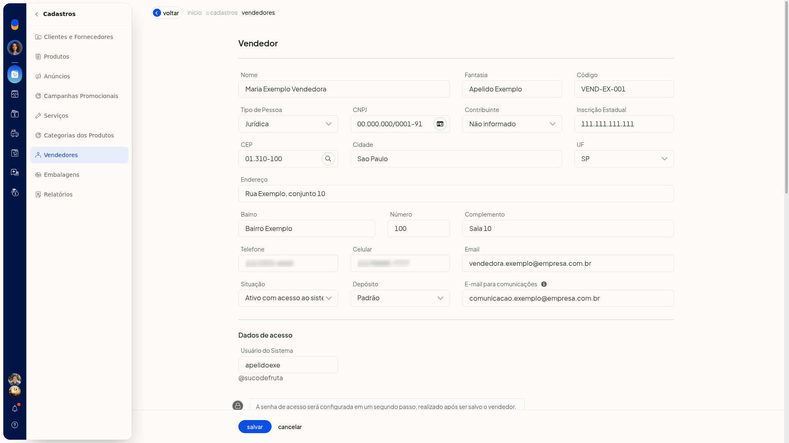
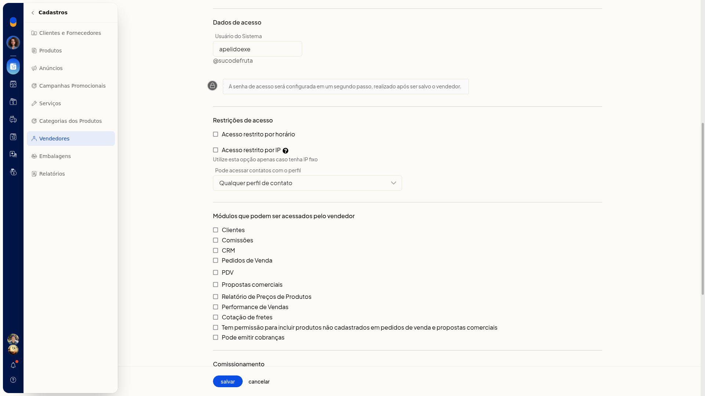
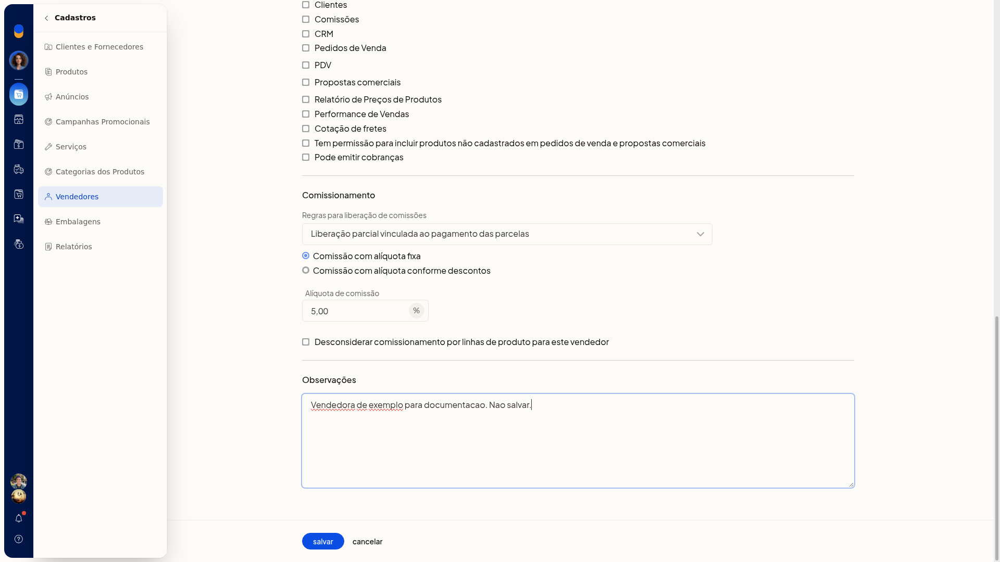
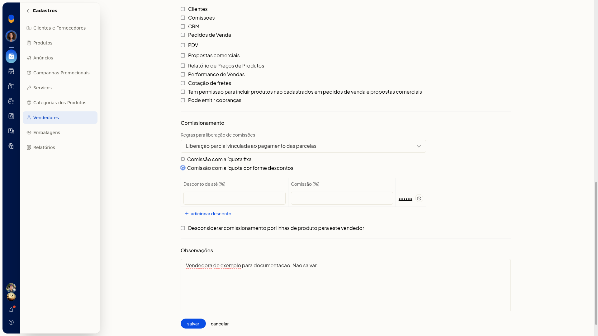
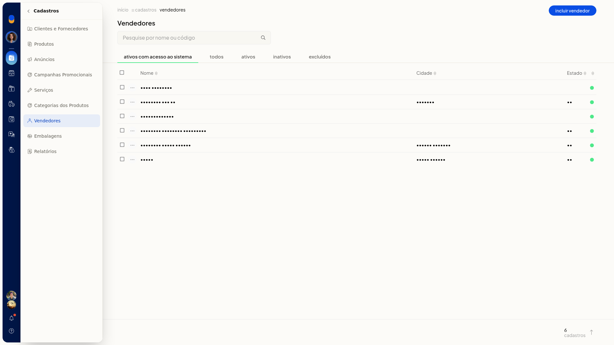
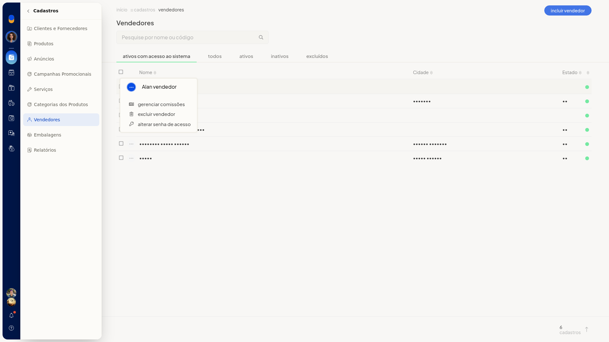
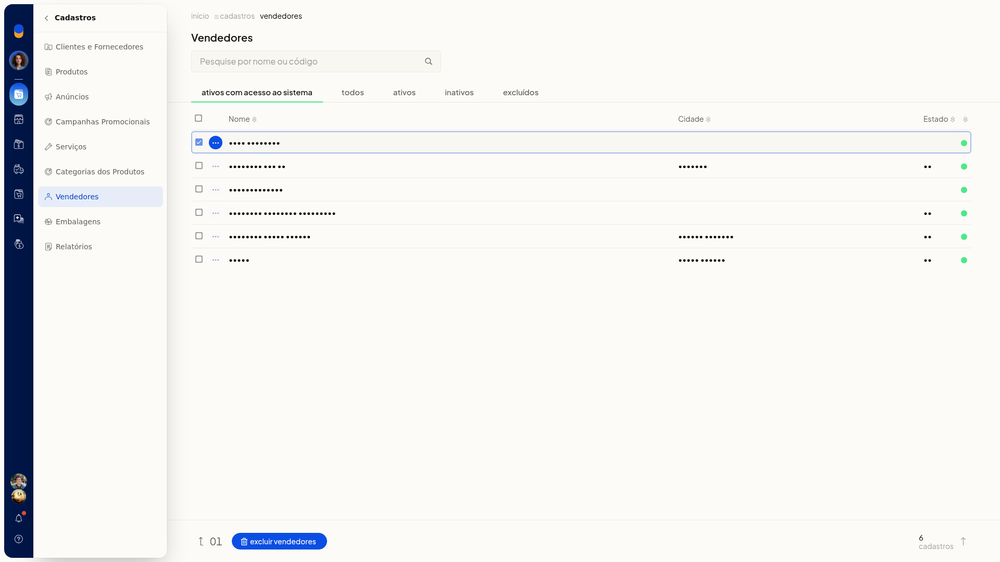

# Vendedores

No ERP da Olist, os vendedores ficam em uma lista própria. Você consulta o cadastro, inclui a identificação, o endereço, o acesso ao sistema e as permissões, e define o comissionamento por alíquota fixa ou por faixas de desconto.

A lista fica em **Cadastros > Vendedores**.

## Importante
- Nenhum campo do formulário vem marcado como obrigatório.
- Use **Acesso restrito por IP** apenas com IP fixo.
- Nesta tela não há ação para importar vendedores por planilha.

## Instruções
### Incluir um vendedor

1. Acesse **Cadastros > Vendedores**.
2. Clique em **incluir vendedor**.

   

3. Preencha a identificação.

#### Identificação

- **Nome**
- **Fantasia**
- **Código**
- **Tipo de Pessoa**: **Jurídica**, **Física**, **Estrangeiro** ou **Estrangeiro no Brasil**. O padrão é **Jurídica**.
- **CNPJ**: informe o documento conforme o tipo de pessoa.
- **Contribuinte**: **Não informado**, **Contribuinte ICMS**, **Contribuinte isento de Inscrição no cadastro de Contribuintes do ICMS** ou **Não Contribuinte, que pode ou não possuir Inscrição Estadual no Cadastro de Contribuintes do ICMS**. O padrão é **Não informado**.
- **Inscrição Estadual**

4. Preencha o endereço e o contato.

#### Endereço e contato

- **CEP**
- **Cidade**
- **UF**: **Selecione** ou uma UF de AC a TO, incluindo **EX**
- **Endereço**
- **Bairro**
- **Número**
- **Complemento**
- **Telefone**
- **Celular**
- **Email**

5. Escolha a **Situação**. As opções são **Ativo com acesso ao sistema**, **Ativo**, **Inativo**, **Sem Movimento** e **Excluído**. O padrão é **Ativo com acesso ao sistema**.
6. Se o campo **Depósito** aparecer, escolha um depósito já cadastrado na empresa. A opção inicial é **Padrão**. O campo só aparece quando a empresa usa depósitos.
7. Preencha o acesso ao sistema.

#### Acesso ao sistema

- **E-mail para comunicações**
- **Usuário do Sistema**: ajuste o valor sugerido, se precisar.
- **Acesso restrito por horário**
- **Acesso restrito por IP**: use apenas com IP fixo.
- **Pode acessar contatos com o perfil**: **Cliente**, **Fornecedor**, **Vendedor**, **Transportador**, **Funcionário** ou **Outro**.

8. Marque as permissões que o vendedor pode usar:

   - **Clientes**
   - **Comissões**
   - **CRM**
   - **Pedidos de Venda**
   - **PDV**
   - **Propostas comerciais**
   - **Relatório de Preços de Produtos**
   - **Performance de Vendas**
   - **Cotação de fretes**
   - **Tem permissão para incluir produtos não cadastrados em pedidos de venda e propostas comerciais**
   - **Pode emitir cobranças**

9. Defina o comissionamento e, se quiser, as **Observações**.

#### Comissionamento

- **Regras para liberação de comissões**: **Liberação parcial vinculada ao pagamento das parcelas** (padrão), **Liberação integral no faturamento**, **Liberação integral após o pagamento da primeira parcela** ou **Liberação de 50% no faturamento e o restante vinculado ao pagamento das parcelas**.
- **Comissionamento**: **Comissão com alíquota fixa** (padrão) ou **Comissão com alíquota conforme descontos**.
- Na alíquota fixa, informe **Alíquota de comissão**.
- **Desconsiderar comissionamento por linhas de produto para este vendedor** só aparece se a empresa usa linhas de produto.

10. Para comissão por faixas, selecione **Comissão com alíquota conforme descontos**. Informe **Desconto de até (%)** e **Comissão (%)**. Clique em **Adicionar desconto** para incluir outra faixa.

   

11. Clique em **salvar** para gravar o vendedor. A senha de acesso é a etapa seguinte ao salvamento. Para voltar à lista sem incluir o vendedor, clique em **cancelar**.

### Consultar vendedores e usar as ações da lista

1. Acesse **Cadastros > Vendedores**. A lista mostra as colunas **Nome**, **Cidade** e **Estado**, os indicadores de situação, a quantidade de cadastros e **Voltar ao topo**.

   

2. Pesquise em **Pesquise por nome ou código**.
3. Use as abas **ativos com acesso ao sistema**, **todos**, **ativos**, **inativos** e **excluídos**. A primeira vem selecionada.
4. Na linha do vendedor, abra o menu de contexto e escolha **Gerenciar comissões**, **Excluir vendedor** ou **Alterar senha de acesso**.

   

5. Marque um vendedor para ver a contagem da seleção e usar **Excluir vendedores**. Sem marcação, **Ações** não abre menu.

   
