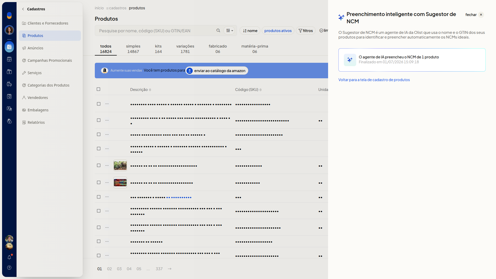

# Consultar o último lote de sugestão de NCM

No ERP da Olist, você consulta o último lote de sugestão de NCM da Lis. No painel, você confere o processamento já concluído, com a quantidade de produtos que tiveram o NCM preenchido e a data e hora de término.

## Instruções
1. Acesse **Cadastros > Produtos**.

   

2. Clique em **Mais ações**.

   

3. Clique em **Consultar último lote de sugestão de ncm**.

4. Confira o card no painel **Preenchimento inteligente com Sugestor de NCM**. Ele mostra a quantidade de produtos com NCM preenchido e a data e hora de término, sem abrir o detalhe dos produtos. Para voltar à listagem, acesse o link **Voltar para a tela de cadastro de produtos**.

   

## Informações adicionais
- O painel informa que o agente de sugestão usa o nome do produto e o GTIN.
