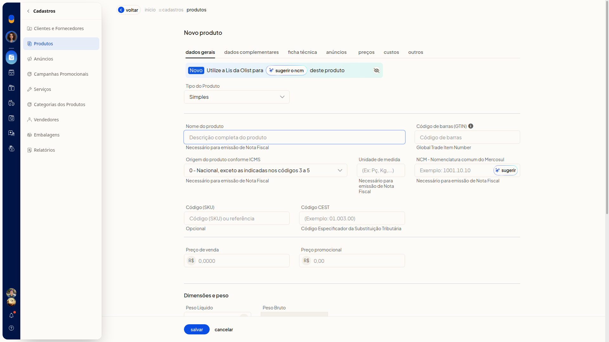
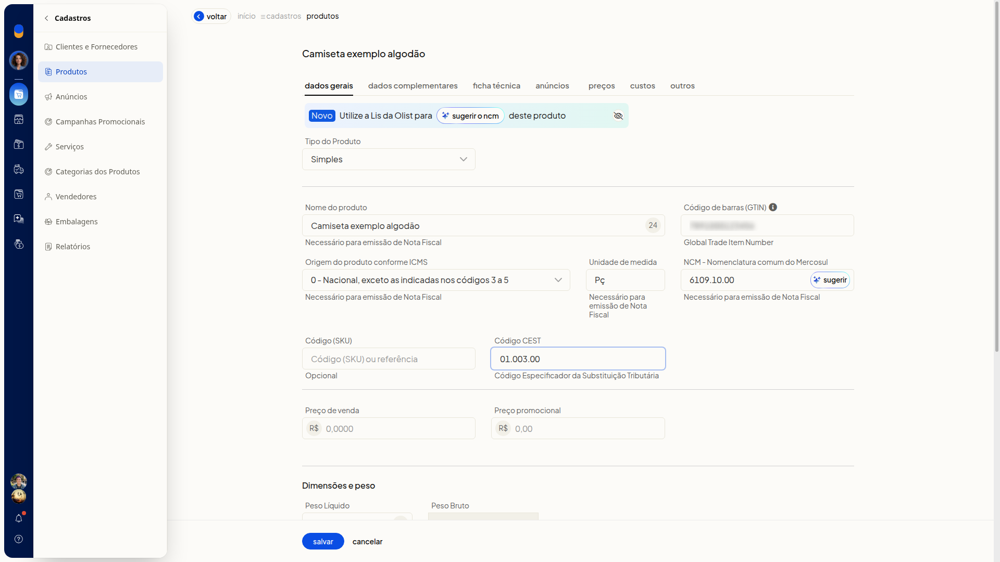
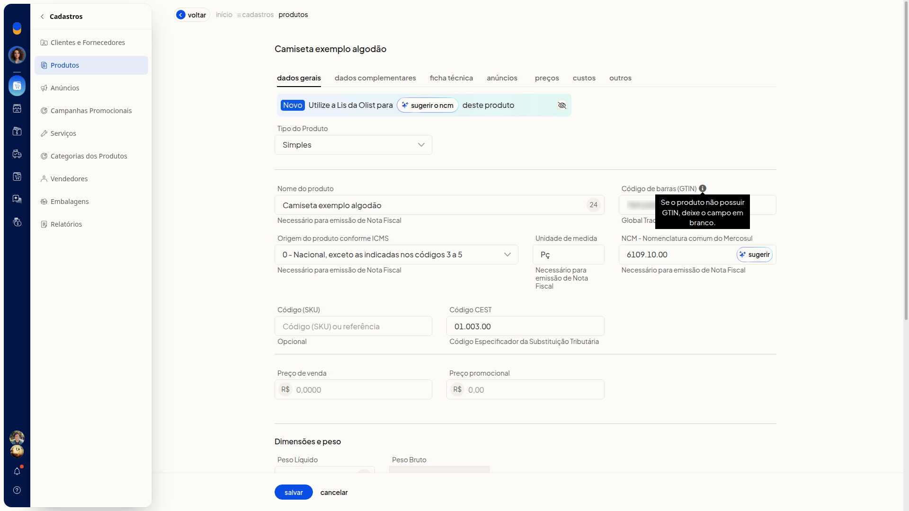
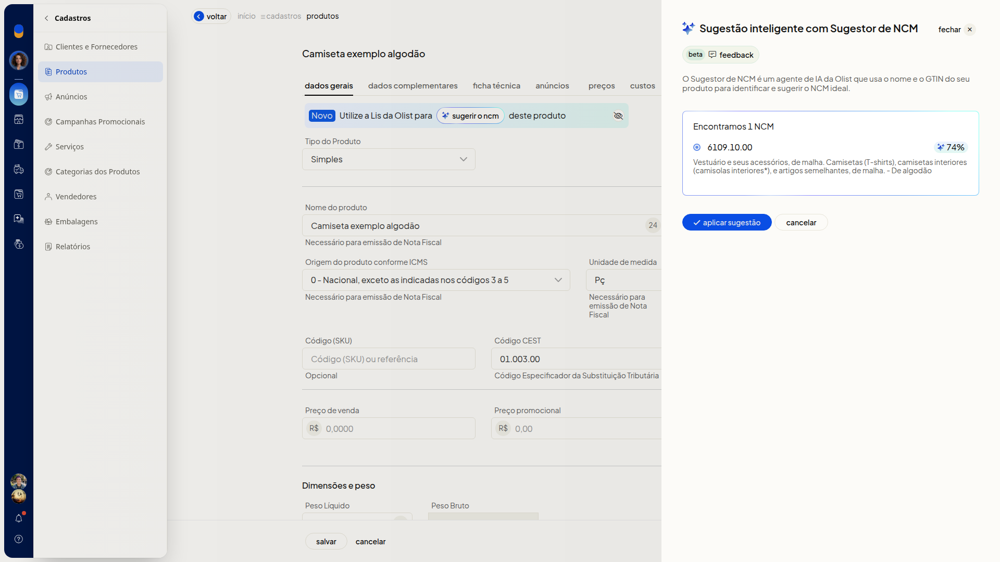

# Dados fiscais do produto: NCM, CEST, origem e GTIN

No ERP da Olist, você informa na ficha do produto a origem conforme ICMS, a unidade de medida, o NCM, o CEST e o GTIN. Os campos ficam na aba **Dados Gerais**.

No campo **NCM**, você pode pedir à Lis da Olist uma sugestão, conferir o código, a descrição e o percentual e decidir se aplica.

## Importante
- Para emitir nota fiscal pelo ERP, preencha **Origem do produto conforme ICMS**, **Unidade de medida** e **NCM**. O texto de ajuda dos campos indica essa necessidade.
- Se o produto não possuir GTIN, deixe **Código de barras (GTIN)** em branco.
- A sugestão de NCM usa o nome do produto e o GTIN.

## Instruções
1. Acesse **Cadastros > Produtos**.

   

2. Clique em **Incluir produto**.

   

3. Preencha os campos fiscais na aba **Dados Gerais**. Na ficha, nenhum deles é obrigatório.

   - **Origem do produto conforme ICMS**: selecione a origem na lista. Exemplo: 0 - Nacional, exceto as indicadas nos códigos 3 a 5.
   - **Unidade de medida**: digite a unidade. Exemplos: Pç e Kg.
   - **NCM**: digite o código ou deixe para a sugestão. Exemplo: 6109.10.00.
   - **Código CEST**: digite o Código Especificador da Substituição Tributária. Exemplo: 01.003.00.
   - **Código de barras (GTIN)**: digite o código de barras. Se o produto não possuir GTIN, deixe o campo em branco.

   

   

4. Informe o nome do produto e clique em **sugerir** no campo **NCM** se quiser uma sugestão.
5. Confira o código, a descrição e o percentual no **Sugestor de NCM**.

   

6. Clique em **aplicar sugestão** para usar o código, ou em **cancelar** para fechar sem aplicar.
7. Clique em **salvar** para gravar a ficha.
