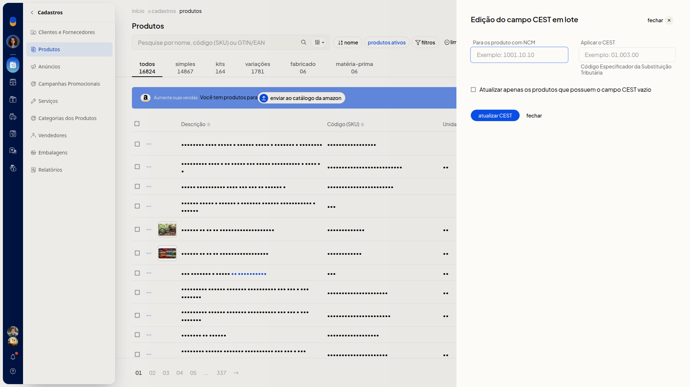
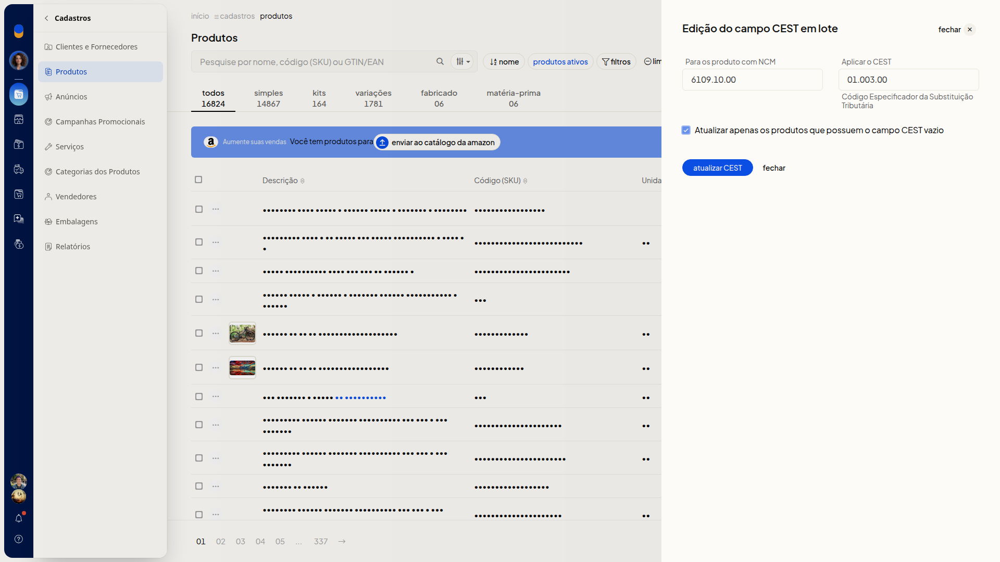

# Editar o CEST dos produtos em lote

## Instruções
1. Acesse **Cadastros > Produtos**.
2. Clique em **Mais ações**.

   

3. Clique em **Editar CEST dos produtos em lote**.

   

4. Digite o NCM em **Para os produto com NCM**. O campo não é obrigatório.
5. Digite o código em **Aplicar o CEST**. O campo não é obrigatório.
6. Marque **Atualizar apenas os produtos que possuem o campo CEST vazio** se quiser limitar a atualização aos produtos desse NCM que estão com o CEST vazio.

   

7. Clique em **atualizar CEST** para aplicar o CEST aos produtos do NCM informado. Para sair sem aplicar, clique em **fechar**.
