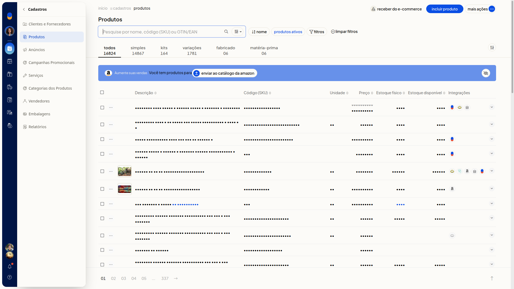
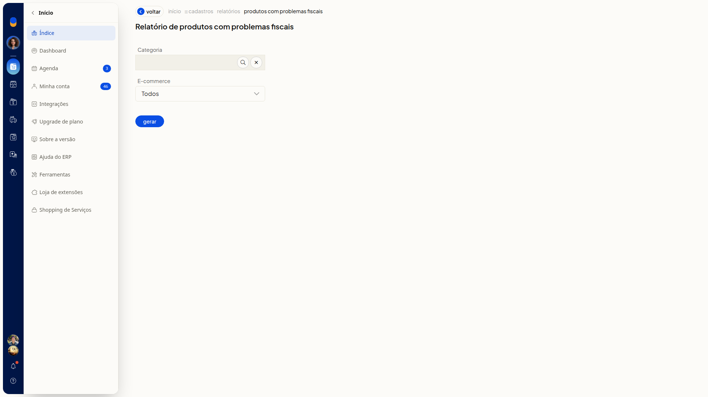

# Gerar o relatório de produtos com problemas fiscais

No ERP da Olist, você gera o relatório de produtos com problemas fiscais. Antes de gerar, pode filtrar por categoria e por ecommerce.

## Instruções
1. Acesse **Cadastros > Produtos**.

   

2. Clique em **Mais ações**.

   

3. Clique em **Produtos com problemas fiscais**.

4. Busque uma categoria em **Categoria**, se quiser. O campo não é obrigatório.

5. Mantenha ou troque **E-commerce**. O filtro abre em **Todos** e não é obrigatório.

   

6. Clique em **Gerar** para emitir o relatório.
