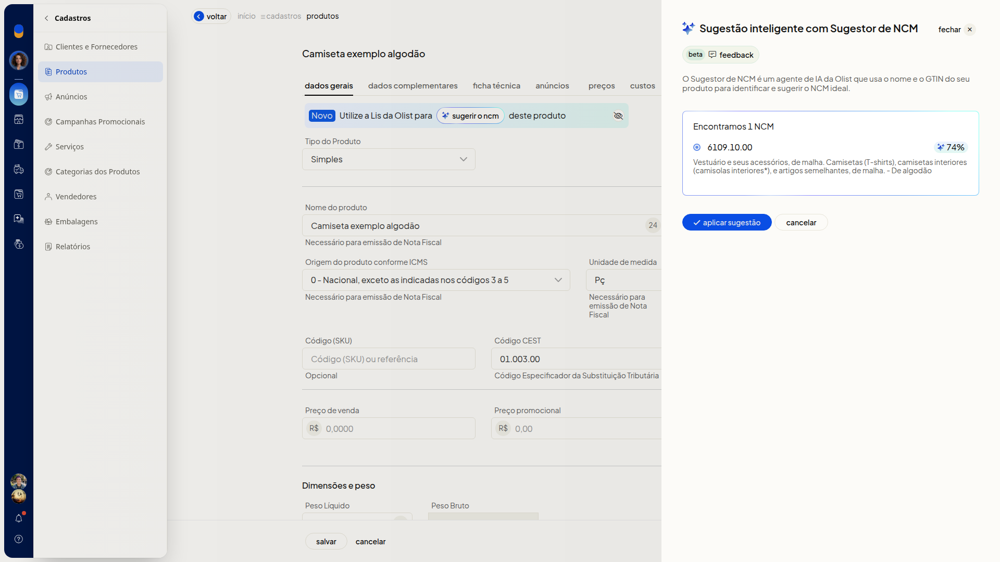
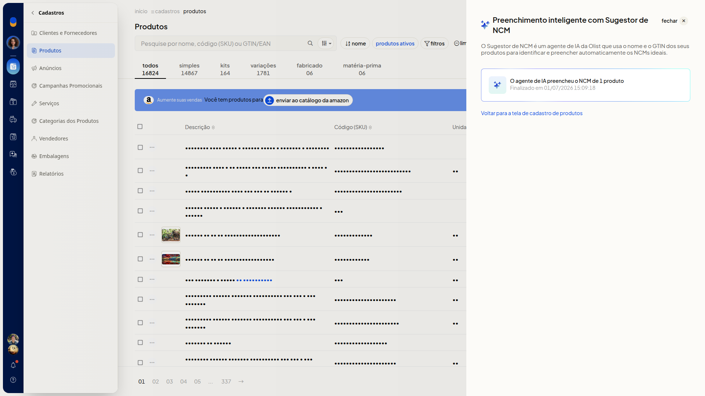

# Sugestão de NCM com IA

## Importante
- O agente de sugestão usa o nome do produto e o GTIN. Informe o nome antes de pedir a sugestão.
- Se o produto não possuir GTIN, deixe o campo **Código de barras (GTIN)** em branco.

## Instruções
### Pedir a sugestão na ficha do produto

1. Acesse **Cadastros > Produtos**.
2. Clique em **Incluir produto**.
3. Informe o nome do produto na aba **Dados Gerais**.
4. No campo **NCM**, clique em **sugerir**.
5. Confira o código, a descrição e o percentual no painel **Sugestor de NCM**.
6. Clique em **aplicar sugestão** para usar o código, ou em **cancelar** para fechar sem aplicar.

   

### Consultar o último lote de sugestão

1. Acesse **Cadastros > Produtos**.
2. Abra **Mais ações**.
3. Clique em **Consultar último lote de sugestão de ncm**.
4. Leia a quantidade de produtos preenchidos e a data e a hora de término no painel **Preenchimento inteligente com Sugestor de NCM**. Para voltar à listagem, acesse o link **Voltar para a tela de cadastro de produtos**.

   

## Informações adicionais
- Clicar no card do lote não abre o detalhe dos produtos.
