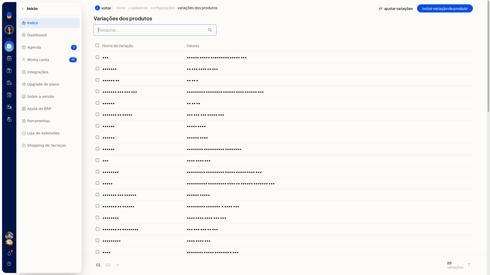
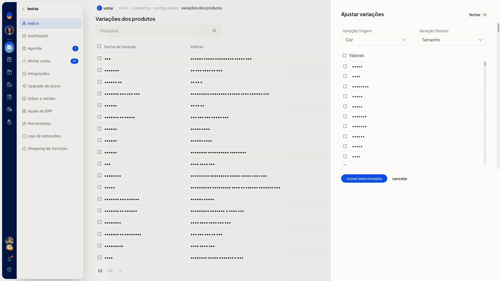

# Ajustar variações movendo valores entre variações

No ERP da Olist, você move valores de uma variação de produto para outra. A origem e o destino são variações já cadastradas, e você escolhe quais valores serão transferidos.

O ajuste fica na lista de variações, em **Configurações > Cadastros**.

## Pré-requisitos
- A variação de origem e a variação de destino já precisam estar cadastradas.

## Instruções
1. Acesse **Configurações > Cadastros** e abra as configurações de variações de produtos.
2. Na lista de variações, clique em **Ajustar variações**.

   

3. Escolha a variação de origem e a variação de destino e marque os valores que serão movidos.

   

4. Clique em **Mover selecionados**.
