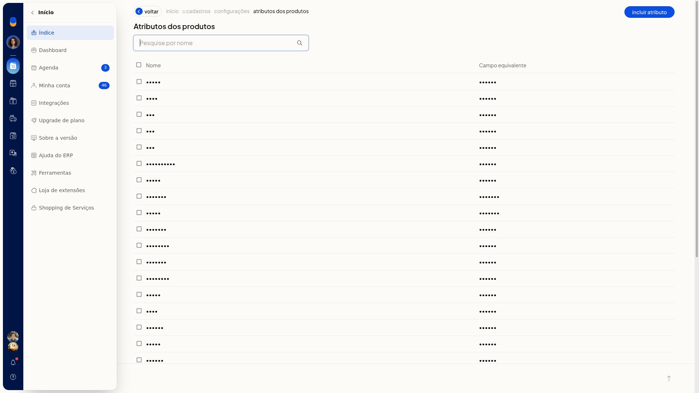
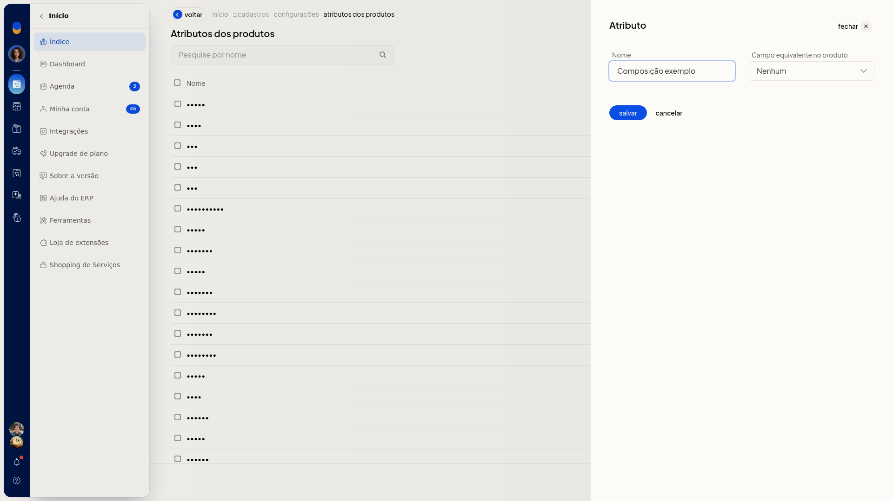
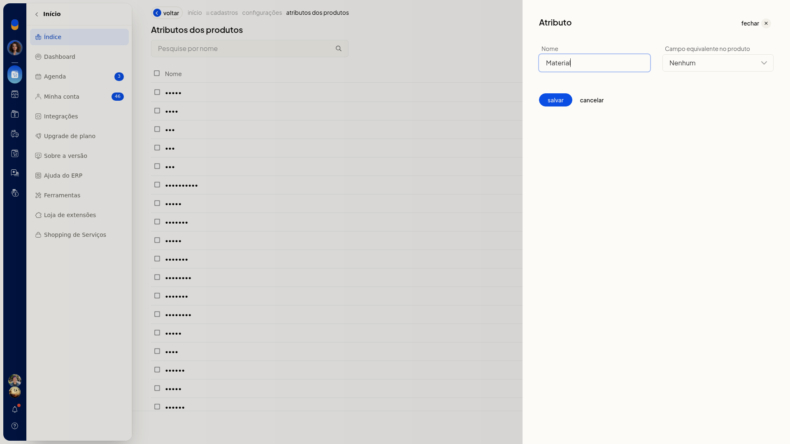
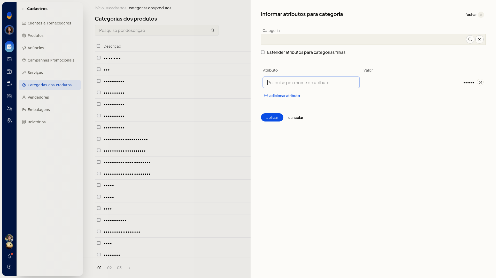
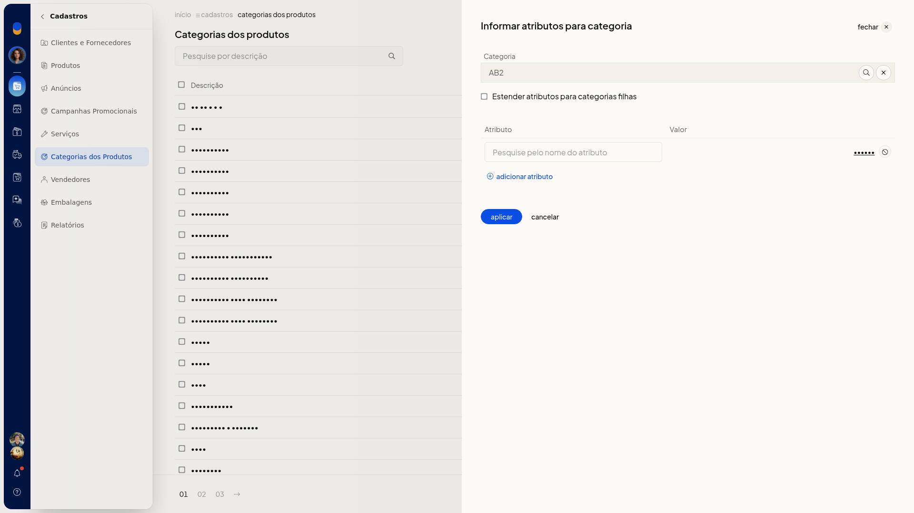
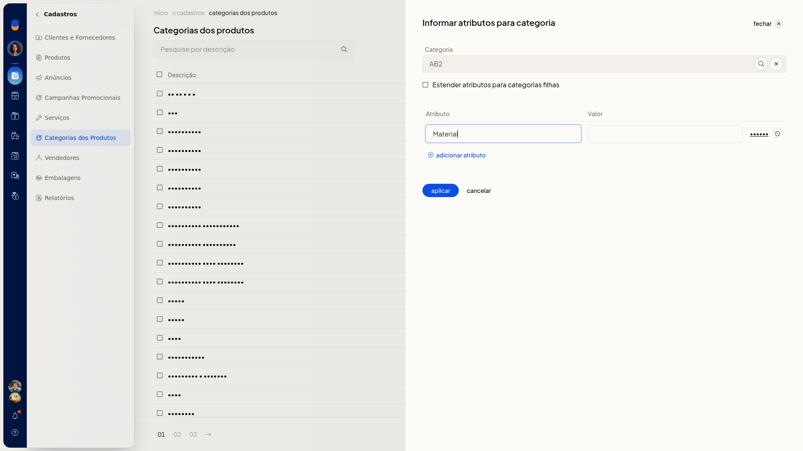

# Atributos dos produtos e ficha técnica

## Pré-requisitos
- Para informar atributos em uma categoria, a categoria e o atributo já precisam estar cadastrados.

## Importante
- Em **Informar atributos**, **Categoria** não aceita texto livre: o que você digita direto no campo não permanece. Escolha a categoria na busca.
- O nome em **Atributo** precisa ser de um atributo já cadastrado. Se o nome não existir, a tela indica que não foi encontrado.
- **Cancelar** na inclusão ou na edição de atributo fecha o painel sem gravar.
- **Cancelar** em **Informar atributos** fecha o painel e volta à lista de categorias sem aplicar.

## Instruções
### Incluir ou editar um atributo

1. Acesse **Configurações > Cadastros**.
2. Abra as configurações de atributos de produtos. A lista tem pesquisa por nome e as colunas **Nome** e **Campo equivalente**.

   

3. Clique em **Incluir atributo**.
4. Informe o **Nome**.
5. Selecione o **Campo equivalente** para ligar o atributo a um campo da ficha:
 - **Nenhum**
 - **GTIN**
 - **Código (SKU)**
 - **Marca**
 - **Unidade**
 - **Fornecedor**
 - **Peso Bruto**
 - **Peso Líquido**
 - **Altura Embalagem**
 - **Largura Embalagem**
 - **Comprimento Embalagem**

   

6. Para alterar um atributo já cadastrado, abra a linha na lista. A edição usa os mesmos campos **Nome** e **Campo equivalente**.

   

7. Grave o atributo no painel. **Cancelar** fecha sem gravar.

### Informar atributos para uma categoria

1. Acesse **Cadastros > Categorias dos Produtos**.
2. Clique em **Informar atributos**.

   

3. Busque a categoria e confirme no seletor. A confirmação preenche **Categoria** e fecha o seletor.

   

4. Se quiser aplicar os mesmos atributos às categorias filhas, marque **Estender atributos para categorias filhas**.
5. Informe **Atributo** e **Valor**. Use o nome de um atributo já cadastrado.

   

6. Para incluir outra linha, clique em **Adicionar atributo**.
7. Clique em **Aplicar**. **Cancelar** fecha o painel e volta à lista sem aplicar.

## Informações adicionais
### O campo equivalente liga o atributo à ficha

Ao cadastrar o atributo, **Campo equivalente** indica qual dado da ficha ele representa, como **GTIN**, **Código (SKU)**, pesos ou medidas de embalagem. **Nenhum** deixa o atributo sem esse vínculo.
