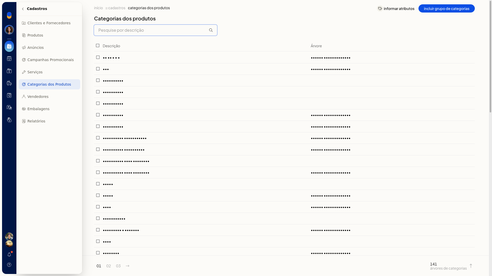
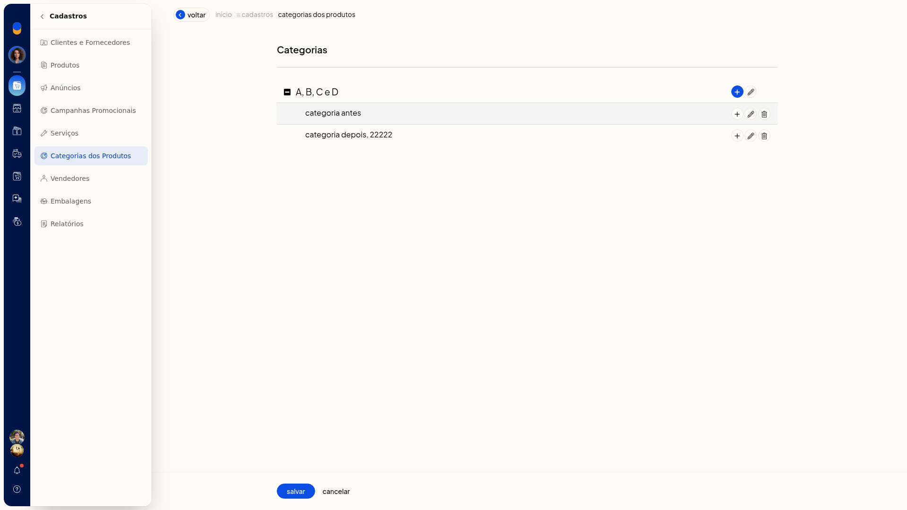
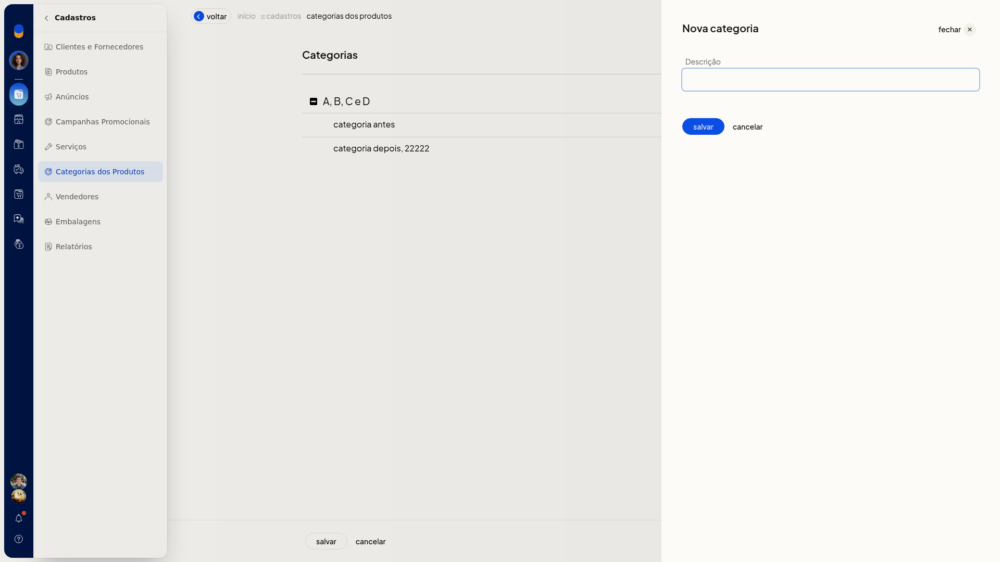
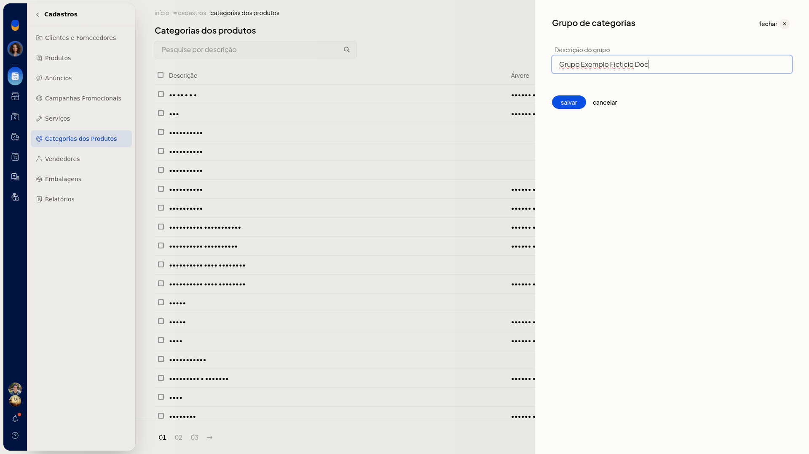
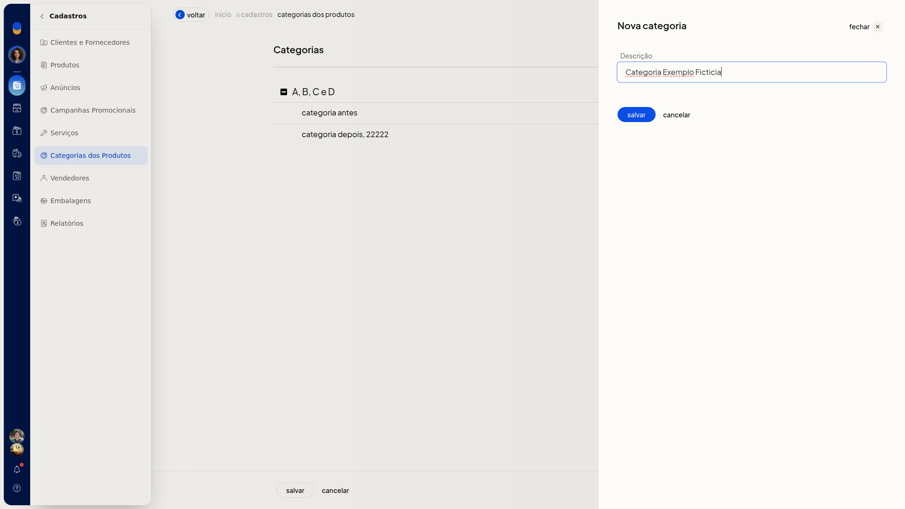
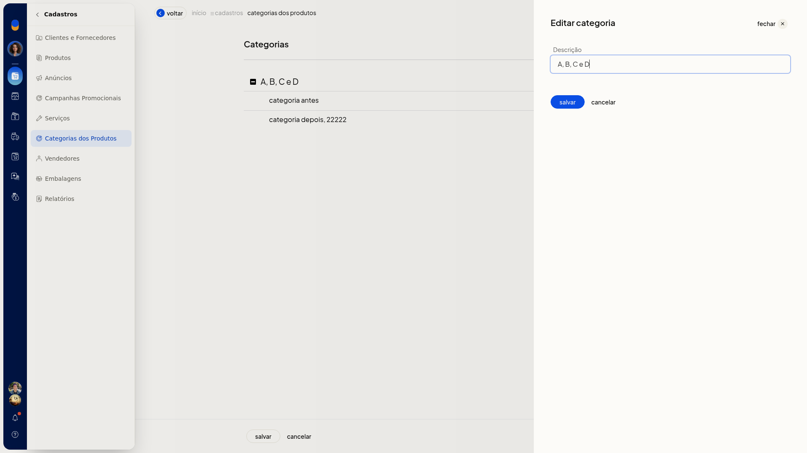
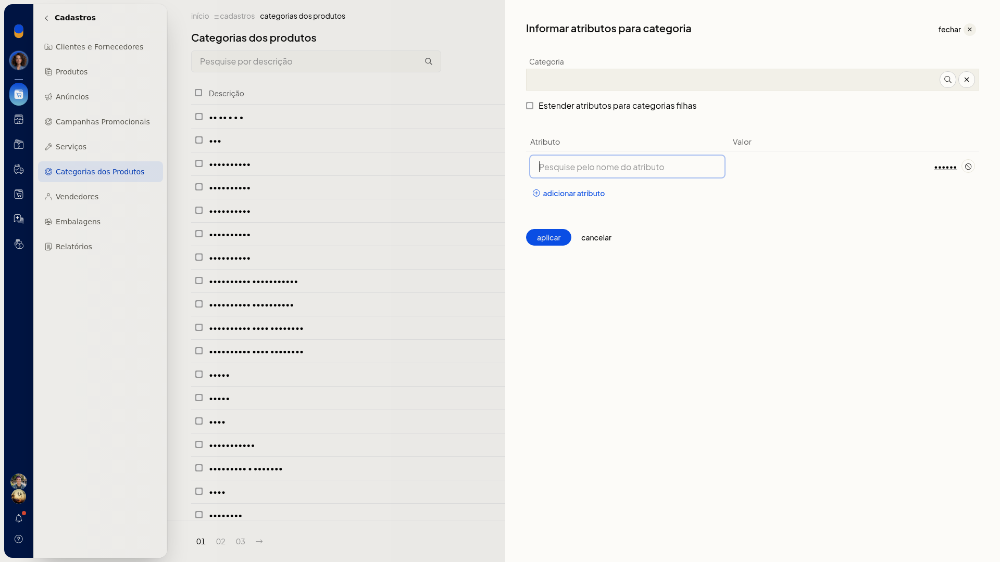
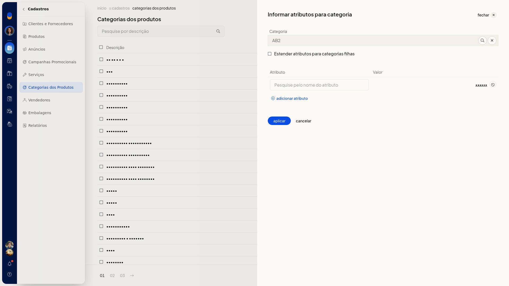
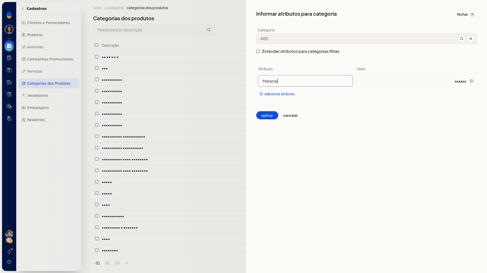

# Categorias dos produtos

No ERP da Olist, as categorias dos produtos são um cadastro auxiliar da ficha. Em **Cadastros > Categorias dos Produtos**, você consulta a lista, abre o grupo e a árvore, inclui ou edita uma categoria e informa atributos para uma categoria já existente.

## Importante
- Para informar atributos, a categoria e o atributo já precisam existir.
- No campo **Categoria**, o texto digitado direto não permanece. Escolha a categoria na busca.
- Um nome de atributo que não existe é indicado como não encontrado.
- **Cancelar** na edição volta à árvore. **Cancelar** na árvore volta à lista de categorias.
- **Cancelar** em **Informar atributos** volta à lista sem aplicar.

## Instruções
### Consultar, incluir ou editar uma categoria

1. Acesse **Cadastros > Categorias dos Produtos**.

   

2. Na lista, abra o grupo de categorias, a árvore, **Nova categoria** ou **Editar categoria**.

   

   

   

3. Preencha o painel aberto. Para sair sem gravar, clique em **Cancelar**. Na edição, **Cancelar** volta à árvore. Na árvore, **Cancelar** volta à lista de categorias.

   

   

   

### Informar atributos para uma categoria

1. Em **Cadastros > Categorias dos Produtos**, clique em **Informar atributos**.

   

2. Busque a categoria e confirme no seletor. O campo **Categoria** é preenchido e o seletor fecha.

   

3. Se quiser aplicar os mesmos atributos nas categorias abaixo, marque **Estender atributos para categorias filhas**.
4. Informe **Atributo** e **Valor**. Clique em **Adicionar atributo** para incluir outra linha. Use um atributo já cadastrado.

   

5. Clique em **Aplicar** para aplicar os atributos. Para sair sem aplicar, clique em **Cancelar**.
