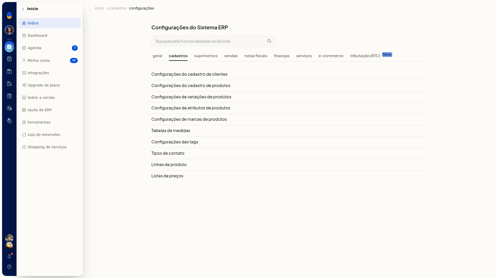
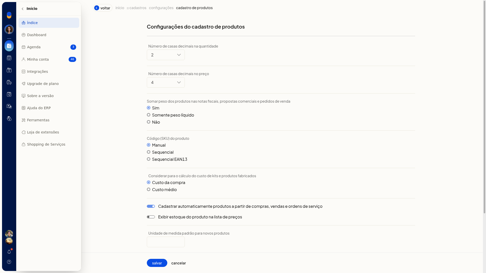
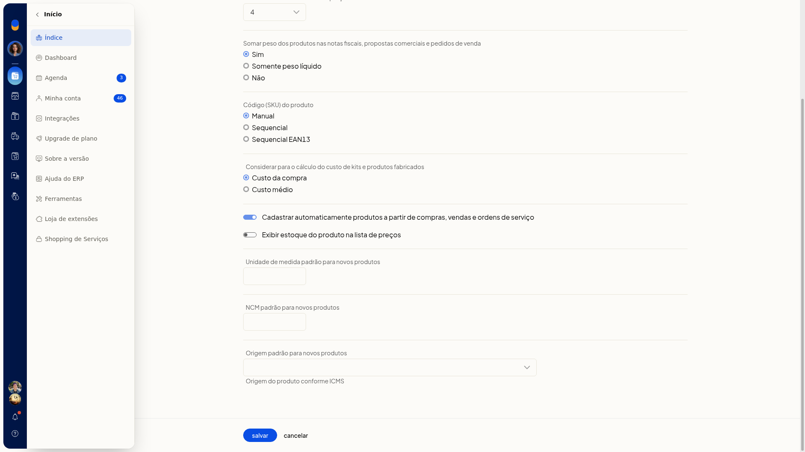

# Configurações do cadastro de produtos

No ERP da Olist, esta tela define os parâmetros padrão do cadastro de produtos. Você ajusta casas decimais, soma de peso, forma do SKU, custo de kits, cadastro automático a partir de compras, vendas e ordens de serviço, exibição de estoque na lista de preços, unidade padrão, NCM padrão e origem padrão do ICMS.

A tela fica em **Configurações > Cadastros > Configurações do cadastro de produtos**.

## Importante
- A gravação só ocorre em **Salvar**.
- Todos os campos desta tela são opcionais.

## Instruções
1. Acesse **Configurações > Cadastros**.

   

2. Clique em **Configurações do cadastro de produtos**.

   

3. Ajuste os parâmetros.

#### Quantidade, preço e peso

- Em **Casas decimais da quantidade**, selecione de 0 a 4.
- Em **Casas decimais do preço**, selecione de 0 a 10.
- Em **Somar peso**, selecione **Sim**, **Somente peso líquido** ou **Não**.

#### SKU e custo

- Em **SKU**, selecione **Manual**, **Sequencial** ou **Sequencial EAN13**.
- Em **Custo de kits**, selecione **Custo da compra** ou **Custo médio**.

#### Cadastro automático e lista de preços

- Marque ou desmarque **Cadastrar automaticamente produtos a partir de compras, vendas e ordens de serviço**.
- Marque ou desmarque **Exibir estoque do produto na lista de preços**.

#### Unidade, NCM e origem

- Informe a **Unidade padrão**.
- Informe o **NCM padrão**.
- Em **Origem padrão**, selecione a origem do produto conforme ICMS:
 - **0**: Nacional, exceto as indicadas nos códigos 3, 4, 5 e 8
 - **1**: Estrangeira, importação direta, exceto a indicada no código 6
 - **2**: Estrangeira, adquirida no mercado interno, exceto a indicada no código 7
 - **3**: Nacional, mercadoria ou bem com conteúdo de importação superior a 40% e inferior ou igual a 70%
 - **4**: Nacional, cuja produção tenha sido feita em conformidade com os processos produtivos básicos de que tratam as legislações citadas nos ajustes
 - **5**: Nacional, mercadoria ou bem com conteúdo de importação inferior ou igual a 40%
 - **6**: Estrangeira, importação direta, sem similar nacional, constante em lista da CAMEX e gás natural
 - **7**: Estrangeira, adquirida no mercado interno, sem similar nacional, constante em lista da CAMEX e gás natural
 - **8**: Nacional, mercadoria ou bem com conteúdo de importação superior a 70%

4. Clique em **Salvar** para gravar os parâmetros padrão do cadastro de produtos.
