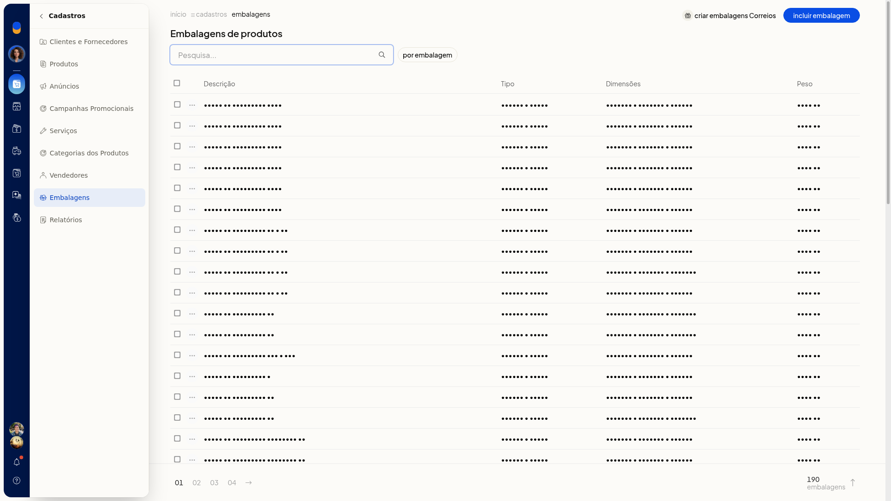

# Criar embalagens dos Correios

No ERP da Olist, você inicia a criação das embalagens dos Correios a partir da lista de embalagens de produtos. O botão **Criar embalagens Correios** fica nessa lista.

## Instruções
1. Acesse **Cadastros > Embalagens**.

   

2. Clique em **Criar embalagens Correios**.
