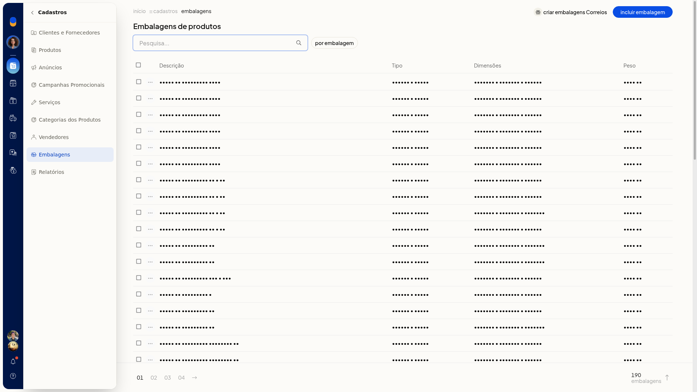
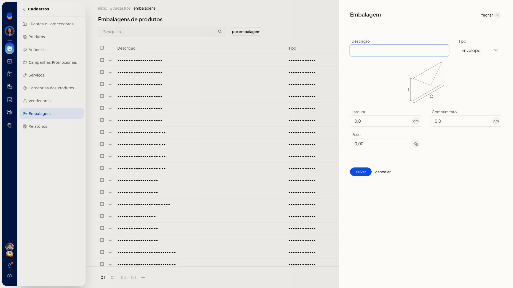

# Embalagens

No ERP da Olist, você consulta as embalagens do cadastro de produtos e inclui novas embalagens com tipo, largura, comprimento e peso. A lista fica em **Cadastros > Embalagens** e também permite pesquisar e filtrar por embalagem.

## Pré-requisitos
- Se a opção não aparecer para você, peça acesso ao administrador da conta.

## Instruções
1. Acesse **Cadastros > Embalagens**.
2. Na lista, use a pesquisa ou o filtro por embalagem para localizar um cadastro. As linhas mostram **Descrição**, **Tipo**, dimensões e peso.

   

3. Clique em **Incluir embalagem**.

   

4. Informe **Descrição**. O campo não é obrigatório.
5. Selecione **Tipo**: **Envelope**, **Pacote / Caixa** ou **Rolo / Cilindro**. O campo não é obrigatório.
6. Informe **Largura** em cm, com vírgula decimal. O campo não é obrigatório.
7. Informe **Comprimento** em cm, com vírgula decimal. O campo não é obrigatório.
8. Informe **Peso** em Kg, com vírgula decimal. O campo não é obrigatório.
9. Clique em **Salvar** para gravar a embalagem.

## Informações adicionais
### Embalagens dos Correios

Na lista, **Criar embalagens Correios** inicia a criação de embalagens dos Correios.
