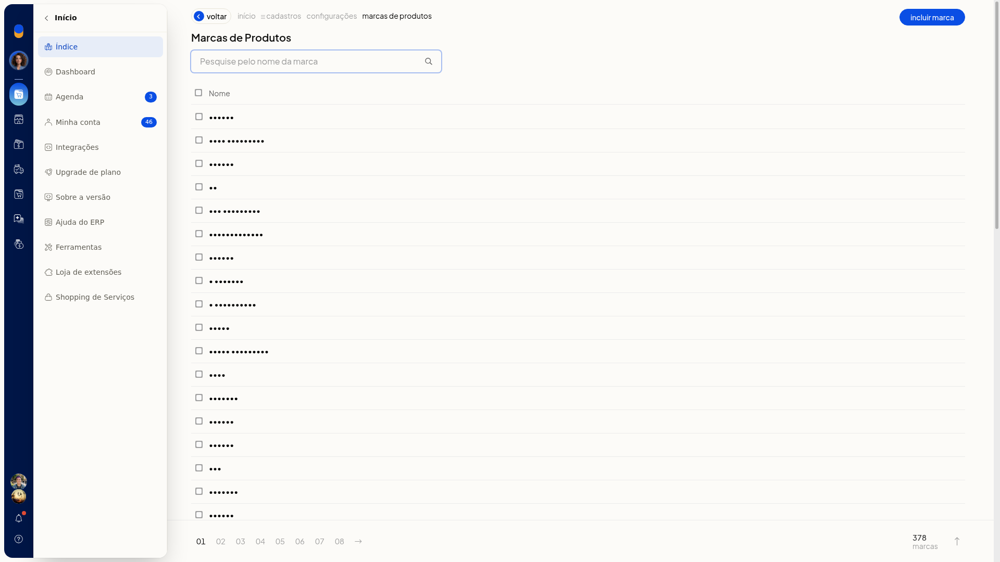
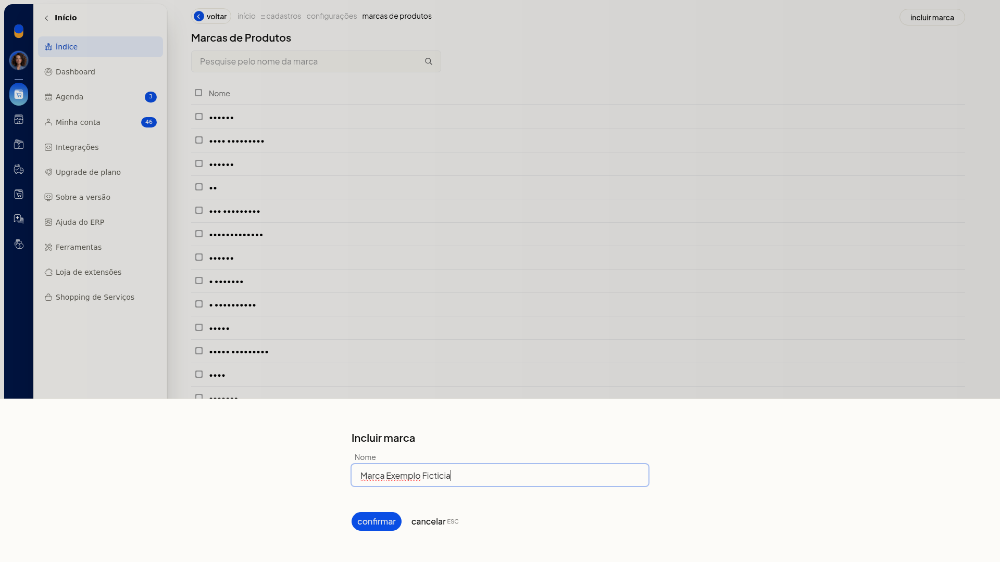
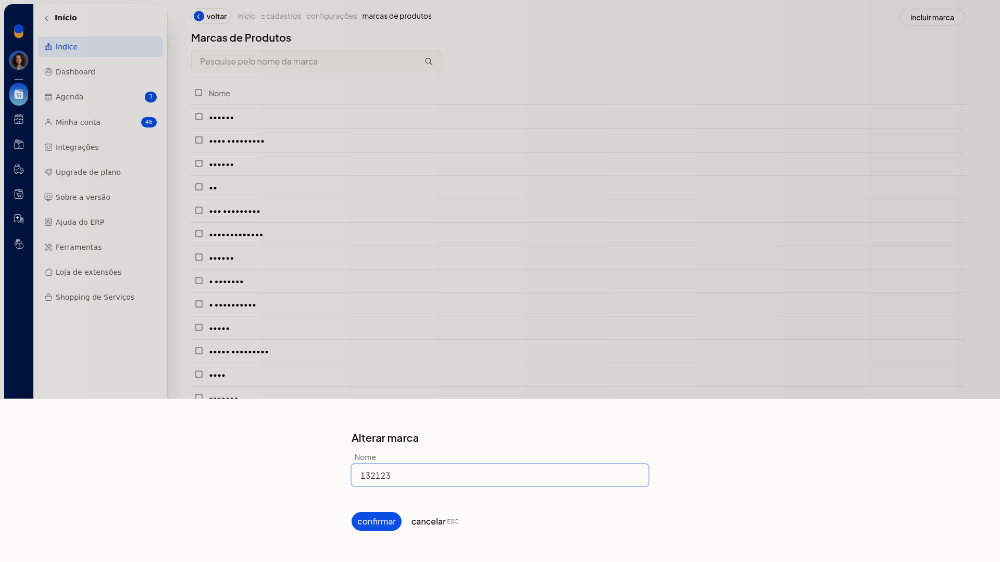

# Marcas dos produtos

No ERP da Olist, as marcas são um cadastro auxiliar da ficha do produto. Você consulta a lista, inclui uma marca e altera o nome de uma marca já cadastrada.

O cadastro fica em **Configurações > Cadastros**, nas configurações de marcas de produtos.

## Instruções
1. Acesse **Configurações > Cadastros**.
2. Abra as configurações de marcas de produtos.
3. Na lista, use a pesquisa para localizar uma marca pelo nome, se precisar.

   

4. Clique em **Incluir marca**.
5. Digite o **Nome**. O campo não exibe marcador de obrigatório.

   

6. Clique em **Confirmar** para gravar a marca. **Cancelar** fecha o painel sem gravar.

Para alterar uma marca já cadastrada:

1. Na lista de marcas, abra **Alterar marca**.
2. O painel mostra o mesmo campo **Nome**. Ajuste o nome.

   

3. Clique em **Confirmar** para gravar. **Cancelar** fecha o painel sem gravar.

## Informações adicionais
- A lista tem pesquisa, a coluna **Nome** e paginação.
- A tela de marcas não oferece importação por planilha.
