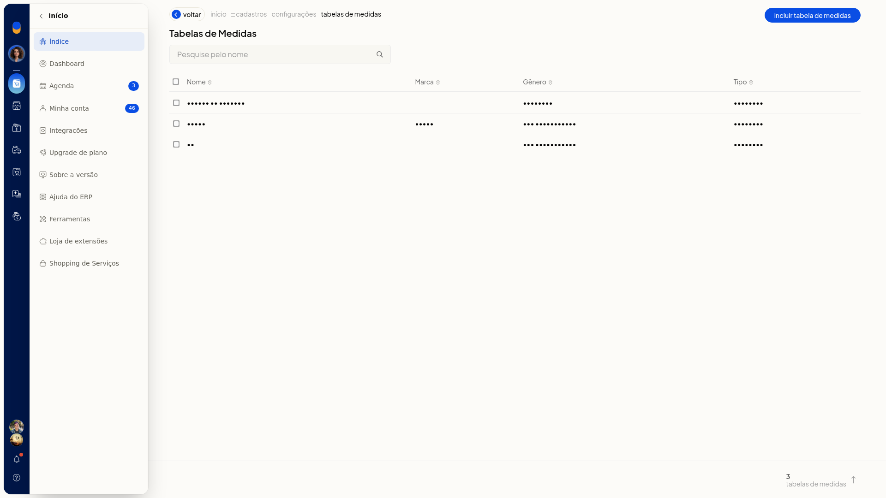
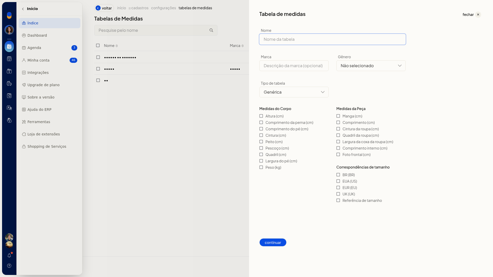
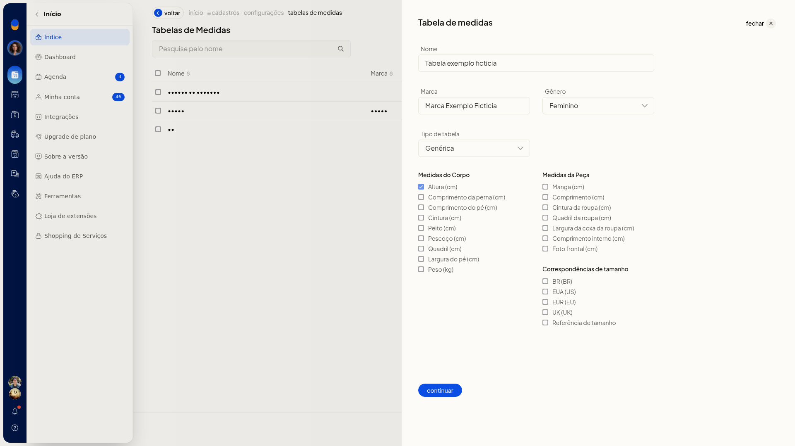
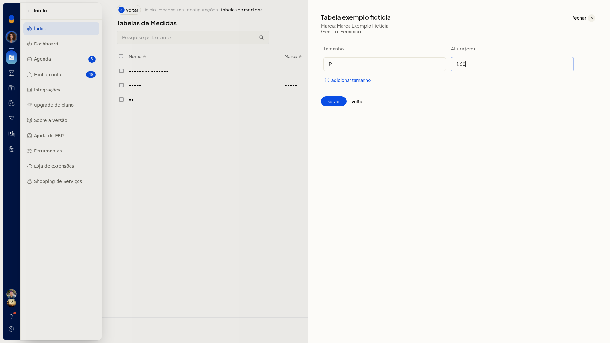
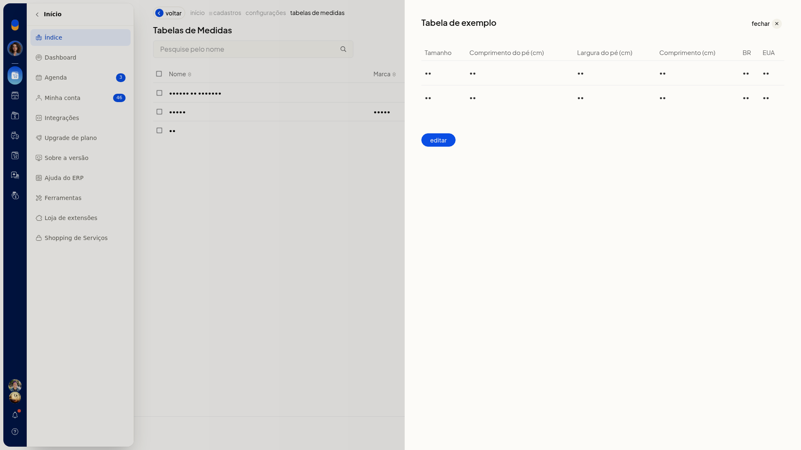
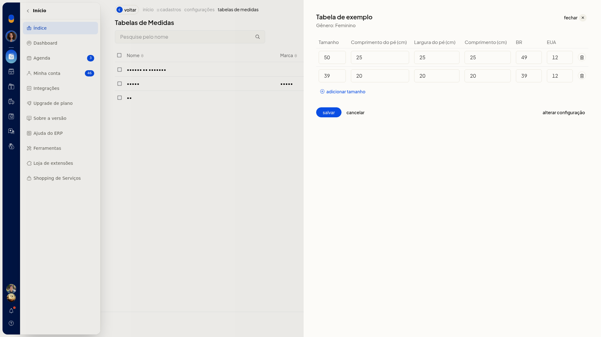

# Tabelas de medidas

No ERP da Olist, a tabela de medidas guarda o gênero, o tipo e as medidas da grade de tamanhos. Você consulta, inclui e edita essas tabelas para usar no cadastro de produtos.

O recurso fica em **Configurações > Cadastros > Tabelas de medidas**.

## Importante
- **Continuar** abre a grade de tamanhos e não grava a tabela.
- Fechar a inclusão devolve a lista sem gravar.
- Na edição, **Cancelar** devolve a visualização da tabela.

## Instruções
1. Acesse **Configurações > Cadastros** e abra **Tabelas de medidas**.
   
2. Clique em **Incluir Tabela de Medidas**.
   
3. Informe **Nome**. Se quiser, informe **Marca**. Em **Gênero**, selecione **Não selecionado**, **Masculino**, **Feminino**, **Meninos** ou **Meninas**. Em **Tipo**, selecione **Genérica**, **Moda - Medidas da peça**, **Moda - Medidas do corpo** ou **Moda - Medidas combinadas**.
4. Marque as medidas que entram na tabela: **Altura (cm)**, **Comprimento da perna (cm)**, **Comprimento do pé (cm)**, **Cintura (cm)**, **Peito (cm)**, **Pescoço (cm)**, **Quadril (cm)**, **Largura do pé (cm)**, **Peso (kg)**, **Manga (cm)**, **Comprimento (cm)**, **Cintura da roupa (cm)**, **Quadril da roupa (cm)**, **Largura da coxa da roupa (cm)**, **Comprimento interno (cm)**, **Foto frontal (cm)**, **BR (BR)**, **EUA (US)**, **EUR (EU)**, **UK (UK)** e **Referência de tamanho**.
   
5. Clique em **Continuar**.
6. Informe **Tamanho** e o valor de cada medida marcada. Para incluir outra linha, clique em **Adicionar tamanho**.
   
7. Clique em **Salvar** para gravar a tabela.

## Informações adicionais
### A lista mostra nome, marca, gênero e tipo

A pesquisa é pelo nome. As colunas são **Nome**, **Marca**, **Gênero** e **Tipo**.

### Uma tabela já cadastrada abre a grade

Abra a tabela na lista para ver a grade e clique em **Editar**. A edição tem **Alterar configuração**, **Adicionar tamanho**, **Salvar** e **Cancelar**.

