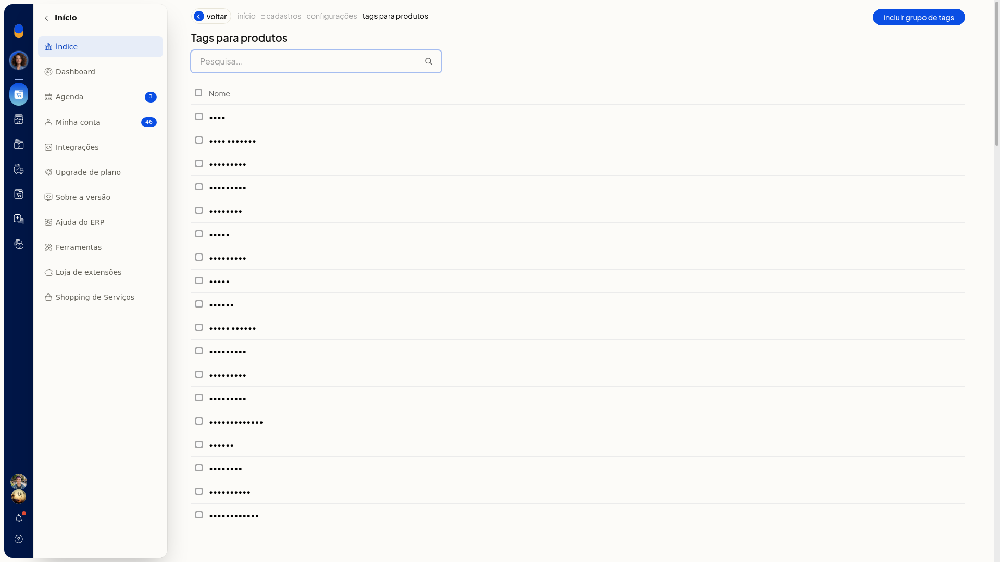
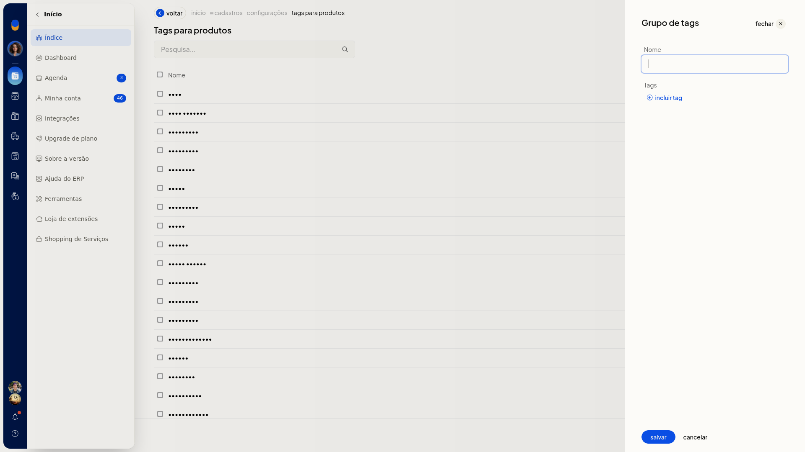
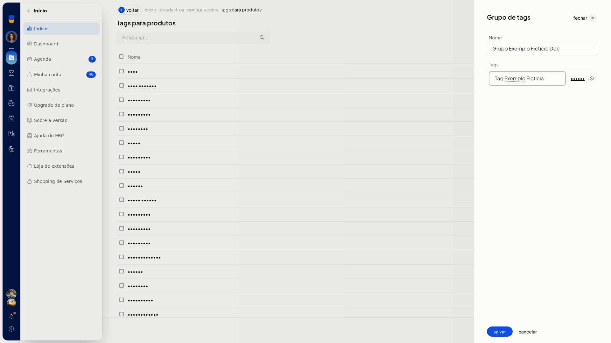
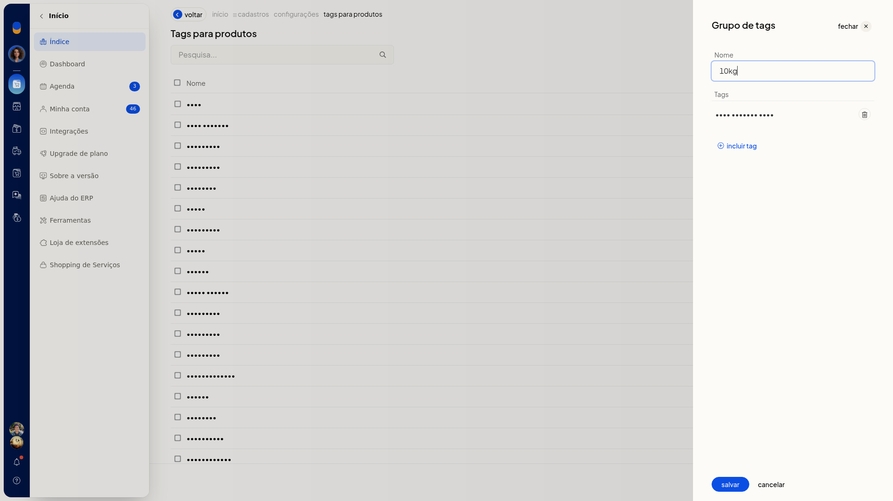

# Tags de produtos

No ERP da Olist, os grupos de tags reúnem as marcações usadas no cadastro de produtos. Você consulta a lista, inclui um grupo, acrescenta tags e altera um grupo já existente.

O caminho fica em **Configurações > Cadastros**, em **Configurações das tags** e depois em **Tags para produtos**.

## Instruções
### Incluir um grupo de tags

1. Acesse **Configurações > Cadastros**.
2. Abra **Configurações das tags** e, em seguida, **Tags para produtos**.
3. Clique em **Incluir grupo de tags**.

   

   

4. Informe o nome do grupo em **Nome**. O campo não é obrigatório.
5. Clique em **Incluir tag**.
6. Informe a tag e clique em **Salvar** da própria tag.
7. Clique em **Salvar** do grupo para gravar.

   

### Editar um grupo de tags

1. Em **Tags para produtos**, abra o grupo na lista.
2. Ajuste o **Nome**, use **Incluir tag** para acrescentar outra tag ou o ícone de remover para tirar uma tag já incluída.
3. Clique em **Salvar**.

   

## Informações adicionais
- A lista de tags tem pesquisa e paginação.
- **Cancelar** no grupo de tags volta à lista de tags.
