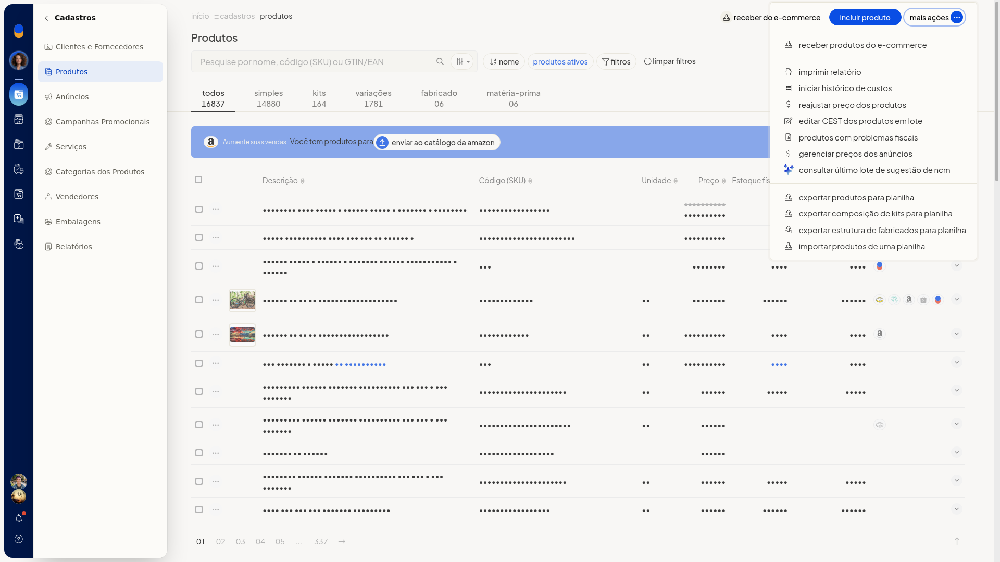
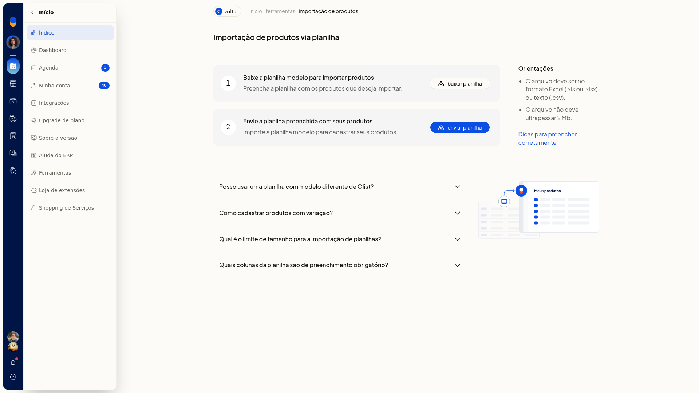
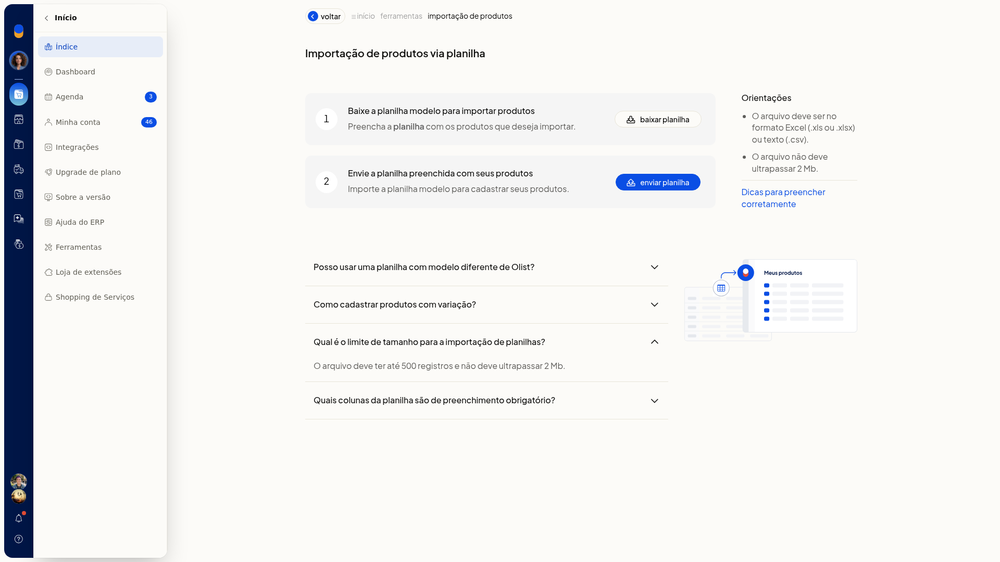
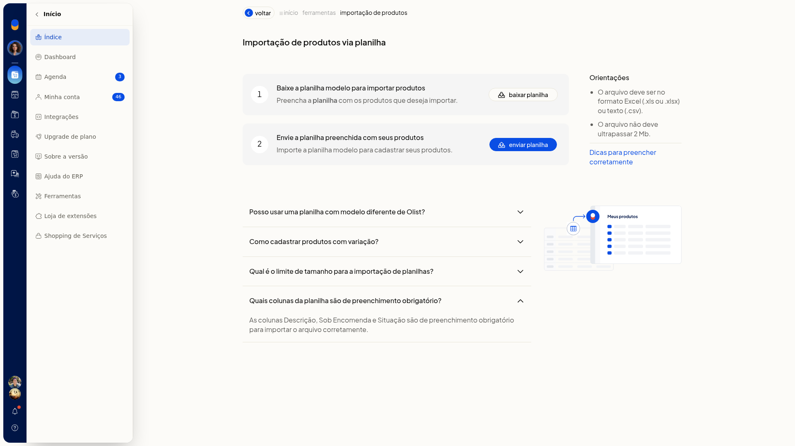
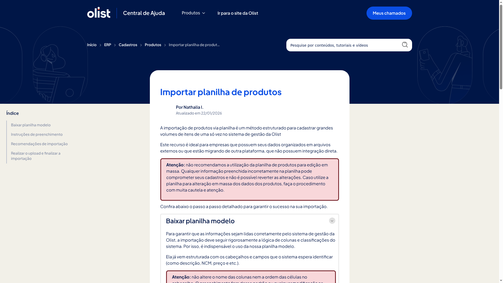
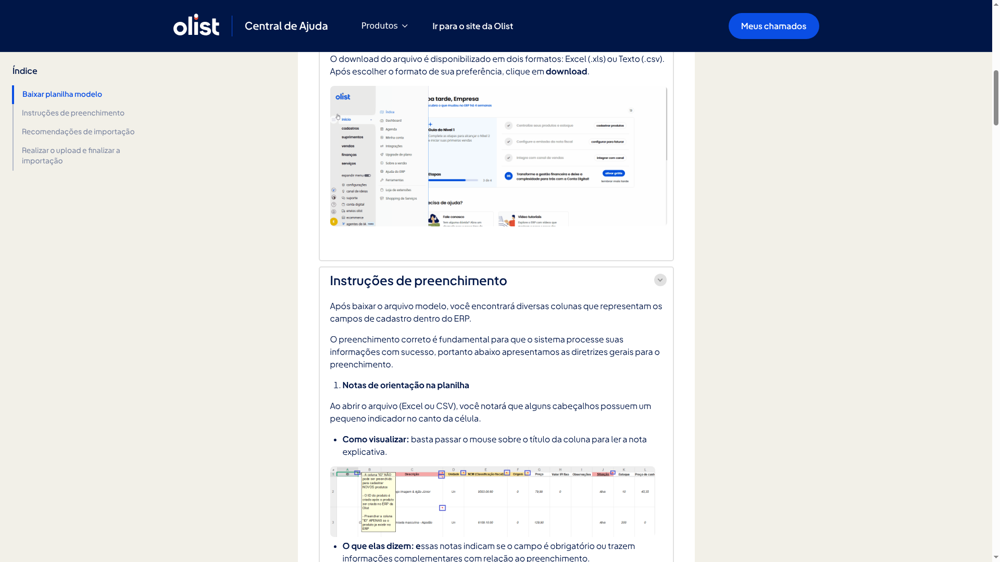
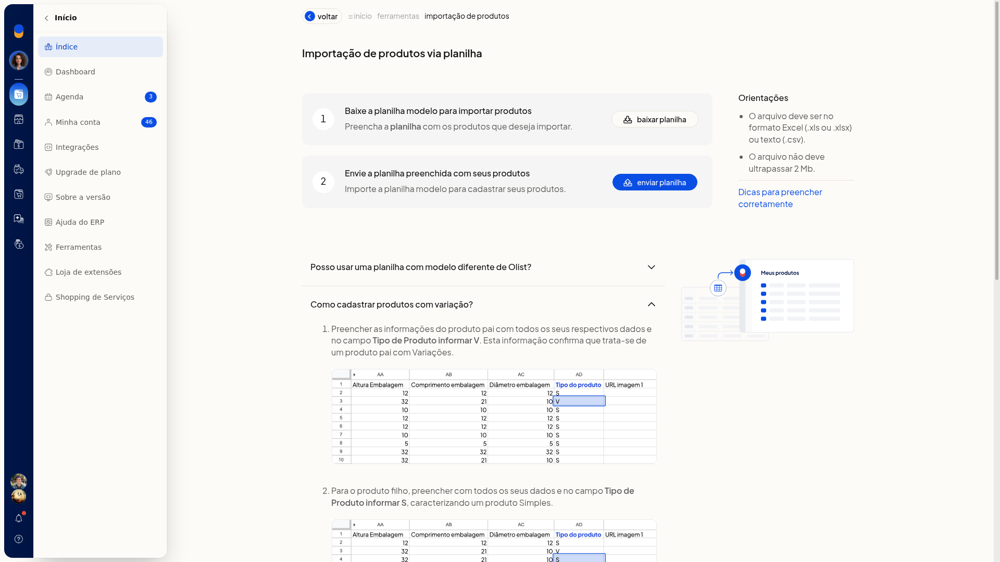
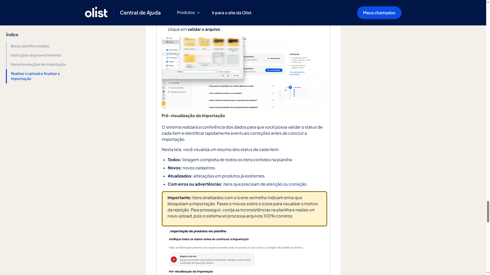
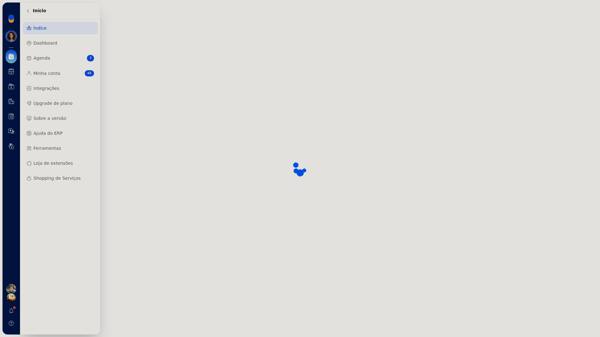
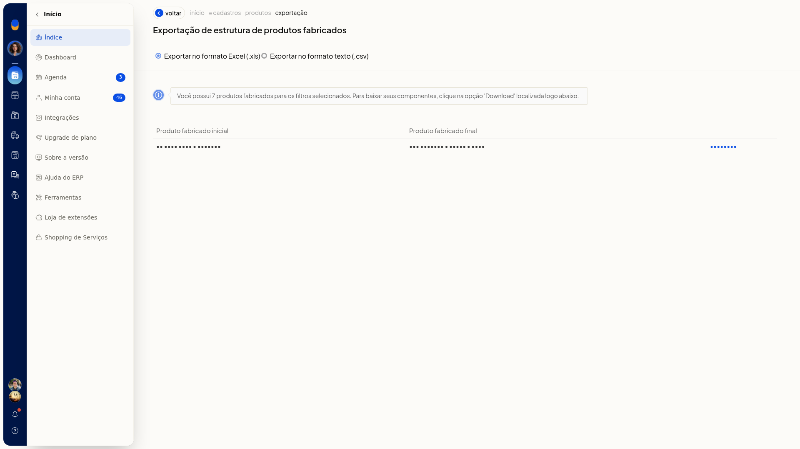

# Importar e exportar produtos por planilha

Na listagem de produtos do ERP da Olist, você inclui ou atualiza produtos em lote com uma planilha e exporta, em Excel ou CSV, a lista filtrada ou os componentes dos produtos fabricados.

O modelo traz as colunas do cadastro. Nas exportações, o arquivo segue os filtros já aplicados na listagem.

## Importante
- As exportações usam os filtros já selecionados em **Cadastros > Produtos**.
- Para exportar a estrutura de fabricados, esses filtros precisam incluir produtos fabricados.
- A importação aceita Excel (.xls/.xlsx) ou CSV, com no máximo 2 Mb e até 500 registros.
- Não renomeie, reordene nem apague colunas do modelo. Deixe em branco as colunas opcionais.
- Imagens na planilha precisam ser URL direta.jpg,.png,.webp ou.jpeg. Link de nuvem é rejeitado. O limite é de 10 imagens.
- O tipo do produto não pode ser alterado depois pela planilha. A composição de kit ou de fabricado vai em outra planilha.

## Instruções
### Como importar produtos

1. Acesse **Cadastros > Produtos**.
2. Clique em **Mais ações** e em **Importar produtos de uma planilha**.

   

3. Clique em **baixar planilha** para obter o modelo.

   

   

4. Preencha o modelo sem alterar o cabeçalho.

#### Colunas obrigatórias

- **Descrição**
- **Sob Encomenda**: Sim ou Não
- **Situação**: Ativo ou Inativo

#### Inclusão, atualização e tipo

- Deixe **ID** em branco para incluir um produto novo. Informe o ID exato para atualizar o produto existente.
- No pai da variação, use **Tipo** V. No filho, use S, K, F ou M, nunca V.
- Para kit, use a letra K. A composição vai em uma segunda planilha.

#### Variação

- Em **Código do Pai**, informe o SKU do produto pai.
- Preencha os atributos no formato Tamanho:GG||Cor:Branco, sem espaços ao redor de: ou ||.

#### Dados fiscais

- **Unidade**, como UN
- **NCM** com 8 dígitos, como 6109.10.00
- **Origem** de 0 a 8

5. Clique em **enviar planilha** e envie o arquivo. Em **Dicas**, a orientação descreve o reconhecimento do arquivo, a validação e a confirmação.

   

### Como exportar produtos

1. Acesse **Cadastros > Produtos**.
2. Clique em **Mais ações** e em **Exportar produtos para planilha**.

   

3. Escolha **Exportar no formato Excel (.xls)** ou **Exportar no formato texto (.csv)**.
4. Em **Depósito para o Saldo em Estoque**, mantenha **Todos** ou selecione um depósito já cadastrado.
5. Clique em **Download** na faixa desejada, entre **Produto inicial** e **Produto final**. A exportação separa o resultado em arquivos de 500. Para exportar tudo de uma vez, clique em **agende uma tarefa**.

### Como exportar a estrutura de fabricados

1. Acesse **Cadastros > Produtos**.
2. Clique em **Mais ações** e em **Exportar estrutura de fabricados para planilha**.
3. Escolha **Exportar no formato Excel (.xls)** ou **Exportar no formato texto (.csv)**.
4. Clique em **Download** na faixa exibida, entre **Produto fabricado inicial** e **Produto fabricado final**. A tela informa quantos produtos fabricados entram nos filtros selecionados.

   

## Informações adicionais
- O mesmo menu **Mais ações** inclui **Exportar composição de kits para planilha**.
- A composição de kit ou de produto fabricado não entra na planilha de produtos: use a planilha correspondente.
- O tipo gravado no produto não muda em uma importação posterior.
