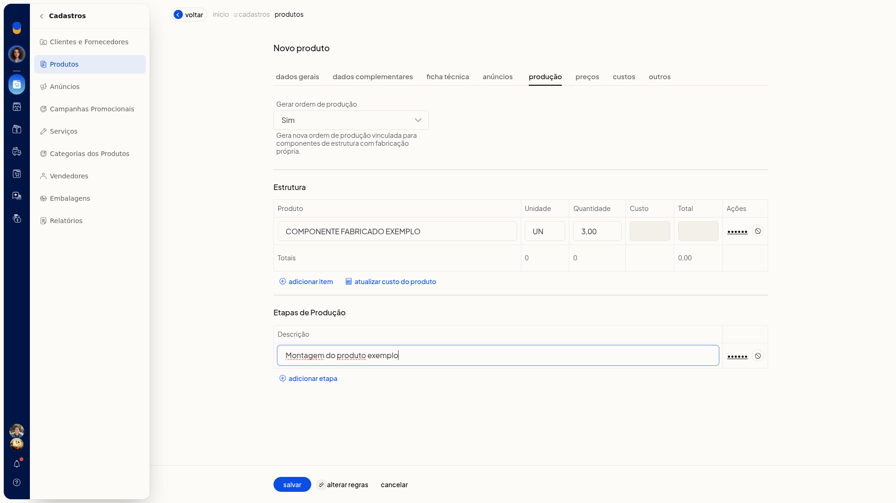

# Cadastrar um produto fabricado e montar a estrutura

No ERP da Olist, você cadastra um produto do tipo Fabricado e monta a estrutura de produção com insumos que já existem no cadastro. A estrutura lista esses insumos para a produção do produto.

O cadastro fica em **Cadastros > Produtos**.

## Pré-requisitos
- Os insumos da estrutura precisam já existir como produtos.

## Importante
- A estrutura aceita no máximo 200 produtos. Ao atingir o limite, a ficha mostra **Não é possível incluir mais de 200 produtos na estrutura**.

## Instruções
1. Acesse **Cadastros > Produtos**.
2. Clique em **Incluir produto**.
3. Em **Tipo do Produto**, selecione **Fabricado**.
4. Preencha os dados gerais do produto.
5. Abra a aba de produção e monte a estrutura com os componentes já cadastrados. A estrutura fica limitada a 200 produtos.

   

## Resultado
A estrutura do produto fabricado aparece na aba de produção, com os insumos informados.
