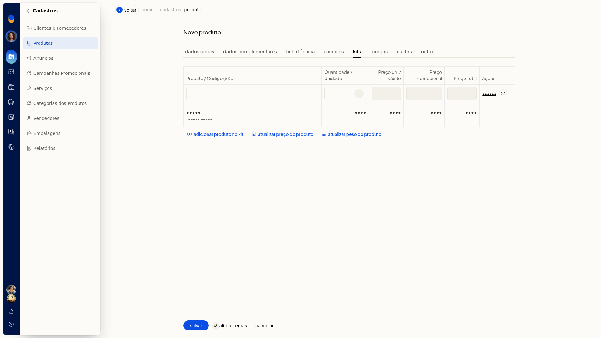
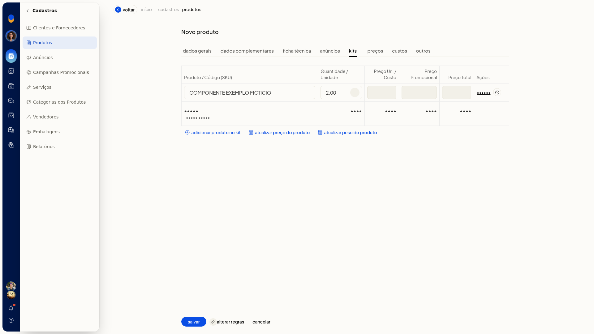
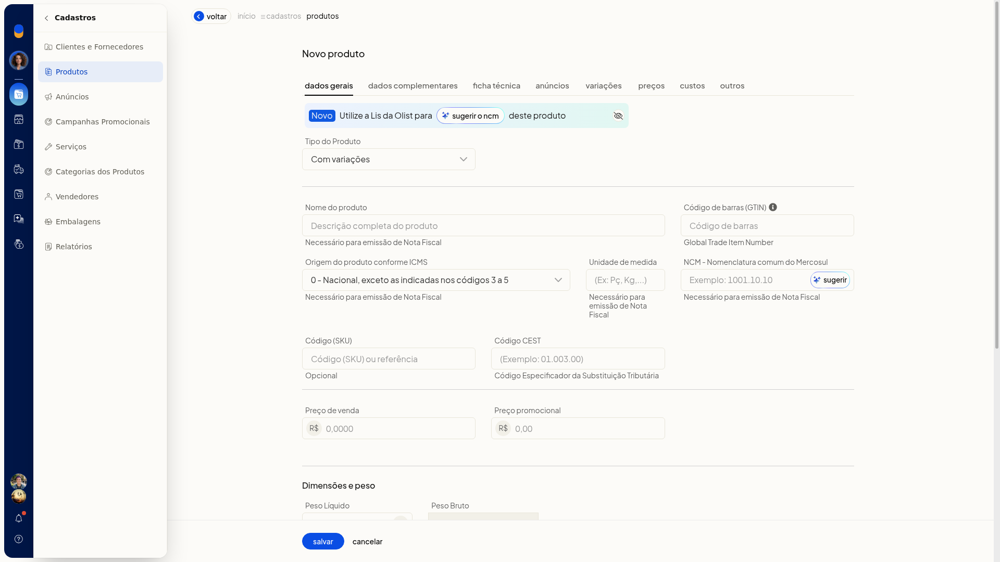
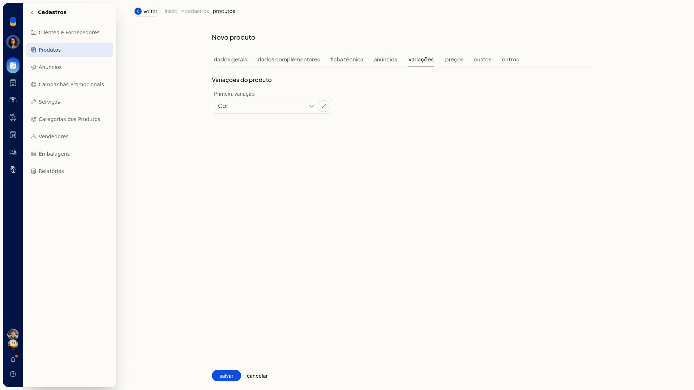
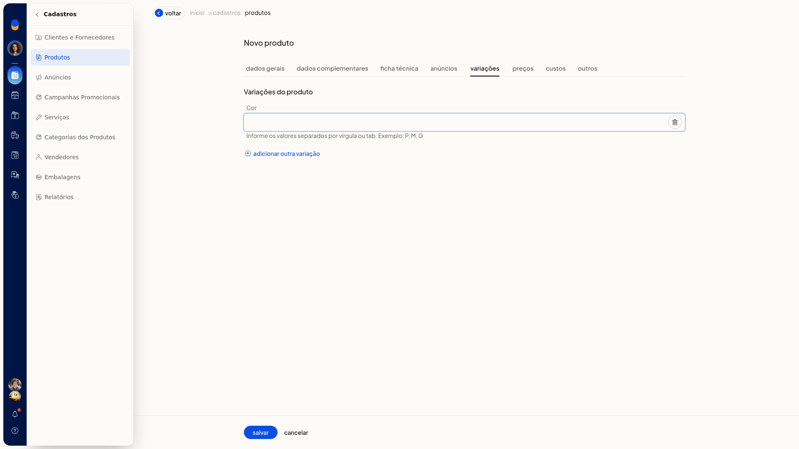
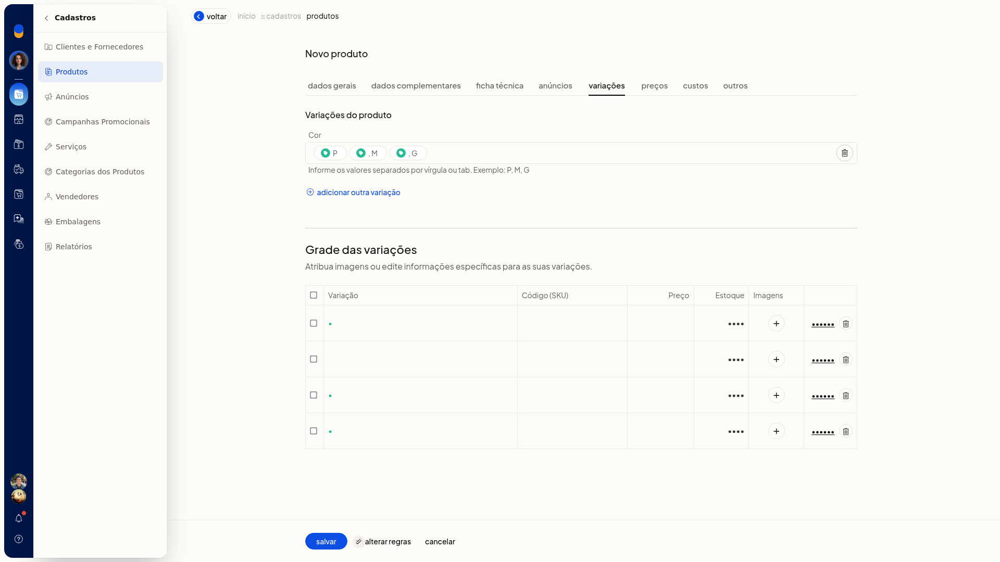
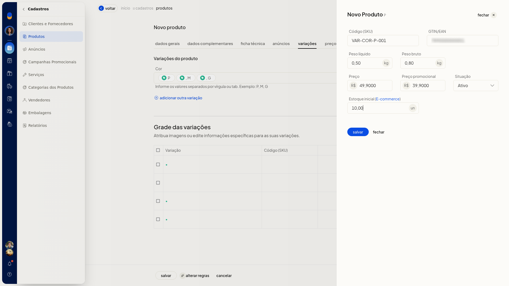
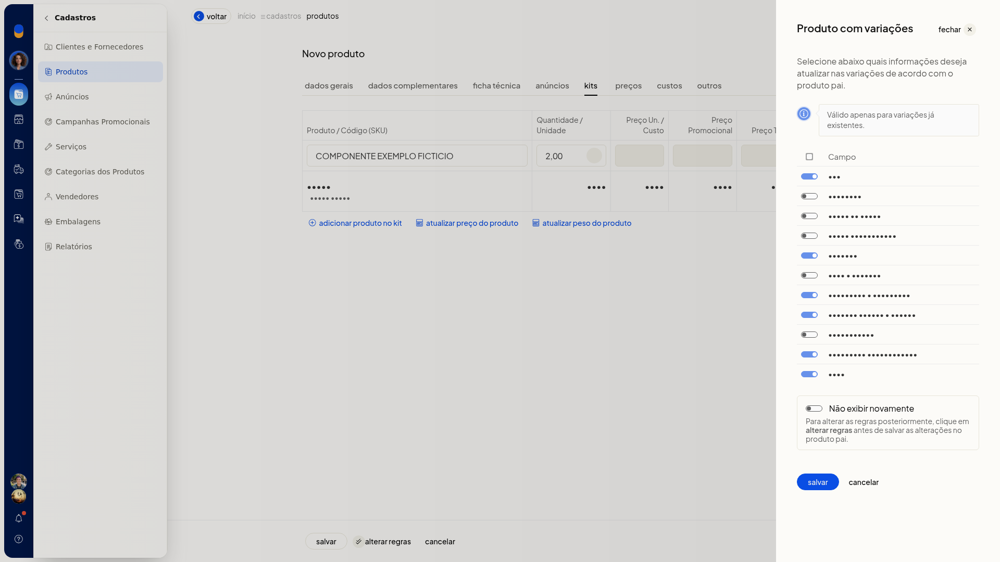

# Kits: cadastro, kits com variações e limites do sistema

No ERP da Olist, você cadastra um produto do tipo kit e monta a composição com componentes já cadastrados. Na composição, você informa o produto e a quantidade e confere os preços calculados na tela.

No mesmo cadastro, o tipo **Com variações** gera a grade de variações para você editar os dados de cada SKU. Esse tipo não usa a composição de kit. O cadastro fica em **Cadastros > Produtos**.

## Pré-requisitos
- Os componentes precisam já existir como produtos. Na composição, um nome que não está cadastrado é sinalizado como produto não encontrado.

## Importante
- A composição do kit aceita no máximo 20 produtos. Ao atingir o limite, a ficha exibe **Não é possível incluir mais de 20 produtos na composição do kit**.
- A ficha exibe **Você não pode cadastrar mais de 50 anúncios por produto**.

## Instruções
### Cadastrar um kit

1. Acesse **Cadastros > Produtos**.
2. Clique em **Incluir produto**.
3. Em **Tipo do Produto**, selecione **Kit**.
4. Preencha os dados gerais do produto, como **Nome**, **Código (SKU)**, **Unidade**, **Preço de venda** e **Preço promocional**. Nos preços, use vírgula para separar os centavos.
5. Na composição do kit, clique em **Adicionar produto no kit**.

   

6. Informe um produto já cadastrado e a quantidade. Na quantidade, use vírgula para separar os decimais, junto da unidade.

   

7. Confira o preço unitário, o preço promocional e o preço total de cada linha, além dos totais da composição. Esses preços da linha não são editáveis.
8. Se quiser recalcular o preço ou o peso do kit, clique em **Atualizar preço do produto** ou em **Atualizar peso do produto**.
9. Clique em **Salvar** para gravar o kit.

### Cadastrar um produto com variações

1. Acesse **Cadastros > Produtos**.
2. Clique em **Incluir produto**.
3. Em **Tipo do Produto**, selecione **Com variações**. A aba de kit deixa de aparecer. Surgem a aba **Variações** e o campo **Depósito padrão**, depósito utilizado para as variações.

   

4. Preencha os dados gerais do produto.
5. Em **Variações**, escolha a primeira variação, por exemplo **Cor**, e confirme.

   

6. Informe os valores separados por vírgula ou tab. O exemplo da tela é P, M, G. Se precisar de outra característica, clique em **Adicionar outra variação**.

   

7. Confira a grade gerada. A orientação da tela é **Atribua imagens ou edite informações específicas para as suas variações**. Em cada linha, use **editar** ou **excluir**.

   

8. Clique em **editar** e preencha **Código (SKU)**, **GTIN/EAN**, peso líquido, peso bruto, preço, preço promocional, **Situação** e estoque inicial (e-commerce). Nos pesos, preços e estoque, use vírgula para separar os decimais. Em **Situação**, as opções são **Ativo** e **Inativo**. Esse modal não tem composição de kit.

   

9. Para definir quais dados acompanham as variações já existentes, clique em **Alterar regras**. No modal **Produto com variações**, marque o que atualizar: **NCM**, **GTIN/EAN**, **Preço de venda**, **Preço promocional**, **Unidade**, **Peso e volumes**, **Embalagem e dimensões**, **Estoque mínimo e máximo**, **Localização**, **Descrição complementar** e **Tags**. Também há **Não exibir novamente**. Clique em **Cancelar** se não for gravar essa alteração.

   

10. Clique em **Salvar** para gravar o produto com a grade de variações.

## Informações adicionais
### O kit na tela, na planilha, na API e na Lis

- Interface/Tela: criar sim, atualizar sim
- Lote (Planilha): criar não, atualizar sim
- API V3: criar não, atualizar sim
- Lis: criar não, atualizar sim
