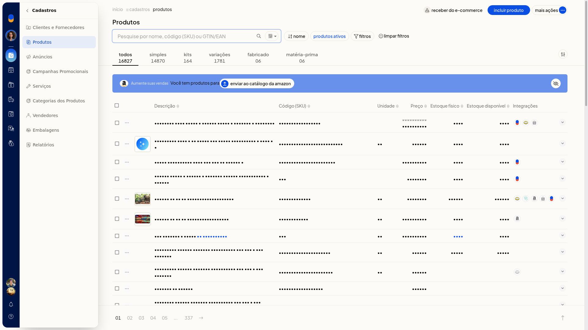
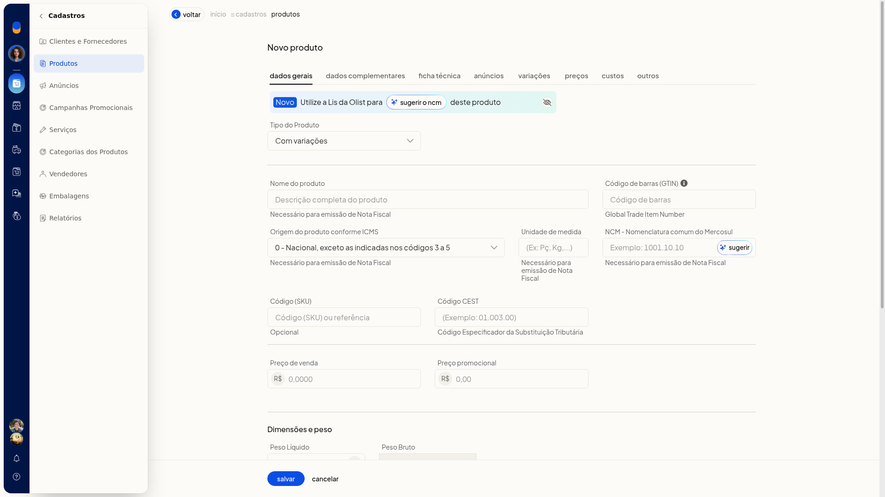

# Definir quais dados podem ser diferentes entre as variações

No ERP da Olist, em **Alterar regras**, você escolhe quais dados podem ser diferentes entre as variações de um produto do tipo **Com variações**.

## Importante
- A alteração vale para variações já existentes.
- Ajuste as regras antes de salvar o produto pai.

## Instruções
1. Acesse **Cadastros > Produtos**.

   

2. Clique em **Incluir produto**.
3. Em **Tipo do Produto**, selecione **Com variações**.

   

4. Na aba **Variações**, clique em **Alterar regras**.
5. Marque o que pode ser diferente entre as variações. Na tela, estavam marcados **NCM**, **Unidade**, **Embalagem e dimensões**, **Estoque mínimo e máximo**, **Descrição complementar** e **Tags**. Estavam desmarcados **GTIN/EAN**, **Preço de venda**, **Preço promocional**, **Peso e volumes** e **Localização**.
6. Ajuste essas marcações antes de clicar em **Salvar** no produto pai. Se não quiser aplicar, cancele.
