# Produtos com variações e limite de variações por produto

No cadastro de produtos do ERP da Olist, você cria um produto pai do tipo **Com variações**, monta níveis (como cor e tamanho) e gera a grade de combinações. Cada combinação pode ter SKU, preço e estoque próprios.

A mesma inclusão também pode começar por planilha, pela transformação de produtos já cadastrados ou pelo recebimento de anúncios de uma loja conectada. O sistema avisa quando o número de variações do produto passa de 200.

## Pré-requisitos
- Se a opção não aparecer para você, peça acesso ao administrador da conta.
- Para transformar produtos já cadastrados, marque ao menos um produto na listagem.
- Para receber do ecommerce, a loja precisa já estar conectada. O campo **Integração** lista as lojas disponíveis.

## Importante
- O número de variações adicionadas ao produto não pode ser maior que o limite de 200.
- Depois de cinco níveis confirmados, o link **Adicionar outra variação** deixa de ser exibido.
- Em **Alterar regras**, a alteração vale para variações já existentes. Ajuste as regras antes de salvar o pai.
- Em **Configurações de variações de produtos** não há campo para mudar o limite de 200.
- Na planilha, o arquivo aceita Excel.xls ou.xlsx, ou CSV, com no máximo 2 Mb. A ajuda cita até 500 registros.

## Instruções
### Pela tela

1. Acesse **Cadastros > Produtos**.

   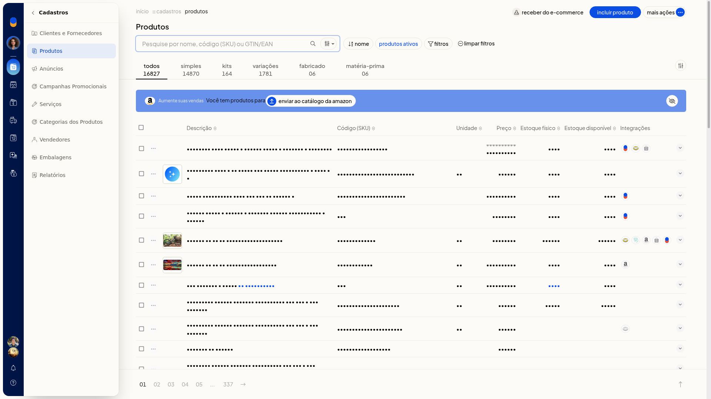

2. Clique em **Incluir produto**.
3. Em **Tipo do Produto**, selecione **Com variações**.

   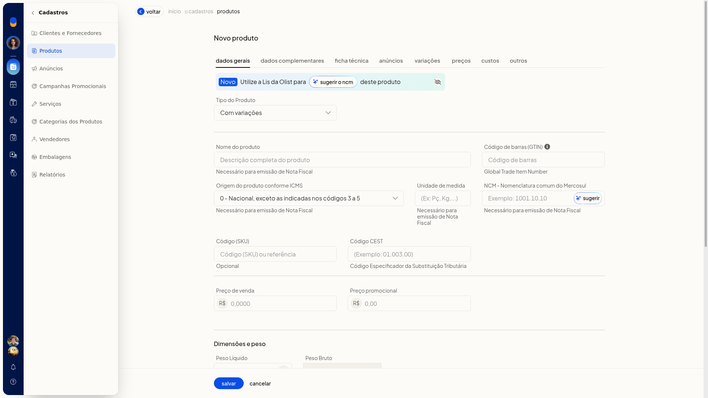

4. Preencha os dados gerais do produto pai. Confirmar um nível de variação não grava o produto.
5. Na aba **Variações**, informe o nome do nível e os valores. Separe os valores por vírgula ou tab, como no exemplo P, M, G.
6. Confirme o nível. Os valores passam a aparecer como chips e a grade ganha uma linha por combinação.
7. Repita para os outros níveis. Depois de cinco níveis confirmados, **Adicionar outra variação** deixa de ser exibido.

   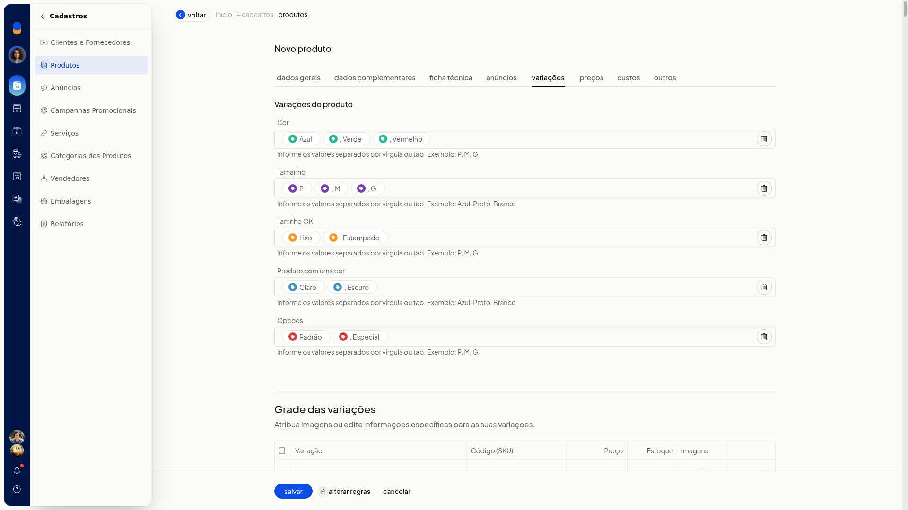

8. Se a quantidade passar do limite, feche o aviso **O número de variações adicionadas ao produto é maior que o limite de 200 permitido pelo sistema**. O formulário continua aberto e nada é gravado.

   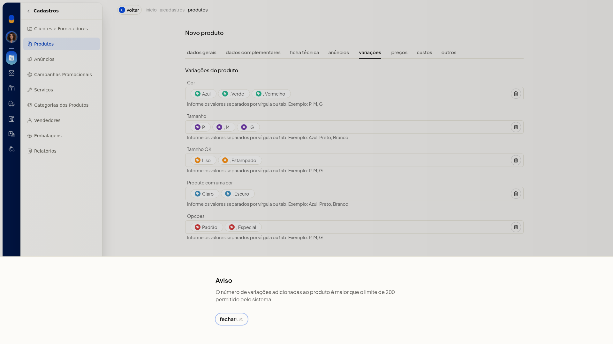

9. Na grade, use editar na combinação que quiser ajustar. No modal **Novo Produto**, preencha **Código (SKU)**, **GTIN/EAN**, **Peso líquido**, **Peso bruto**, **Preço**, **Preço promocional**, **Situação** (**Ativo** ou **Inativo**) e **Estoque inicial**. Pesos e preços usam vírgula decimal. Feche sem salvar se não quiser alterar a grade.

   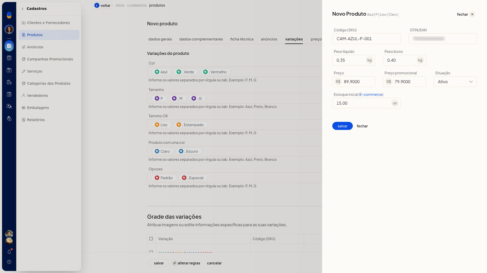

10. Em **Alterar regras**, marque o que pode diferir entre as variações. Podem estar marcados **NCM**, **Unidade**, **Embalagem e dimensões**, **Estoque mínimo e máximo**, **Descrição complementar** e **Tags**. Podem estar desmarcados **GTIN/EAN**, **Preço de venda**, **Preço promocional**, **Peso e volumes** e **Localização**. Cancele se não quiser aplicar.
11. Clique em **Salvar** para gravar o produto pai com a grade. **Cancelar** volta à listagem sem criar o produto.

### Por planilha

1. Acesse **Cadastros > Produtos**.
2. Abra **Mais ações** e clique em **Importar produtos de uma planilha**.

   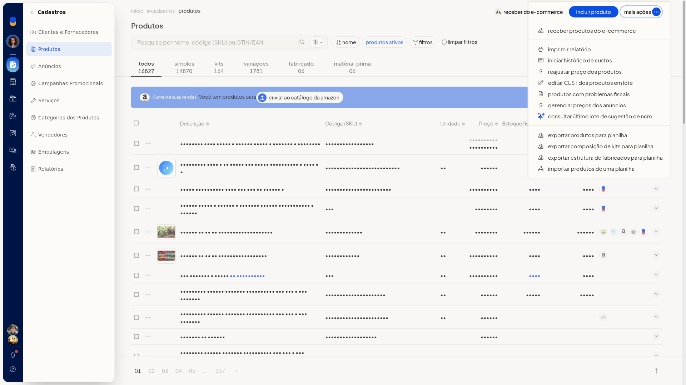

3. Baixe a planilha.
4. Preencha o arquivo. O pai usa **Tipo de Produto** V e não tem estoque próprio. O filho usa S, K, F ou M, nunca V. O **Código do Pai** do filho é o SKU do pai. Informe as variações no formato Nome:Valor||Nome:Valor, por exemplo Tamanho:GG||Cor:Branco. O SKU precisa ser manual. As colunas obrigatórias citadas na ajuda são **Descrição**, **Sob Encomenda** e **Situação**.

   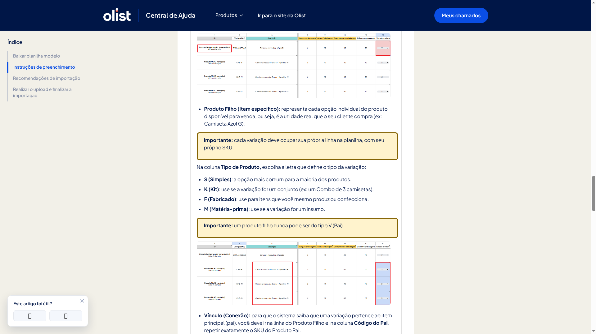

5. Envie a planilha em Excel.xls ou.xlsx, ou CSV, com no máximo 2 Mb.

   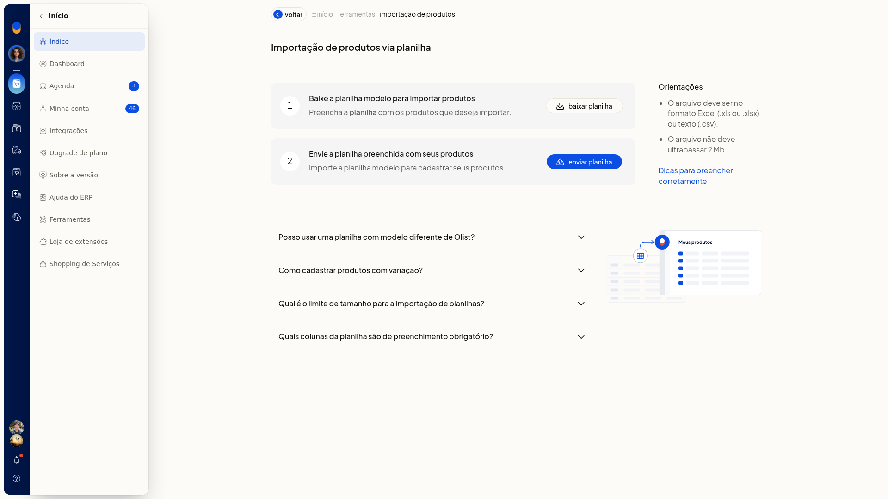

### Transformar produtos em variações

1. Acesse **Cadastros > Produtos**.
2. Marque um ou mais produtos. A ação não aparece no menu da linha nem no **Mais ações** do cabeçalho.

   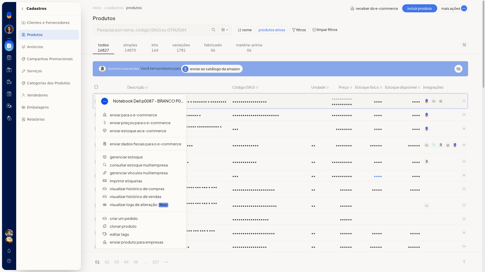

3. Na barra de seleção, abra **Mais ações** e clique em **Transformar em variações**.

   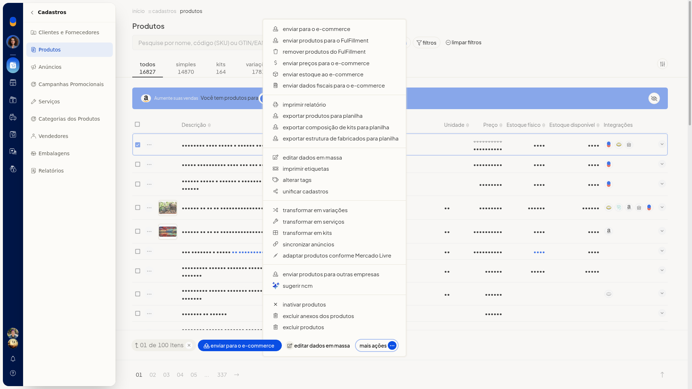

4. Escolha **Criar novo produto pai** ou **Utilizar produto pai existente**. **Criar novo produto pai** vem selecionado.
5. Clique em **Continuar**. **Cancelar** abandona o fluxo sem alterar os produtos.

   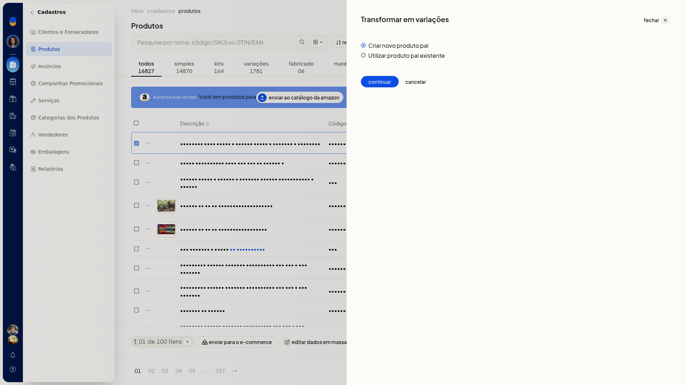

6. Para um pai novo, em **Informe os dados do produto pai**, preencha **Descrição**, **Código (SKU)**, **Origem**, **NCM**, **Preço de venda**, **Unidade** e **GTIN/EAN**. **Voltar** retorna à escolha sem gravar.

   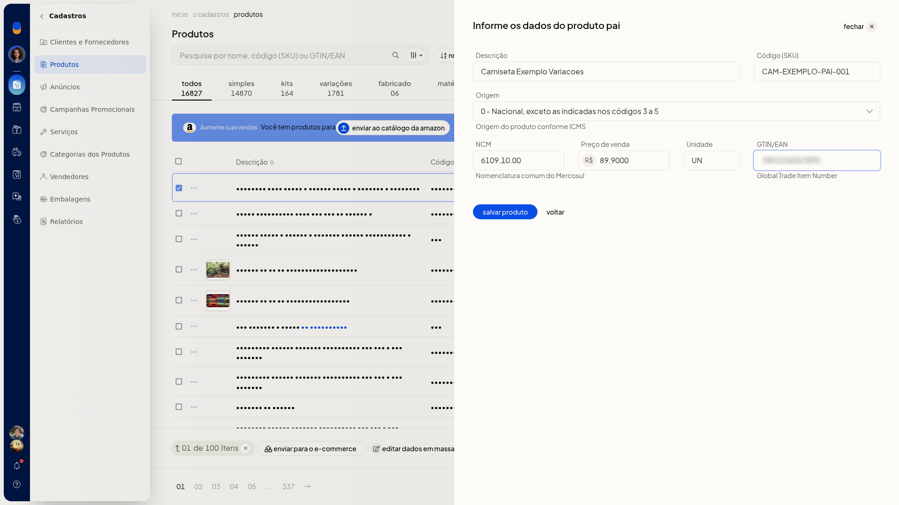

7. Clique em **Salvar produto** para concluir com o pai novo.
8. Para um pai já existente, selecione **Utilizar produto pai existente** e clique em **Continuar**.

   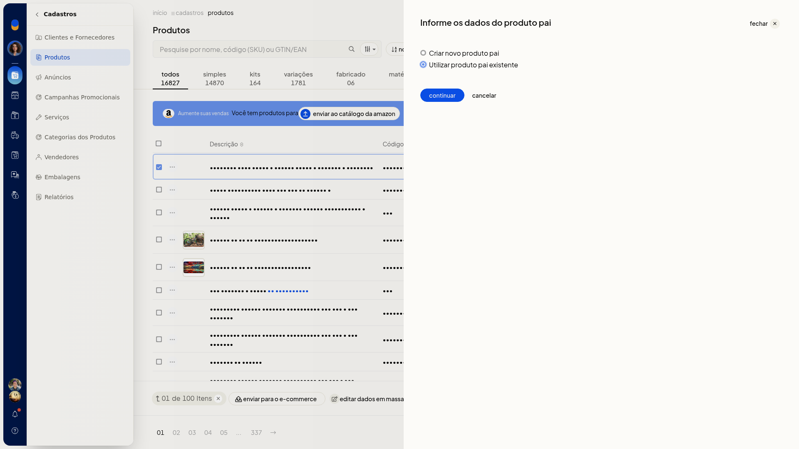

9. Em **Selecione o produto pai**, busque em **Produto pai** e clique em **Selecionar produto**. **Voltar** retorna sem gravar.

   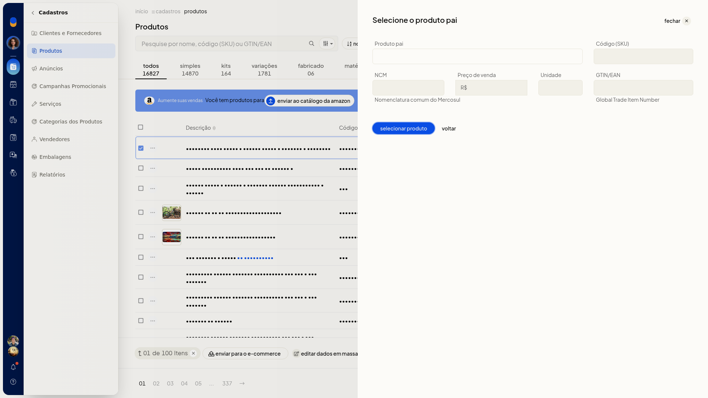

### Receber do ecommerce

1. Acesse **Cadastros > Produtos**, sem produto marcado.
2. Clique em **Receber do e-commerce**. O mesmo início está em **Mais ações > Receber produtos do e-commerce**.
3. Na janela **Receber produtos do e-commerce**, confira **Consumo de anúncios** e **Anúncios restantes**.
4. Em **Integração**, selecione a loja já conectada. Ao continuar, você segue para a nova tela de anúncios.
5. Clique em **Avançar** para seguir à tela de anúncios da integração escolhida. Fechar a janela dispensa o recebimento sem importar.

   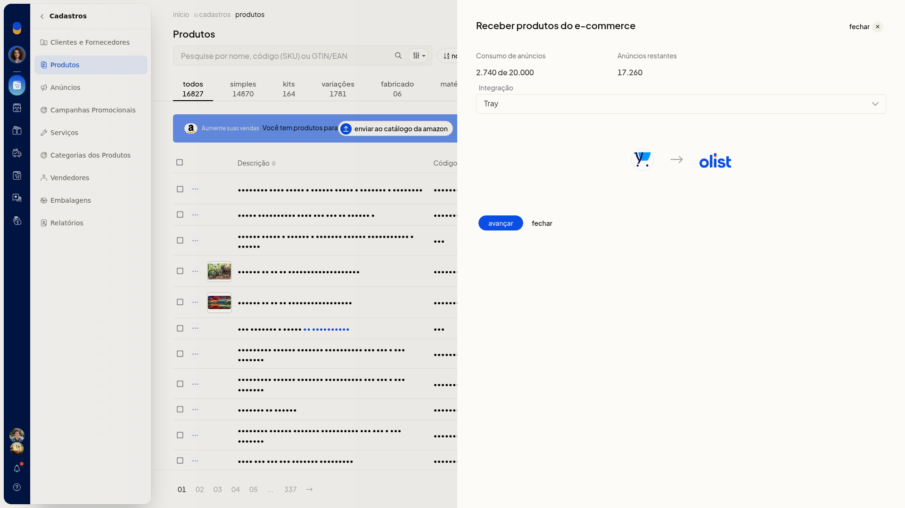

### Catálogo de tipos de variação

1. Acesse **Configurações > Configurações ERP > Configurações do Sistema ERP > Cadastros > Configurações de variações de produtos**.
2. Na tela **Variações dos produtos**, consulte **Nome da Variação** e **Valores**. Use a busca se precisar. Não há campo numérico de limite por produto.

   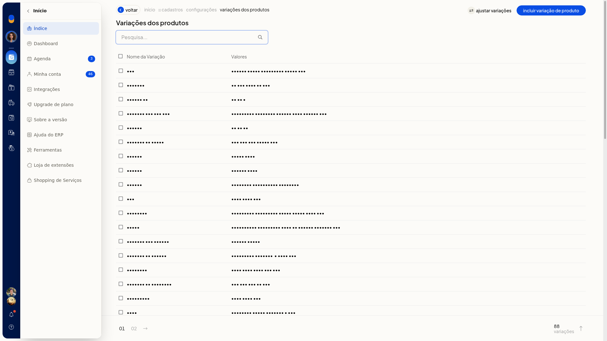

3. Clique em **Incluir variação de produto**.
4. Preencha **Nome** e **Valor**. O valor também aceita itens separados por vírgula ou tab.

   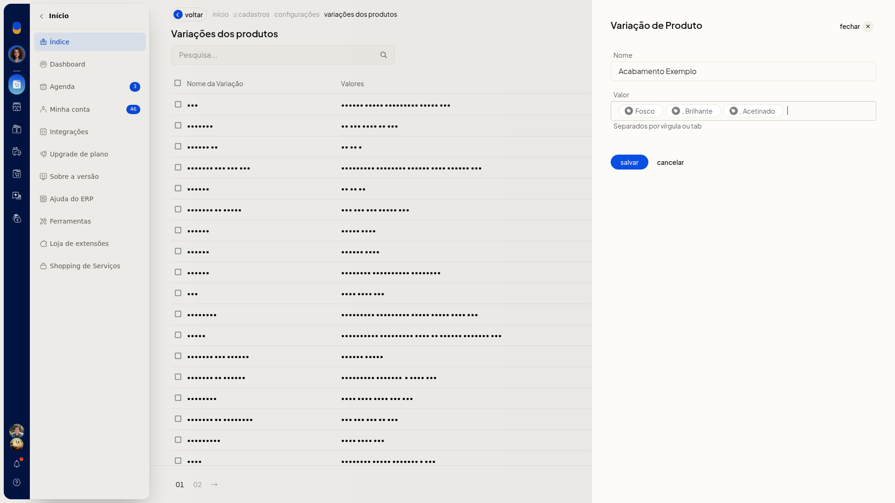

5. Salve o tipo para incluí-lo no catálogo. Cancele se não quiser gravar.
6. Em **Ajustar variações**, escolha **Variação Origem** e **Variação Destino** e marque os valores.
7. Mova os selecionados para transferir os valores. **Cancelar** fecha sem mover.

   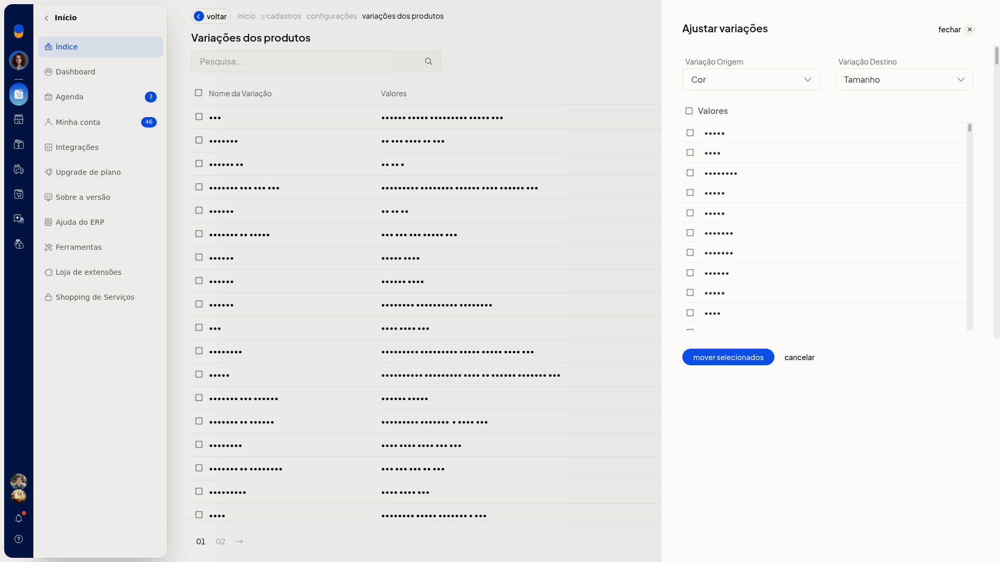

## Resultado
Na listagem, a aba **Variações** separa os produtos com variação. No produto pai, o indicador aparece no formato (N variações). Antes de salvar, a aba **Variações** mostra os níveis em chips e a grade de combinações.

## Informações adicionais
- O limite de 200 por produto não é configurado em **Configurações de variações de produtos**.
- A ajuda da planilha não informa o limite de 200.
- Interface/Tela: criar sim, atualizar sim
- Lote (Planilha): criar sim, atualizar sim
- API V3: criar sim, atualizar sim
- Lis: criar sim, atualizar sim
