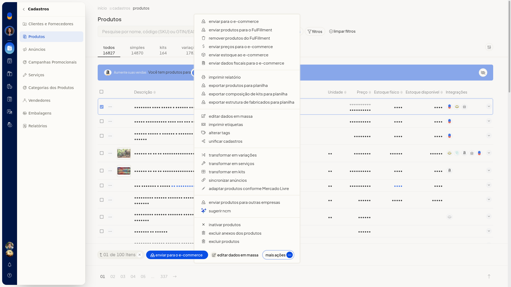
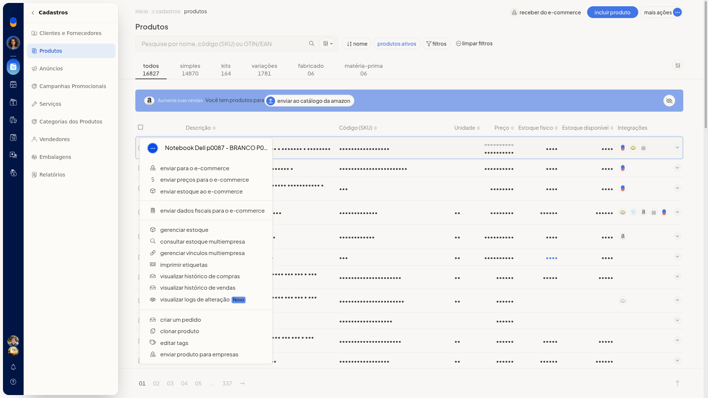
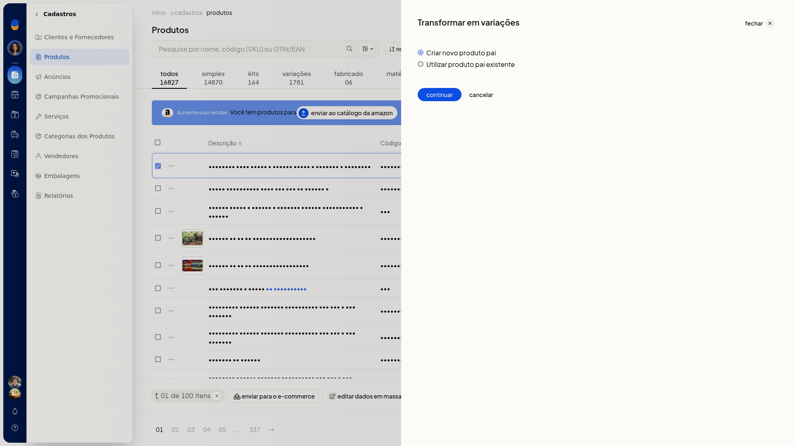
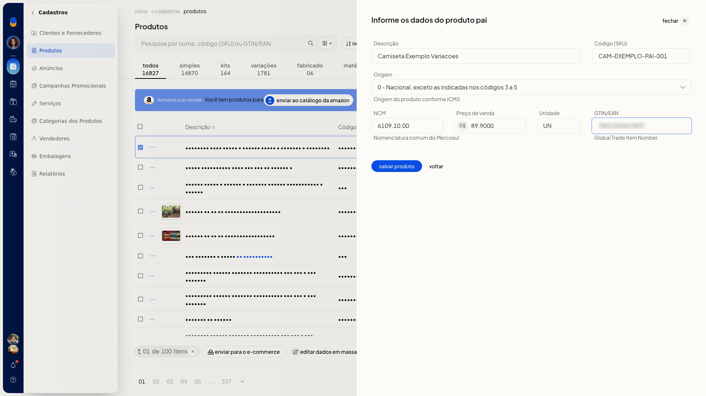
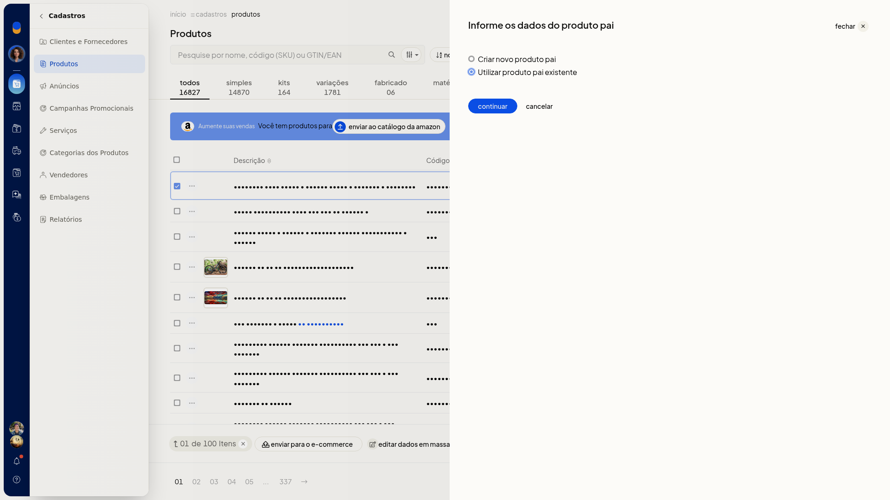
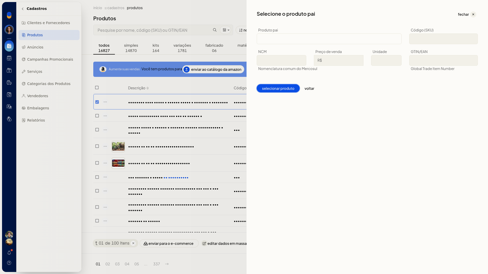

# Transformar produtos em variações

## Pré-requisitos
- Se **Transformar em variações** não aparecer, peça acesso ao administrador da conta.

## Importante
- Marque ao menos um produto. A ação só aparece em **Mais ações** da barra de seleção.
- A ação não aparece no menu da linha do produto nem no **Mais ações** do cabeçalho.
- **Cancelar** abandona o fluxo sem alterar os produtos.

## Instruções
1. Acesse **Cadastros > Produtos**.
2. Marque um ou mais produtos. A barra passa a mostrar **Enviar para o e-commerce**, **editar dados em massa** e **Mais ações**.
3. Abra **Mais ações** e clique em **Transformar em variações**.

   

   

4. Escolha **Criar novo produto pai** ou **Utilizar produto pai existente**. **Criar novo produto pai** já vem selecionado.
5. Clique em **Continuar**.

   

#### Criar novo produto pai

6. Em **Informe os dados do produto pai**, preencha **Descrição**, **Código (SKU)**, **Origem**, **NCM**, **Preço de venda**, **Unidade** e **GTIN/EAN**. Nenhum desses campos aparece como obrigatório.
7. Em **Origem**, selecione o código de 0 a 8. Em **Preço de venda**, informe o valor em reais. Em **GTIN/EAN**, informe o Global Trade Item Number. Em **NCM**, informe a Nomenclatura comum do Mercosul.
8. Clique em **Salvar produto**. **Voltar** retorna à escolha sem gravar.

   

#### Utilizar produto pai existente

6. Selecione **Utilizar produto pai existente** e clique em **Continuar**.

   

7. Em **Selecione o produto pai**, busque o pai em **Produto pai**.
8. Clique em **Selecionar produto**. **Voltar** retorna sem gravar.

   

## Informações adicionais
### O produto também pode ser criado ou atualizado por outros canais

- Interface/Tela: criar sim, atualizar sim
- Lote (Planilha): criar sim, atualizar sim
- API V3: criar sim, atualizar sim
- Lis: criar sim, atualizar sim
