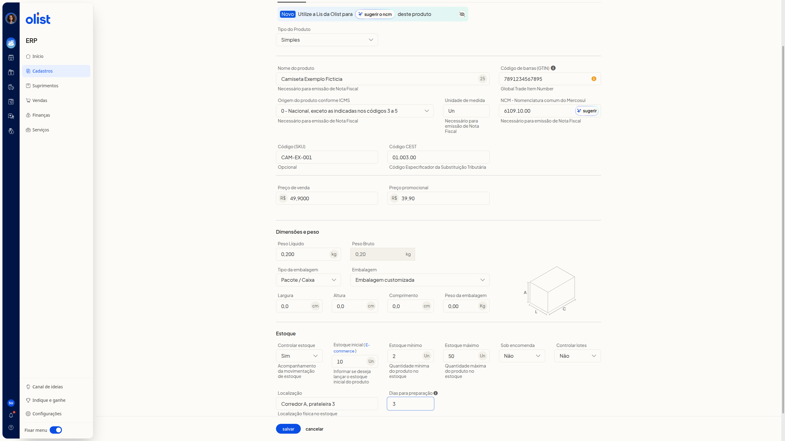

# Cadastro de produtos na lista Meus produtos

## Descrição

Você cadastra produtos no ERP da Olist pela lista de produtos. Acesse-a no menu lateral, no item **Cadastros**.

Você pode cadastrar pela tela ou por planilha. Na tela, **Incluir produto** abre **Novo produto** na aba **Dados Gerais**. Na planilha, **Mais ações > Importar produtos de uma planilha** abre **Importação de produtos via planilha**, com o modelo para baixar e o envio do arquivo.

## Pré-requisitos

- Acesso à lista de produtos no ERP, com **Cadastros** visível no menu lateral.
- Para importar por planilha, você precisa da permissão de produtos, da permissão de importação de registros e da permissão para incluir e editar produtos.
- Para a planilha, arquivo Excel (.xls ou.xlsx) ou texto (.csv), de no máximo 2 Mb, a partir da planilha modelo.

## Importante

- Para emitir nota fiscal, preencha **Origem do produto conforme ICMS** e **Unidade de medida**.
- O preço promocional só é importado pela planilha quando a empresa tem o módulo de preço promocional.
- Na importação por planilha, a variação só é vinculada ao produto pai se ele já estiver cadastrado com o **Código (SKU)** informado.
- Na importação por planilha, o estoque não é atualizado para kits nem para produtos do tipo variações.
- Na importação por planilha, o fornecedor só é vinculado ao produto se já existir um contato cadastrado com o mesmo nome.

## Instruções

### Pela tela

1. Acesse a lista de produtos no menu lateral, em **Cadastros**.
2. Clique em **Incluir produto**.
3. Na aba **Dados Gerais**, preencha os campos abaixo. Nenhum campo desta aba é obrigatório. O formulário também tem as abas **Dados Complementares**, **Ficha técnica**, **Anúncios**, **Preços**, **Custos** e **Outros**.

   

#### Identificação

- **Tipo do Produto**: opções **Simples**, **Kit**, **Com variações**, **Fabricado** e **Matéria-prima**. O padrão é **Simples**.
- **Nome do produto**
- **Código de barras (GTIN)**
- **Código (SKU)**

#### Dados fiscais

- **Origem do produto conforme ICMS**: necessário para emitir nota fiscal. O padrão é **0 - Nacional, exceto as indicadas nos códigos 3 a 5**. Há opções de 0 a 8 para origem nacional ou estrangeira e faixas de conteúdo de importação.
- **Unidade de medida**: necessário para emitir nota fiscal.
- **NCM - Nomenclatura comum do Mercosul**: no campo, há o botão **sugerir o ncm**.
- **Código CEST**: Código Especificador da Substituição Tributária.

#### Preço

- **Preço de venda**
- **Preço promocional**

#### Peso e embalagem

- **Peso Líquido**
- **Peso Bruto**
- **Tipo da embalagem**: opções **Envelope**, **Pacote / Caixa** e **Rolo / Cilindro**. O padrão é **Pacote / Caixa**.
- **Embalagem**: o padrão é **Embalagem customizada**. A lista também oferece caixas de encomenda, inclusive Flex, CE e variações de tamanho.
- **Largura**
- **Altura**
- **Comprimento**
- **Peso da embalagem**

#### Estoque

- **Controlar estoque**: opções **Sim** e **Não**. O padrão é **Sim**. Indica o acompanhamento da movimentação de estoque.
- **Estoque inicial ( E-commerce )**
- **Estoque mínimo**
- **Estoque máximo**
- **Sob encomenda**: opções **Sim** e **Não**. O padrão é **Não**.
- **Controlar lotes**: opções **Sim** e **Não**. O padrão é **Não**.
- **Localização**: localização física no estoque.
- **Dias para preparação**

4. Clique em **Salvar** para gravar o produto.

### Por planilha

1. Acesse a lista de produtos no menu lateral, em **Cadastros**.
2. Acesse **Mais ações > Importar produtos de uma planilha**.
3. No passo 1 da tela **Importação de produtos via planilha**, clique em **baixar planilha**.
4. Preencha a planilha modelo com os produtos.
5. Mantenha o arquivo em Excel (.xls ou.xlsx) ou texto (.csv), com no máximo 2 Mb e a mesma quantidade de colunas do layout de importação.
6. Informe cada nível de variação como tipo e valor separados por dois-pontos, com no máximo 5 níveis separados por duas barras verticais (||).
7. Consulte **Orientações**, o link **Dicas para preencher corretamente** e as perguntas frequentes da mesma tela, se precisar de ajuda no preenchimento.
8. No passo 2, clique em **enviar planilha** para importar o arquivo.

## Informações adicionais

### Cancelar descarta o rascunho

**Cancelar** fecha **Novo produto** e volta à lista de produtos, sem gravar.

### O recebimento do ecommerce começa na lista

Na lista, **Receber do e-commerce** e **Mais ações > Receber produtos do e-commerce** iniciam o recebimento de produtos do ecommerce.

### O produto pode ser criado e atualizado por estes canais

- Interface/Tela: criar sim, atualizar sim
- Lote (Planilha): criar sim, atualizar sim
- API V3: criar sim, atualizar sim
- Lis: criar sim, atualizar sim

## Links relacionados

Se precisar de ajuda para cadastrar produtos, fale com o suporte.
