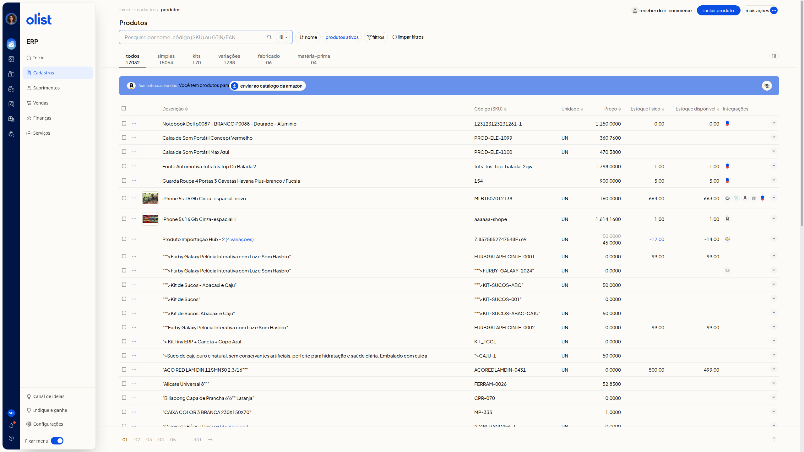
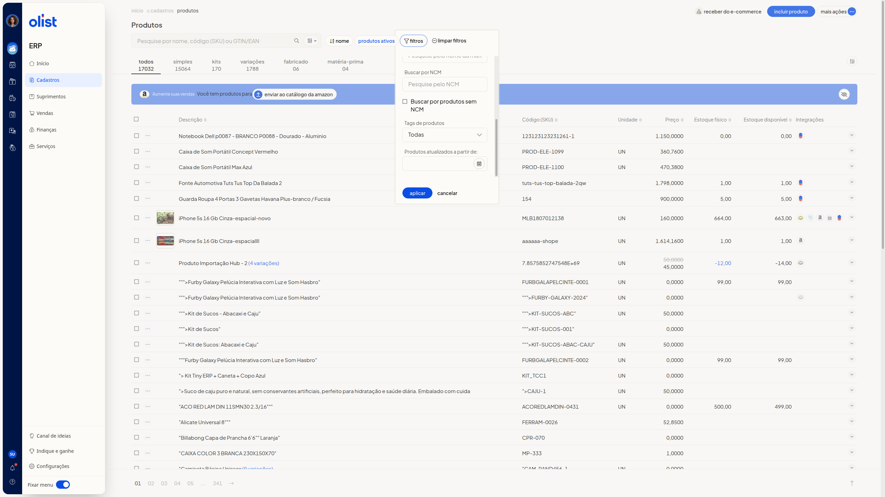

# Como buscar e filtrar produtos na lista de produtos

## Descrição

A lista de produtos do ERP da Olist permite consultar e filtrar os produtos. Você localiza um produto pelo nome, pelo código (SKU) ou pelo GTIN/EAN, alterna o tipo nas abas e aplica filtros de loja no ecommerce, categoria, fornecedor, marca, NCM, tags e data de atualização.

A lista fica no menu lateral, com o item **Cadastros**.

## Pré-requisitos

- acesso à lista de produtos no ERP, com o item **Cadastros** visível no menu lateral.

## Instruções

1. Abra a lista de produtos, com o item **Cadastros** no menu lateral do ERP.

   

2. Busque por nome, código (SKU) ou GTIN/EAN em **Pesquise por nome, código (SKU) ou GTIN/EAN**.

3. Use os atalhos **nome**, **produtos ativos** e **limpar filtros**.

4. Selecione a aba **Todos**, **Simples**, **Kits**, **Variações**, **Fabricado** ou **Matéria-prima**. Cada aba exibe a quantidade do tipo.

5. Clique em **filtros**.

   

6. Restrinja a lista, se quiser, com **Que estão no e-commerce**, **Que não estão no e-commerce**, **categoria**, **Fornecedor**, **Marca**, **Buscar por NCM**, **Buscar por produtos sem NCM**, **Tags de produtos** e **Produtos atualizados a partir de**. **Que estão no e-commerce** e **Que não estão no e-commerce** filtram as lojas em que o produto está ou não está no ecommerce.

7. Clique em **Aplicar** ou em **Cancelar**. A lista mostra os produtos nas colunas **Descrição**, **Código (SKU)**, **Unidade**, **Preço**, **Estoque físico**, **Estoque disponível** e **Integrações**, com paginação.

## Resultado

A lista exibe os produtos por tipo, com paginação.

## Links relacionados

Se a busca ou os filtros não localizarem o produto, fale com o suporte.
