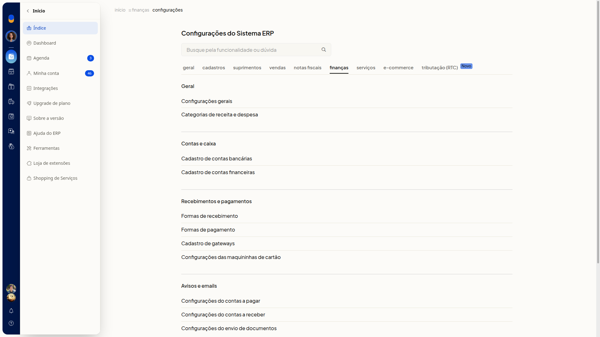
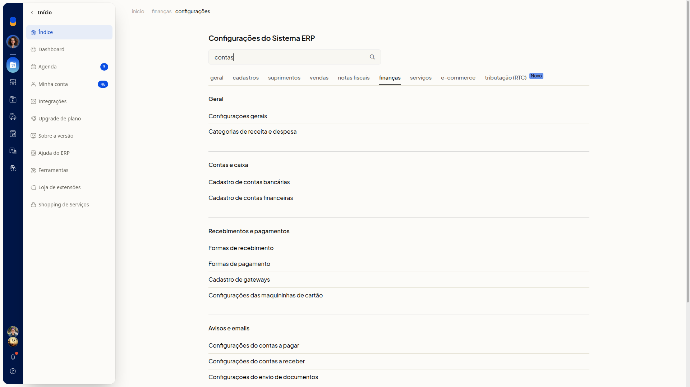

# Como consultar o índice de configurações de Finanças

A aba **Finanças** é o índice de links das configurações financeiras do ERP da Olist. As opções ficam agrupadas por seção, para você localizar o assunto sem preencher dados nesta tela. Não há formulário de cadastro, botão de novo registro, importação de planilha nem ação de salvar.

## Importante

Se a opção não aparecer para você, peça acesso ao administrador da conta.

## Como acessar

Acesse **Configurações > Configurações ERP**. Na página **Configurações do Sistema ERP**, selecione a aba **Finanças**.

## Pré-requisitos

- O menu **Configurações** precisa estar disponível para você abrir **Configurações ERP**.

## Grupos de configuração

Você não precisa preencher o campo **Busque pela funcionalidade ou dúvida** para ver o índice. Se digitar um termo, a lista de seções e links permanece completa: a pesquisa não filtra o índice nesta tela.

Se você usar o botão ao lado do campo depois de digitar, sai desta aba e vai para um índice global de resultados.

### Geral

- **Configurações gerais**
- **Categorias de receita e despesa**

### Contas e caixa

- **Cadastro de contas bancárias**
- **Cadastro de contas financeiras**

### Recebimentos e pagamentos

- **Formas de recebimento**
- **Formas de pagamento**
- **Cadastro de gateways**
- **Configurações das maquininhas de cartão**

### Avisos e emails

- **Configurações do contas a pagar**
- **Configurações do contas a receber**
- **Configurações do envio de documentos**

### Marcadores

- **Configurações dos marcadores**

Clique no link da configuração que você quer ajustar.

## Links relacionados

Se precisar de ajuda para localizar uma configuração, fale com o suporte.
