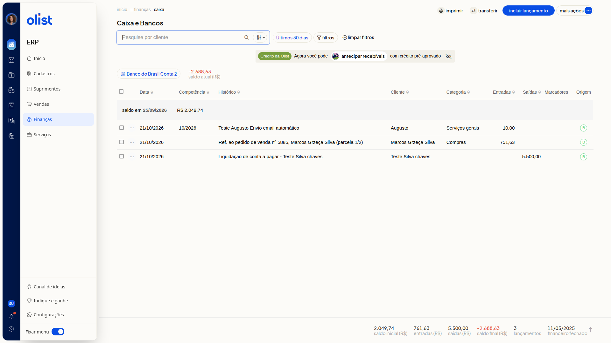

# Como consultar e filtrar lançamentos no Caixa e Bancos

## Descrição

No ERP da Olist, a tela **Caixa e Bancos** lista os lançamentos da conta selecionada. A pesquisa por cliente e os filtros de período, categoria e marcador ajudam você a localizar esses lançamentos.

Acesse **Finanças > Caixa** para abrir **Caixa e Bancos**.

## Pré-requisitos

- Permissão de Caixa para acessar **Finanças > Caixa**.
- Uma conta de caixa ou banco já selecionada na lista. O nome da conta e o saldo atual aparecem no topo.

## Importante

- O filtro do período **Por competência** só aparece para empresas com o módulo DRE.

## Instruções

1. Acesse **Finanças > Caixa**.
2. Confira a conta selecionada, o saldo atual, a lista de lançamentos, a linha de saldo e o rodapé com totais.

   

3. Use **Pesquise por cliente** para localizar lançamentos de um cliente.
4. Abra o período. A opção inicial é **Últimos 30 dias**.
5. Escolha **Por emissão** ou **Por competência**.
 - Em **Por emissão**, as opções são **Últimos 30 dias**, **Sem filtro**, **Do dia**, **Da semana**, **Do mês**, **Intervalo** e **Sem competência**.
 - Em **Por competência**, **Do dia** e **Da semana** não aparecem. As opções são **Últimos 30 dias**, **Sem filtro**, **Do mês**, **Intervalo** e **Sem competência**.
6. Em **Intervalo**, informe **De** e **Até**. Em **Por emissão**, informe as datas. Em **Por competência**, informe os meses.
7. Abra **Filtros**.
8. Em **Categoria**, escolha **Todas**, uma categoria cadastrada ou **Sem categoria**.
9. Em **Marcador**, escolha **Sem filtro por marcador**, um marcador existente ou **Sem marcadores**.
10. Clique em **Aplicar**. A lista permanece na conta selecionada e pode ser restringida por cliente, período, categoria e marcador. Para não aplicar a escolha, clique em **Cancelar**. A tela também oferece limpar filtros.

## Resultado

A lista da conta selecionada pode ser restringida por cliente, período, categoria e marcador.

## Informações adicionais

### A lista reúne colunas, saldo e totais

As colunas são **Data**, **Histórico**, **Cliente**, **Categoria**, **Entradas**, **Saídas**, **Marcadores** e **Origem**. A coluna **Competência** só é exibida para empresas com o módulo DRE. A lista também mostra uma linha de saldo e o rodapé com totais.

## Links relacionados

Se precisar de ajuda para consultar os lançamentos, fale com o suporte.
