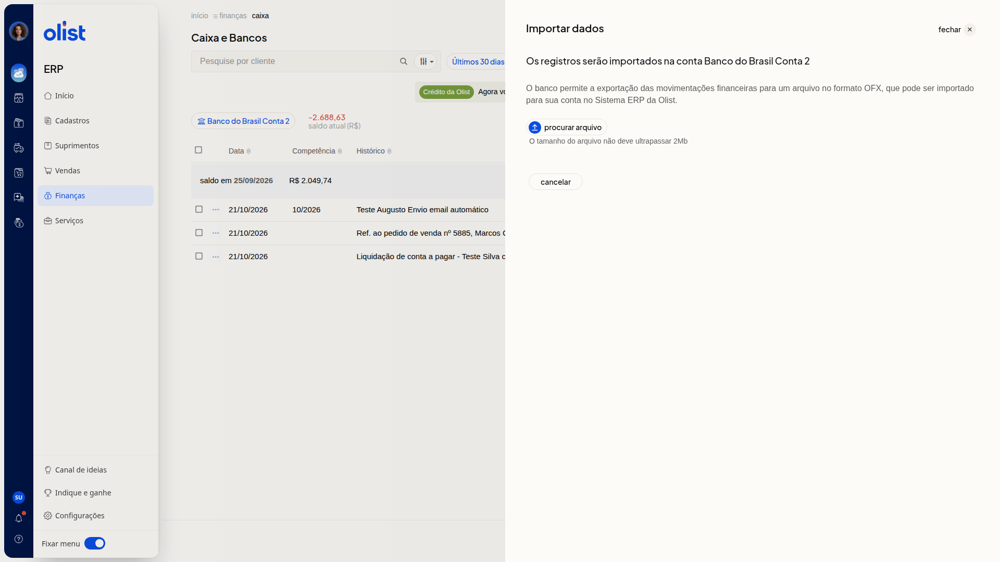

# Como importar extrato OFX no Caixa e Bancos

## Descrição

A importação de extrato OFX leva para o ERP da Olist as movimentações que o banco exporta nesse formato. Os registros entram na conta de caixa ou banco que está selecionada em **Caixa e Bancos**.

Para abrir a tela, acesse **Finanças > Caixa**. A importação fica em **Mais ações > Importar extrato OFX**.

## Pré-requisitos

- Você precisa da permissão de Caixa para acessar **Finanças > Caixa**
- Você precisa da permissão de inclusão no Caixa para importar o extrato OFX
- Uma conta de caixa ou banco já selecionada na lista
- Um arquivo exportado pelo banco no formato OFX, de até 2Mb, referente à conta selecionada

## Importante

- Os registros entram na conta selecionada no topo da lista. Confira a conta antes de importar.
- Não é possível incluir lançamento em data de período financeiro fechado.

## Instruções

1. Acesse **Finanças > Caixa**.
2. Confira a conta selecionada no topo de **Caixa e Bancos**.
3. Clique em **Mais ações**.
4. Clique em **Importar extrato OFX**.
5. Confira em **Importar dados** que os registros serão importados na conta selecionada.

   

6. Clique em **Procurar arquivo** e escolha o arquivo OFX de até 2Mb. Para fechar o painel, clique em **Cancelar**.

## Links relacionados

Se precisar de ajuda para importar o extrato, fale com o suporte.
