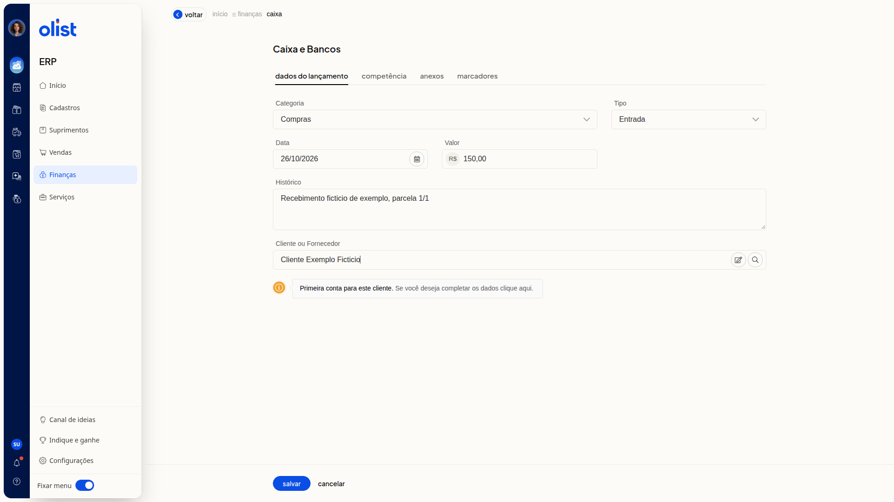
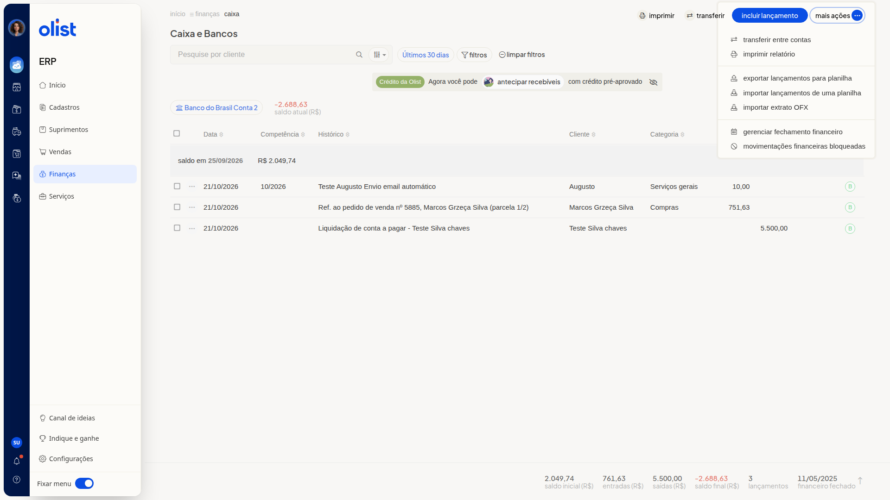
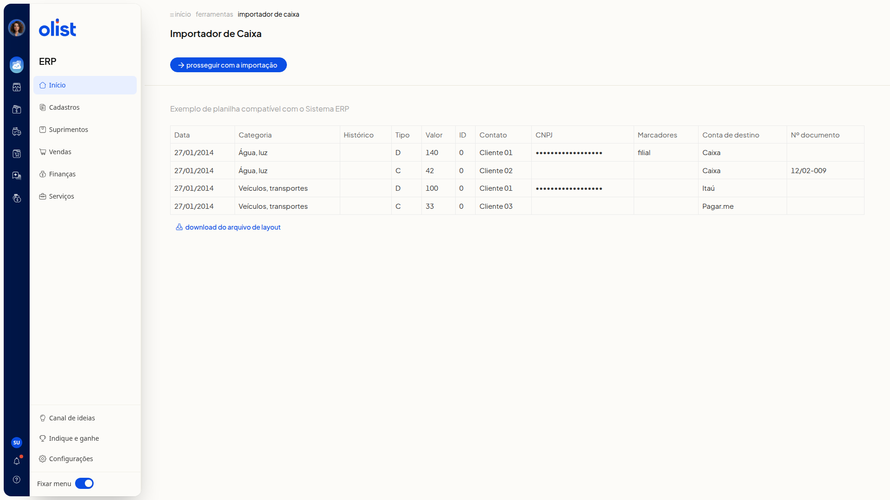

# Como incluir um lançamento no Caixa e Bancos

## Descrição

No ERP da Olist, a tela **Caixa e Bancos** lista os lançamentos da conta de caixa ou banco selecionada. Você pode registrar uma entrada, uma saída ou um saldo nessa conta.

Acesse **Finanças > Caixa**. Dá para incluir o lançamento pela tela, por planilha ou por extrato OFX.

## Pré-requisitos

- Você precisa da permissão de Caixa para acessar **Finanças > Caixa**.
- Para incluir pela tela e para importar extrato OFX, você precisa da permissão de inclusão no Caixa.
- Para importar lançamentos de uma planilha, você precisa da permissão de inclusão e de edição no Caixa e da permissão de importação de registros.
- A conta de caixa ou banco já deve estar selecionada na lista. O nome da conta e o saldo atual aparecem no topo.
- Para a planilha, tenha um arquivo no layout exibido no **Importador de Caixa**. O botão **Download do arquivo de layout** fica nessa tela.
- Para o OFX, tenha um arquivo exportado pelo banco no formato OFX, de até 2Mb, referente à conta selecionada.

## Importante

- Não é possível incluir um lançamento em data de período financeiro fechado. O rodapé da lista indica o **financeiro fechado**.
- Na aba **Anexos**, o arquivo não deve ultrapassar 2Mb.
- O arquivo OFX não deve ultrapassar 2Mb. Os registros entram na conta selecionada na lista.

## Instruções

### Pela tela

1. Acesse **Finanças > Caixa**.
2. Clique em **Incluir lançamento**.

   
3. Na aba **Dados do lançamento**, preencha os campos abaixo.

#### Dados do lançamento

- **Categoria**: não obrigatório. Selecione uma categoria cadastrada ou **Adicionar nova categoria**.
- **Tipo**: não obrigatório. Selecione **Saída**, **Entrada** ou **Saldo**.
- **Data**: não obrigatório. Informe no formato DD/MM/AAAA.
- **Valor**: não obrigatório.
- **Histórico**: não obrigatório.
- **Cliente ou Fornecedor**: não obrigatório. Se o cliente não estiver cadastrado, aparece o aviso **Primeira conta para este cliente**.

4. Abra a aba **Competência** e informe o mês e o ano no navegador de mês. O campo **Competência** não é obrigatório.
5. Abra a aba **Anexos** e clique em **Procurar arquivo**, se quiser anexar um arquivo de até 2Mb. O campo não é obrigatório.
6. Abra a aba **Marcadores** e separe os marcadores por vírgula ou pela tecla Tab. O campo **Marcadores** não é obrigatório.
7. Clique em **Salvar**. Para voltar à lista sem incluir o lançamento, clique em **Cancelar**.

### Por planilha

1. Acesse **Finanças > Caixa**.
2. Clique em **Mais ações**.

   

3. Clique em **Importar lançamentos de uma planilha**.
4. Confira o layout de exemplo no **Importador de Caixa**. As colunas são:

   - **Data**
   - **Categoria**
   - **Histórico**
   - **Tipo (D/C)**
   - **Valor**
   - **ID**
   - **Contato**
   - **CNPJ**
   - **Marcadores**
   - **Conta de destino**
   - **Nº documento**

   

5. Clique em **Download do arquivo de layout** para obter o modelo.
6. Clique em **Prosseguir com a importação**.

### Por extrato OFX

1. Acesse **Finanças > Caixa**.
2. Confira a conta selecionada no topo da lista.
3. Clique em **Mais ações** e depois em **Importar extrato OFX**.
4. Confira no painel **Importar dados** que os registros entram na conta selecionada. O banco exporta as movimentações em OFX para importação no ERP.

   

5. Clique em **Procurar arquivo** e escolha um arquivo.ofx de até 2Mb. Para fechar o painel sem importar, clique em **Cancelar**.

## Links relacionados

Se precisar de ajuda para incluir o lançamento, fale com o suporte.
