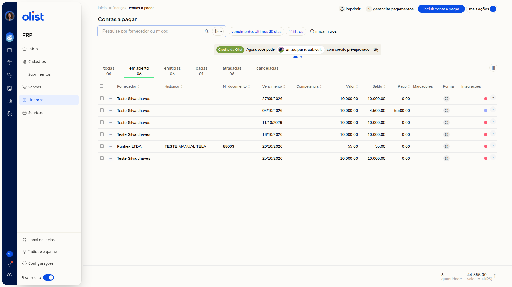
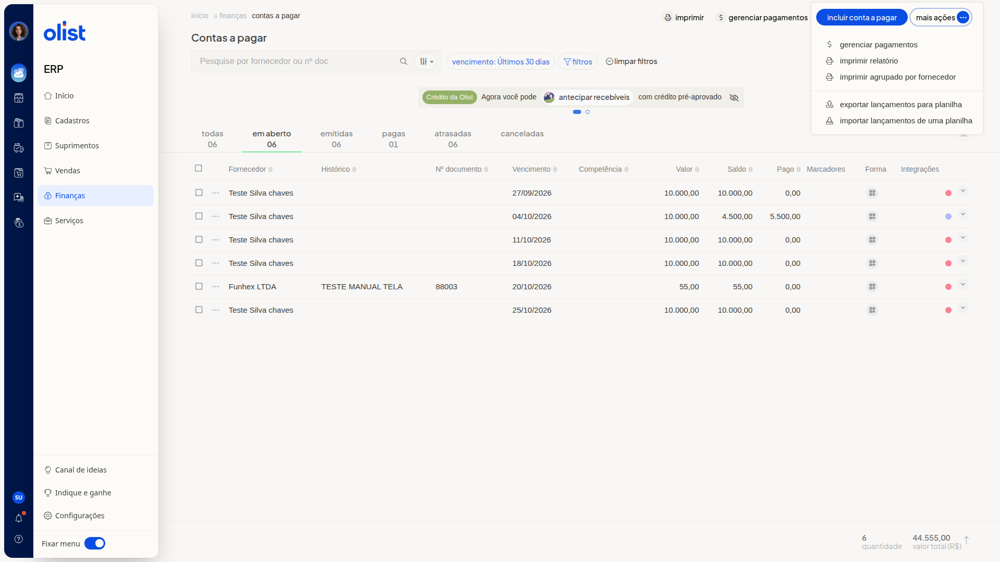

# Como exportar lançamentos de contas a pagar para planilha

## Descrição

No ERP da Olist, você exporta os lançamentos de contas a pagar para planilha pela tela **Contas a pagar**. A ação fica na lista dessa tela.

O caminho é **Finanças > Contas a pagar**. Na lista, a exportação está em **Mais ações**, no item **Exportar lançamentos para planilha**.

## Pré-requisitos

- Acesso à tela **Contas a pagar** no ERP.

## Instruções

1. Acesse **Finanças > Contas a pagar**.

   

2. Clique em **Mais ações**.

   

3. Clique em **Exportar lançamentos para planilha**.

## Links relacionados

Se precisar de ajuda, fale com o suporte.
