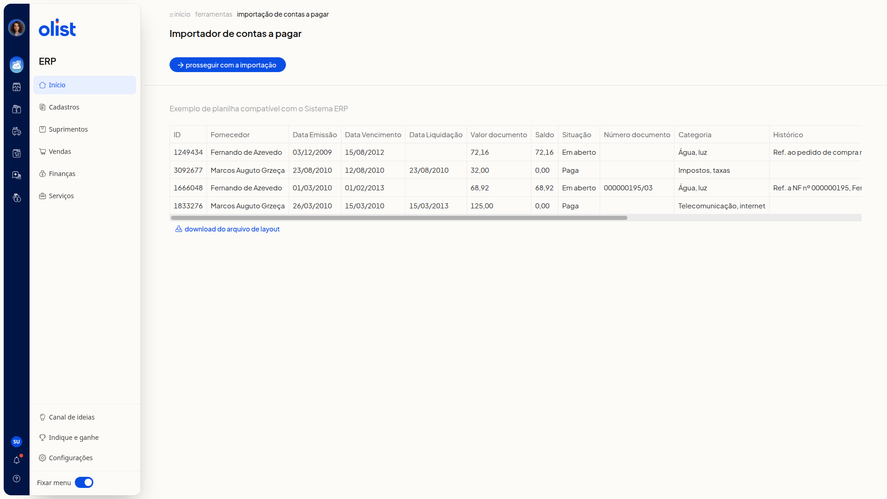

# Como importar lançamentos de contas a pagar por planilha

## Descrição

No ERP da Olist, você inclui lançamentos de contas a pagar importando uma planilha. O modelo desse arquivo é o layout disponível na tela do importador.

A importação fica em **Finanças > Contas a pagar**. Na lista, abra **Mais ações**.

## Pré-requisitos

Tenha acesso à tela **Contas a pagar** no ERP.

## Instruções

1. Acesse **Finanças > Contas a pagar**.
2. Clique em **Mais ações**.

   

3. Clique em **Importar lançamentos de uma planilha**.
4. Confira a tabela de exemplo na tela **Importador de contas a pagar**. As colunas são:

   - **ID**
   - **Fornecedor**
   - **Data Emissão**
   - **Data Vencimento**
   - **Data Liquidação**
   - **Valor documento**
   - **Saldo**
   - **Situação**
   - **Número documento**
   - **Categoria**
   - **Histórico**

   

5. Clique em **Download do arquivo de layout** para obter o modelo.
6. Clique em **Prosseguir com a importação** para enviar o arquivo.

## Links relacionados

Se precisar de ajuda, fale com o suporte.
