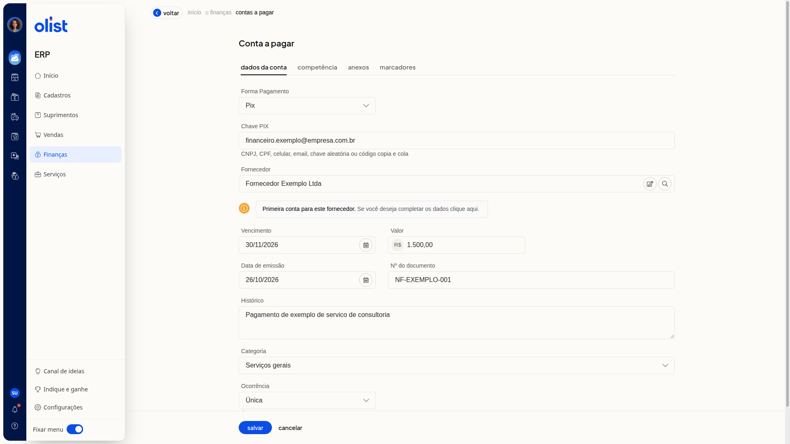

# Como incluir uma conta a pagar manualmente

## Descrição

A inclusão manual registra uma conta a pagar no ERP da Olist pelo formulário **Conta a pagar**. Você informa os dados da conta, a competência, os anexos e os marcadores do lançamento.

Acesse **Finanças > Contas a pagar** e clique em **Incluir conta a pagar > Incluir manualmente**.

## Pré-requisitos

- Acesso à tela **Contas a pagar** no ERP.

## Importante

- Os campos do formulário não são obrigatórios.
- O arquivo da aba **Anexos** não deve ultrapassar 2Mb.
- Se a **Forma Pagamento** for **Pix**, informe a **Chave PIX**.
- **Voltar** ou cancelar deixa a lista sem gravar.

## Instruções

1. Acesse **Finanças > Contas a pagar**.
2. Clique em **Incluir conta a pagar**.
3. Clique em **Incluir manualmente**.
4. Preencha os campos em **Dados da conta**.

   

#### Dados da conta

- **Forma Pagamento**: escolha a forma. A tela exibe os campos dessa forma.
- Opções: **Boleto**, **Cheque**, **Crediário**, **Cartão de crédito**, **Cartão de débito**, **Depósito**, **Depósito Bancário**, **Dinheiro**, **Duplicata Mercantil**, **Programa de fidelidade**, **Cashback**, **Crédito Virtual**, **Pix**, **Vale-troca**, **Vale Alimentação**, **Vale Combustível**, **Vale Presente**, **Vale Refeição**, **Transferência bancária**, **Carteira Digital** e **Outros**.
- **Chave PIX**: preencha se a forma for **Pix**, com CNPJ, CPF, celular, email, chave aleatória ou código copia e cola.
- **Fornecedor**: informe o fornecedor. Se ainda não houver conta para ele, a tela avisa que é a primeira conta para esse fornecedor e oferece um link para os dados do fornecedor.
- **Vencimento**: informe a data.
- **Valor**: informe o valor em reais.
- **Data de emissão**: informe a data.
- **Nº do documento**: informe o número.
- **Histórico**: escreva um texto livre.
- **Categoria**: escolha uma categoria já cadastrada ou **Adicionar nova categoria**.
- **Ocorrência**: escolha **Única**, **Semanal**, **Quinzenal**, **Mensal**, **Trimestral**, **Semestral**, **Anual** ou **Parcelada**.

5. Abra a aba **Competência** e informe o mês.
6. Abra a aba **Anexos** e procure o arquivo. O tamanho não deve ultrapassar 2Mb.
7. Abra a aba **Marcadores** e inclua os marcadores separados por vírgula ou pela tecla tab.
8. Clique em **Salvar** para registrar a conta.

## Links relacionados

Se precisar de ajuda para concluir o lançamento, fale com o suporte.
