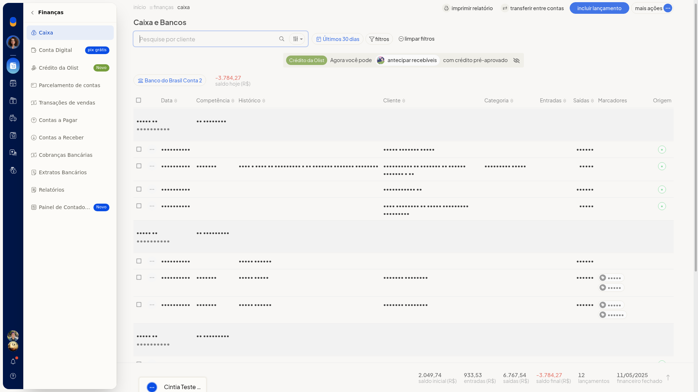
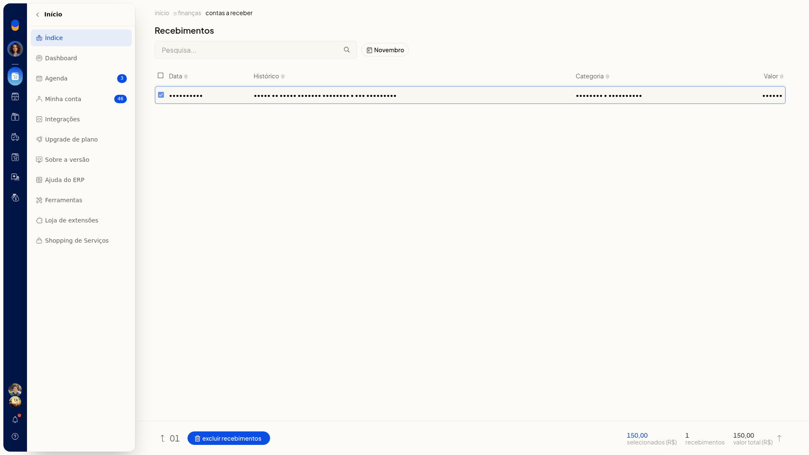
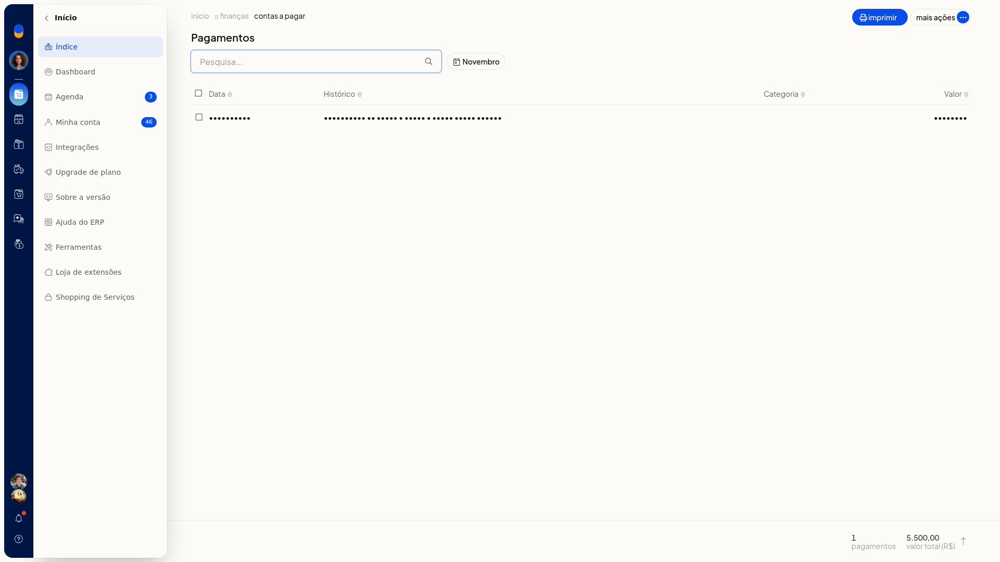
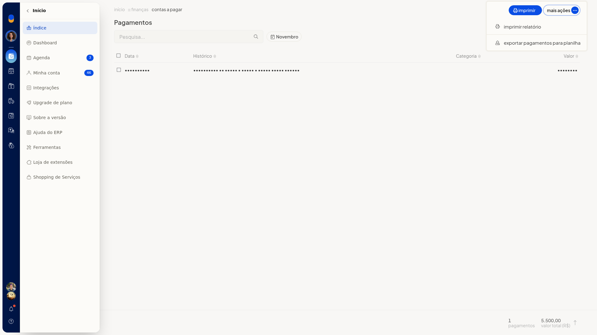
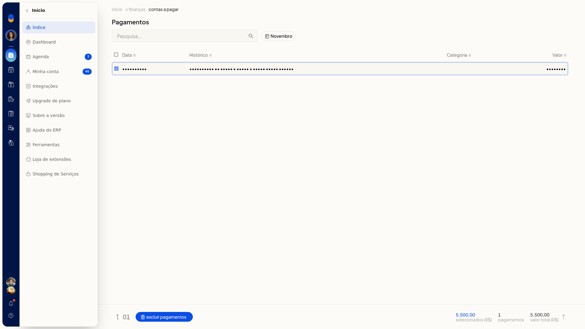
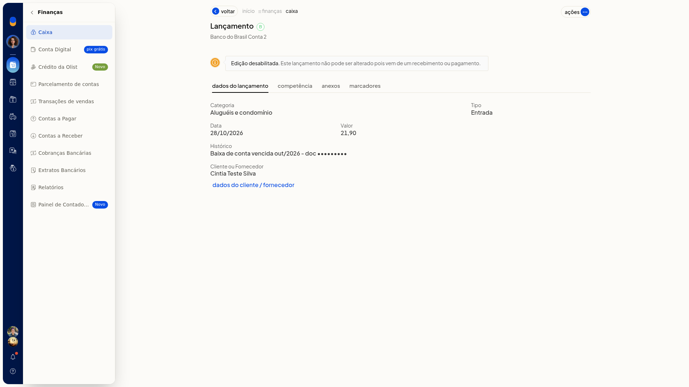

# Caixa

No Caixa do ERP da Olist, a baixa de uma conta a receber ou a pagar aparece como um lançamento da conta financeira. Você reconhece esse lançamento pelo histórico, como baixa de conta vencida ou liquidação de conta a pagar, e pelo vínculo de **Origem**. A consulta não tem coluna de Status.

Pela **Origem**, você abre o recebimento ou o pagamento que gerou o lançamento, imprime um relatório ou exporta os registros para planilha. O lançamento de baixa não se altera no Caixa quando vem de um recebimento ou de um pagamento.

## Pré-requisitos
- A baixa já precisa existir como lançamento na conta financeira. No Caixa não há botão para dar baixa em conta a receber ou a pagar.

## Importante
- Não há coluna de Status na lista do Caixa nem em **Recebimentos** e **Pagamentos** abertos pela **Origem**, e o menu do lançamento de baixa não tem ação de Status.
- O lançamento que vem de um recebimento ou de um pagamento não pode ser alterado. A ficha informa **Edição desabilitada. Este lançamento não pode ser alterado pois vem de um recebimento ou pagamento.**
- Para abrir o recebimento ou o pagamento, use o controle de **Origem** do lançamento. Não use a trilha do topo da página como caminho.
- Lançamentos do caixa até a data do fechamento financeiro ficam bloqueados.

## Instruções
1. Acesse **Finanças > Caixa**.
2. Na conta financeira aberta, localize o lançamento de baixa pelo histórico.
3. Abra o menu da linha. As ações são **Editar**, **Imprimir recibo**, **Alterar conta** e **Marcadores**.

   

4. Localize o controle de **Origem**, o ícone com a letra B.
5. No lançamento com histórico de baixa de conta a receber, clique em **Origem**.
6. Consulte o recebimento em **Recebimentos**, nas colunas **Data**, **Histórico**, **Categoria** e **Valor**.
7. Clique em **Mais ações** e use **Imprimir relatório** ou **Exportar recebimentos para planilha**.
8. Marque a caixa de seleção para ver a quantidade selecionada, **Excluir recebimentos** e, no rodapé, o valor selecionado, a quantidade de recebimentos e o valor total.

   

9. No lançamento com histórico de liquidação de conta a pagar, clique em **Origem**.
10. Consulte o pagamento em **Pagamentos**, nas colunas **Data**, **Histórico**, **Categoria** e **Valor**. A tela também traz pesquisa, seletor de mês, **Imprimir** e **Mais ações**.

   

11. Clique em **Mais ações** e use **Imprimir relatório** ou **Exportar pagamentos para planilha** para levar os registros a uma planilha.

   

12. Marque a caixa de seleção para ver a quantidade, **Excluir pagamentos** e, no rodapé, o valor selecionado, a quantidade de pagamentos e o valor total.

   

13. No lançamento de baixa, abra o menu da linha e clique em **Editar**.
14. Leia a mensagem de edição desabilitada nas abas **Dados do lançamento**, **Competência**, **Anexos** e **Marcadores** e clique em **Voltar** para retornar à lista. A baixa permanece no Caixa e não se corrige por essa ficha.

   

## Resultado
O lançamento de baixa fica visível no Caixa, com histórico de baixa ou liquidação e controle de **Origem**. A **Origem** abre **Recebimentos** ou **Pagamentos** com o registro correspondente, sem coluna de Status. A edição do lançamento exibe a mensagem de edição desabilitada.

## Informações adicionais
- Nas listas de **Recebimentos** e **Pagamentos** abertas pela **Origem** não há opção de importar planilha nem de ativar integração para consultar ou lançar a baixa.
