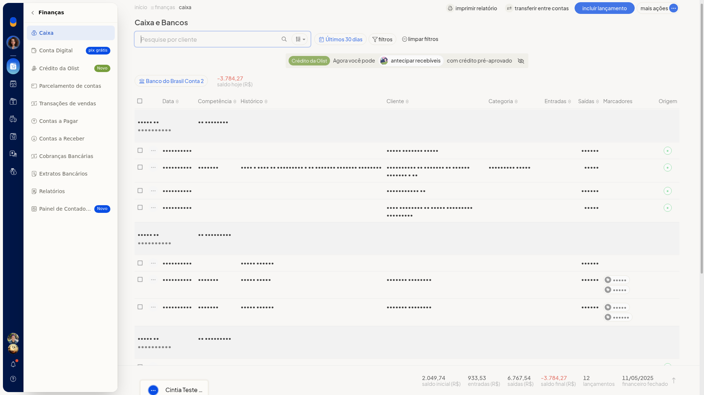
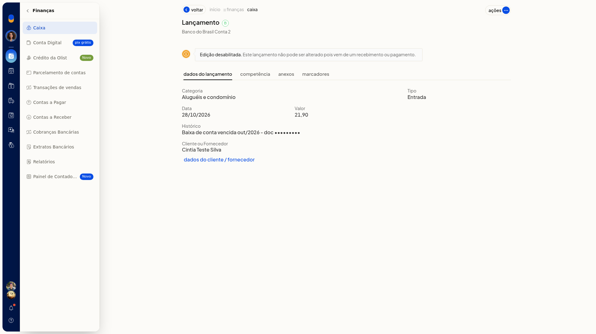
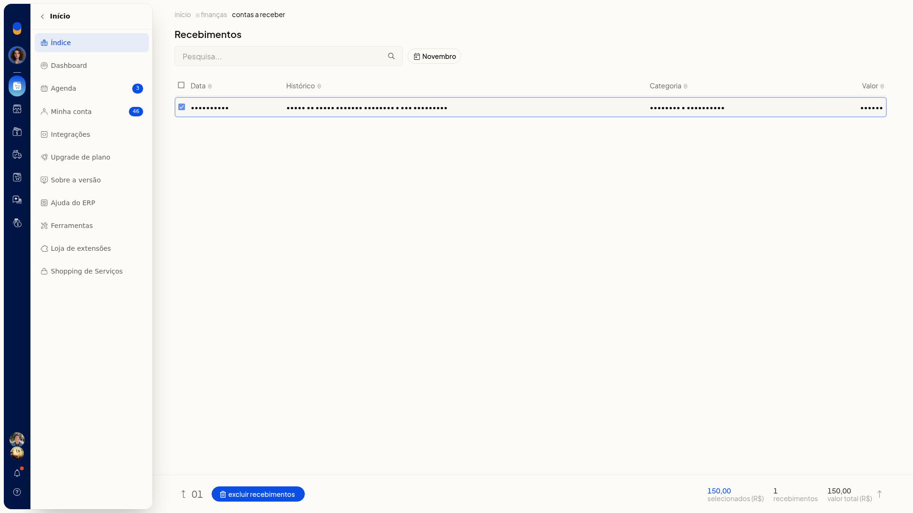
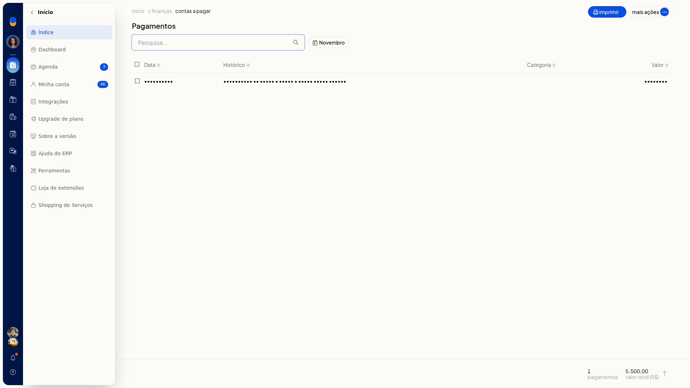
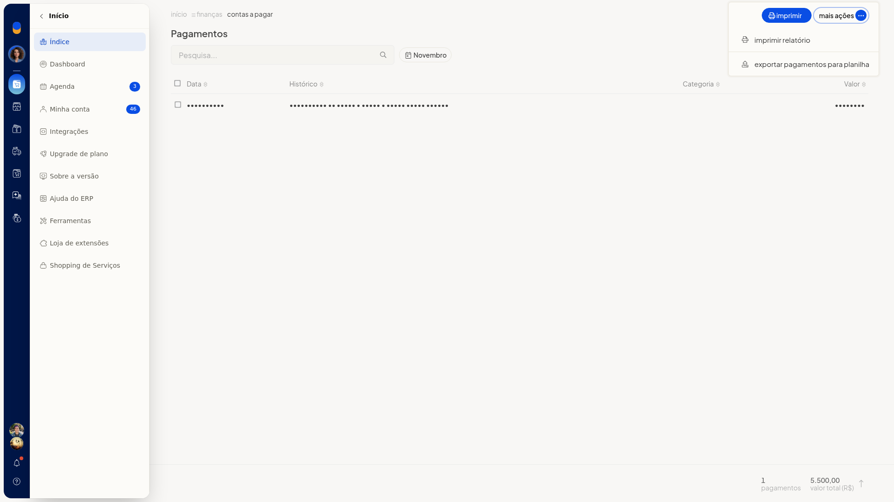
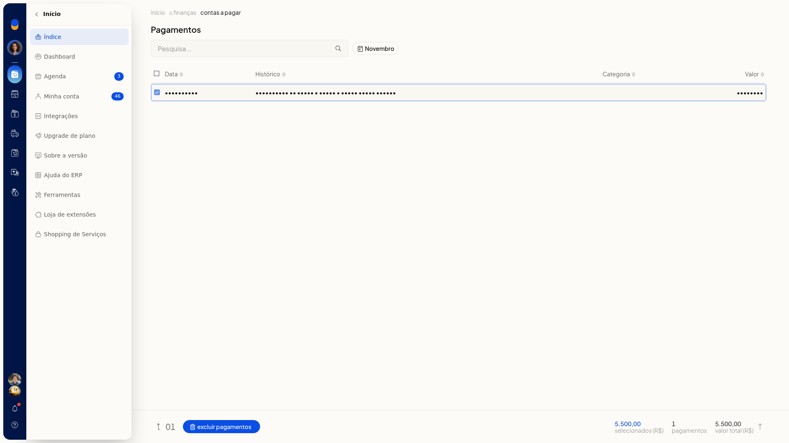

# Consultar a origem da baixa no Caixa

No Caixa do ERP da Olist, a baixa de uma conta a receber ou a pagar aparece como um lançamento da conta financeira. Você reconhece esse lançamento pelo histórico e pelo vínculo de **Origem**. Não há coluna de **Status** nessa consulta.

Pelo controle de **Origem**, você abre o recebimento ou o pagamento que gerou o lançamento. Esse lançamento não se corrige no Caixa: a edição fica desabilitada porque ele vem de um recebimento ou de um pagamento.

## Pré-requisitos
- A baixa já precisa existir como lançamento na conta financeira do Caixa. Nesta tela não há como dar baixa em conta a receber ou a pagar.

## Importante
- Não há coluna de **Status** no lançamento de baixa nem nas listas de **Recebimentos** e **Pagamentos** abertas pela origem.
- Para abrir o recebimento ou o pagamento, use o controle de **Origem** do lançamento. Não use a trilha do topo da página como caminho.
- Lançamento vindo de recebimento ou pagamento não pode ser alterado. A ficha informa: Edição desabilitada. Este lançamento não pode ser alterado pois vem de um recebimento ou pagamento.

## Instruções
1. Acesse **Finanças > Caixa**.
2. Na conta financeira, localize o lançamento de baixa pelo histórico. O histórico pode indicar baixa de conta vencida ou liquidação de conta a pagar.
3. Abra o menu da linha do lançamento. As opções são **Editar**, **Imprimir recibo**, **Alterar conta** e **Marcadores**. Não há ação de **Status**.

   

4. Clique em **Editar**.
5. Confira a mensagem de edição desabilitada. A ficha traz as abas **Dados do lançamento**, **Competência**, **Anexos** e **Marcadores**. Clique em **Voltar** para retornar à lista, sem alterar nem salvar.

   

6. No lançamento cujo histórico indica baixa de conta a receber, clique no controle de **Origem**, o ícone com a letra B. A lista **Recebimentos** mostra o recebimento relacionado, com as colunas **Data**, **Histórico**, **Categoria** e **Valor**.
7. Em **Mais ações**, veja **Imprimir relatório** e **Exportar recebimentos para planilha**. Se quiser apenas consultar, não imprima nem exporte.
8. Marque a caixa de seleção para ver a quantidade selecionada e **Excluir recebimentos**. O rodapé mostra o valor selecionado, a quantidade de recebimentos e o valor total. Não confirme a exclusão. A consulta do recebimento que gerou o lançamento termina aqui.

   

9. No lançamento cujo histórico indica liquidação de conta a pagar, clique no controle de **Origem**. A lista **Pagamentos** mostra o pagamento relacionado, com as colunas **Data**, **Histórico**, **Categoria** e **Valor**, além de pesquisa, seletor de mês, **Imprimir** e **Mais ações**.

   

10. Clique em **Mais ações** e veja **Imprimir relatório** e **Exportar pagamentos para planilha**. Se quiser apenas consultar, não imprima nem exporte.

   

11. Marque a caixa de seleção para ver a quantidade e **Excluir pagamentos**. O rodapé mostra o valor selecionado, a quantidade de pagamentos e o valor total. Não confirme a exclusão. Você consulta o pagamento que gerou o lançamento de caixa.

   

## Resultado
O lançamento de baixa permanece no Caixa, com histórico de baixa ou liquidação e o controle de **Origem**. A origem abre **Recebimentos** ou **Pagamentos** com o registro correspondente, sem coluna de **Status**.

## Informações adicionais
- Nessas listas de origem não há opção de importar planilha nem de ativar integração para consultar ou lançar a baixa.
- **Mais ações** reúne **Imprimir relatório** e a exportação para planilha: **Exportar recebimentos para planilha** ou **Exportar pagamentos para planilha**, conforme a lista.
