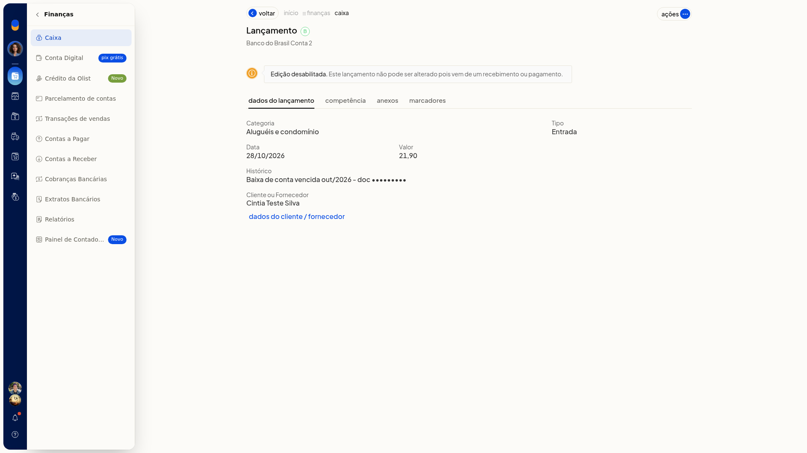
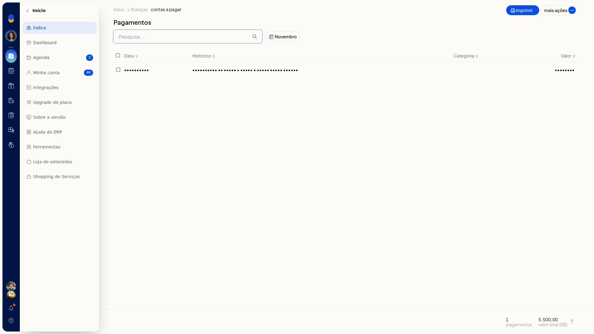
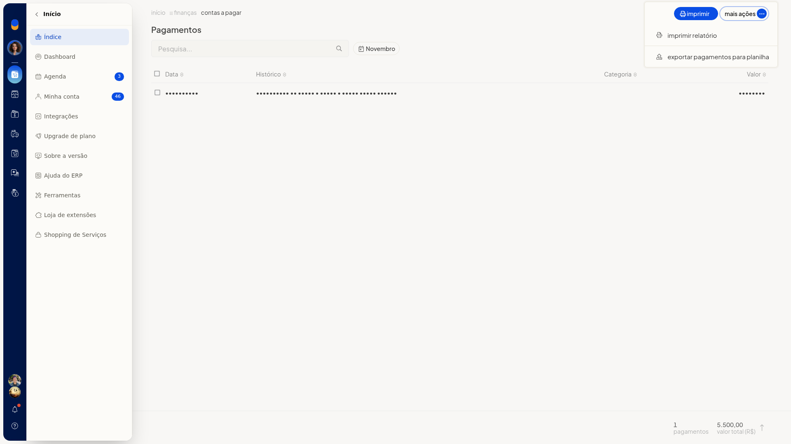

# Contas a pagar

No Caixa do ERP da Olist, a liquidação de uma conta a pagar aparece como um lançamento da conta financeira. Você reconhece esse lançamento pelo histórico de liquidação de conta a pagar e pelo vínculo de Origem.

Por esse vínculo, você abre o pagamento que gerou o lançamento e consulta os dados. Também encontra as opções de imprimir relatório e de exportar para planilha. A liquidação não se corrige editando o lançamento no Caixa.

## Pré-requisitos
- A liquidação já precisa existir como lançamento na conta financeira do Caixa.

## Importante
- No Caixa não há botão para liquidar a conta a pagar.
- Não há coluna de Status na lista do Caixa nem na tela **Pagamentos** aberta pela Origem.
- O lançamento que vem de um pagamento não pode ser alterado no Caixa.
- Para abrir o pagamento, use o controle de Origem do lançamento. Não use a trilha do topo da página como caminho.

## Instruções
1. Acesse **Finanças > Caixa**.
2. Na conta financeira, localize o lançamento pelo histórico de liquidação de conta a pagar.
3. Abra o menu da linha do lançamento. As opções são **Editar**, **Imprimir recibo**, **Alterar conta** e **Marcadores**.
4. Clique em **Editar**. A ficha traz as abas **Dados do lançamento**, **Competência**, **Anexos** e **Marcadores** e a mensagem **Edição desabilitada. Este lançamento não pode ser alterado pois vem de um recebimento ou pagamento.** Clique em **Voltar** para retornar à lista.

   

5. No mesmo lançamento, clique no controle de **Origem**, o ícone com a letra B.
6. Confira o pagamento na tela **Pagamentos**, nas colunas **Data**, **Histórico**, **Categoria** e **Valor**.

   

7. Clique em **Mais ações** para usar **Imprimir relatório** ou **Exportar pagamentos para planilha**. A tela também oferece **Imprimir**.

   

## Resultado
O lançamento da liquidação fica visível no Caixa, com o histórico de liquidação e o controle de Origem. A Origem abre **Pagamentos** com o pagamento correspondente, sem coluna de Status. A edição do lançamento exibe a mensagem de edição desabilitada.

## Informações adicionais
### A lista de origem não importa planilha

Na tela **Pagamentos** aberta pela Origem não há opção de importar planilha nem de ativar integração para consultar ou lançar a baixa.
