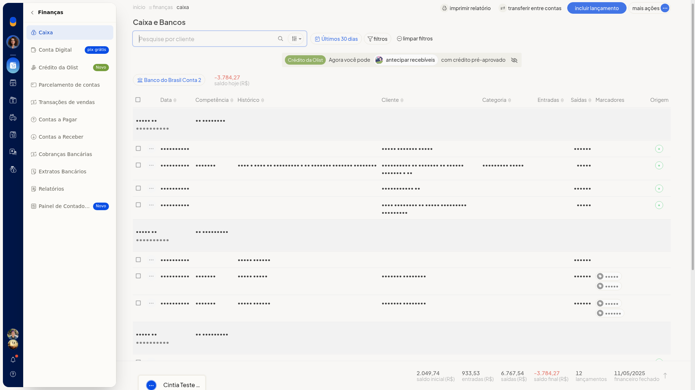
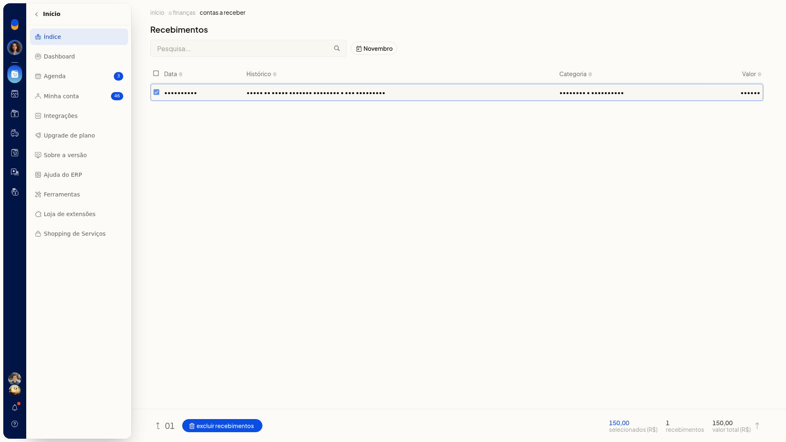
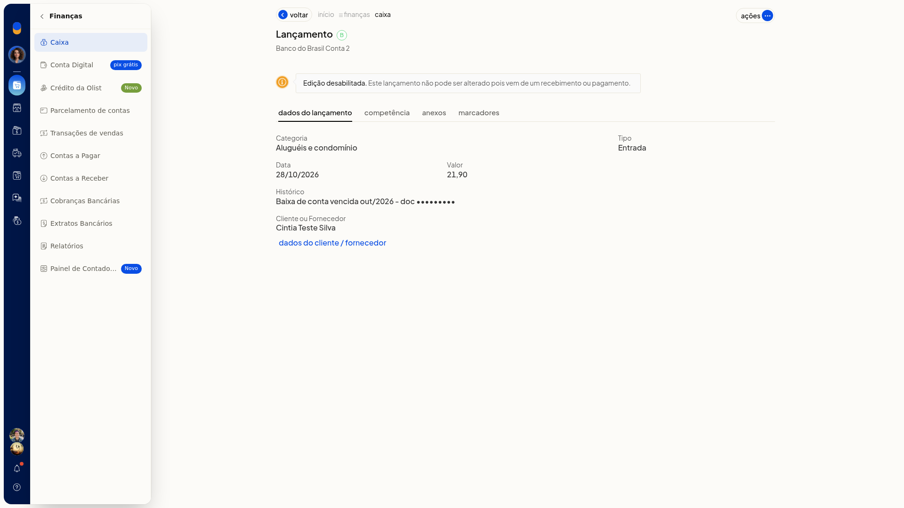

# Contas a receber

No Caixa, a baixa de uma conta a receber aparece como um lançamento da conta financeira. Você reconhece esse lançamento pelo histórico de baixa de conta vencida e pelo vínculo de **Origem**. Não há coluna de Status nessa consulta nem na lista de **Recebimentos** aberta por esse vínculo.

Pela **Origem**, você abre o recebimento que gerou o lançamento. Nessa lista dá para imprimir um relatório ou exportar os registros para planilha. O lançamento de baixa não se corrige no Caixa: a edição fica desabilitada porque ele vem de um recebimento.

## Importante
- A baixa já precisa existir como lançamento no Caixa. Nesta tela não há botão para dar baixa em conta a receber.
- Não há coluna nem ação de Status no lançamento de baixa nem em **Recebimentos**.
- Lançamento vindo de recebimento não pode ser alterado. A ficha informa: Edição desabilitada. Este lançamento não pode ser alterado pois vem de um recebimento ou pagamento.
- Para abrir o recebimento, use o controle de **Origem** do lançamento. Não use a trilha do topo da página como caminho.

## Instruções
1. Acesse **Finanças > Caixa**.
2. Na conta financeira, localize o lançamento de baixa pelo histórico de baixa de conta vencida.
3. Abra o menu da linha do lançamento. As opções são **Editar**, **Imprimir recibo**, **Alterar conta** e **Marcadores**.

   

4. No mesmo lançamento, clique no controle de **Origem**, o ícone com a letra B.
5. Em **Recebimentos**, consulte o recebimento relacionado. As colunas são **Data**, **Histórico**, **Categoria** e **Valor**.
6. Clique em **Mais ações** para usar **Imprimir relatório** ou **Exportar recebimentos para planilha**.
7. Para ver a exclusão, marque a caixa de seleção do recebimento. A barra inferior mostra a quantidade selecionada e **Excluir recebimentos**. O rodapé mostra o valor selecionado, a quantidade de recebimentos e o valor total.

   

8. Para conferir a restrição, volte ao lançamento de baixa no Caixa, abra o menu da linha e clique em **Editar**.
9. Leia o aviso de edição desabilitada nas abas **Dados do lançamento**, **Competência**, **Anexos** e **Marcadores** e clique em **Voltar** para retornar à lista.

   

## Resultado
O lançamento de baixa fica visível no Caixa, com histórico de baixa de conta vencida e controle de **Origem**. A **Origem** abre **Recebimentos** com o registro correspondente, sem coluna de Status. A edição do lançamento exibe a mensagem de edição desabilitada.

## Informações adicionais
- O lançamento de baixa também oferece **Imprimir recibo**, **Alterar conta** e **Marcadores** no menu da linha.
- Em **Recebimentos** não há menu de ações na linha, apenas a caixa de seleção.
- Nessas listas de origem não há opção de importar planilha nem de ativar integração para consultar ou lançar a baixa.
