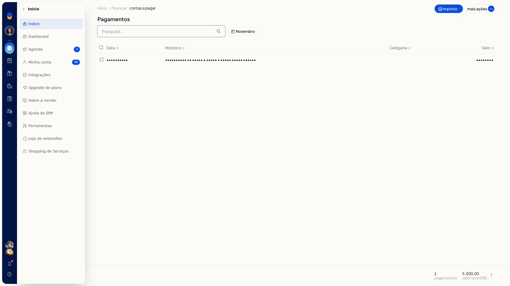
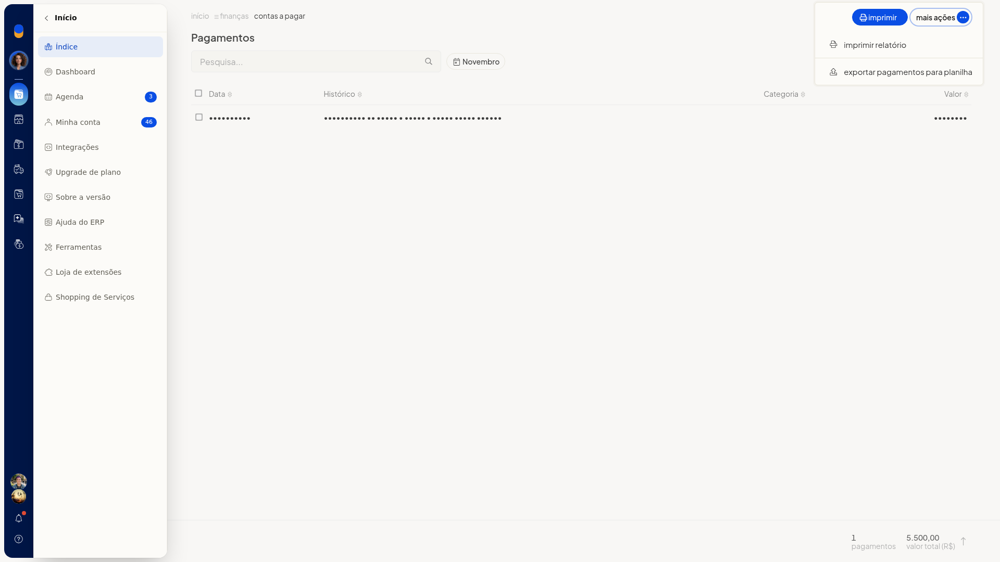

# Exportar recebimentos ou pagamentos de origem para planilha

No Caixa, a baixa de uma conta a receber ou a liquidação de uma conta a pagar aparece como um lançamento da conta financeira. Pelo controle de Origem desse lançamento, você abre o recebimento ou o pagamento correspondente e exporta os registros para planilha.

## Pré-requisitos
- A baixa já precisa existir como lançamento na conta financeira do Caixa.

## Importante
- Para abrir o recebimento ou o pagamento, use o controle de Origem do lançamento. Não use a trilha do topo da página como caminho.

## Instruções
1. Acesse **Finanças > Caixa**.
2. Na conta financeira, localize o lançamento pelo histórico de baixa de conta vencida ou de liquidação de conta a pagar.
3. Clique no controle de **Origem**, o ícone com a letra B. A lista **Recebimentos** ou **Pagamentos** abre com o registro relacionado. As colunas visíveis são **Data**, **Histórico**, **Categoria** e **Valor**.

   

4. Clique em **Mais ações**.

   

5. Clique em **Exportar recebimentos para planilha** ou em **Exportar pagamentos para planilha**, conforme a lista aberta. Esse é o caminho para levar os registros da lista de origem a uma planilha.

## Informações adicionais
### Essas listas não importam planilha

Nas listas de origem não há opção de importar planilha nem de ativar integração para consultar ou lançar a baixa.
