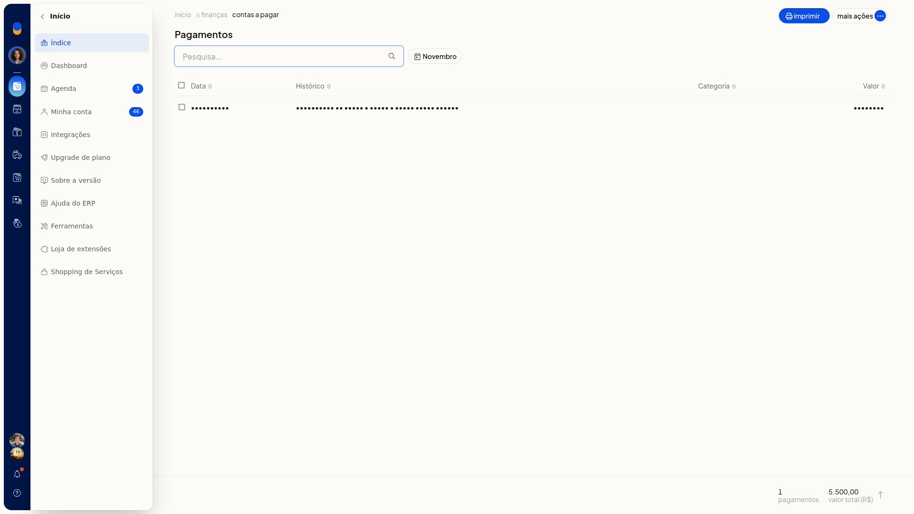
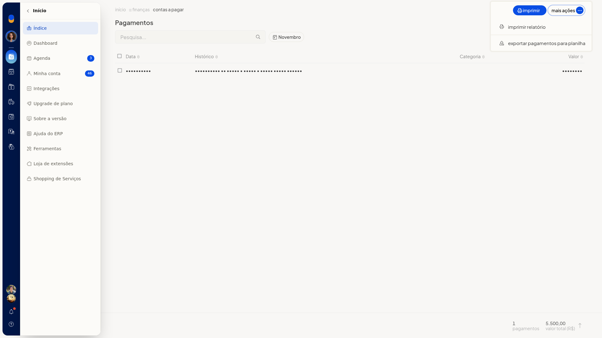

# Imprimir relatório de recebimentos ou pagamentos de origem

No ERP da Olist, a baixa de uma conta a receber ou a pagar aparece no Caixa como lançamento da conta financeira. Pelo controle de **Origem** desse lançamento, você abre o recebimento ou o pagamento correspondente e imprime o relatório.

## Pré-requisitos
- A baixa já precisa existir como lançamento na conta financeira do Caixa.

## Importante
- Abra o recebimento ou o pagamento pelo controle de **Origem** do lançamento. Não use a trilha do topo da página como caminho.

## Instruções
### Pelo recebimento de origem

1. Acesse **Finanças > Caixa**.
2. Na conta financeira, localize o lançamento com histórico de baixa de conta vencida.
3. Clique no controle de **Origem**, o ícone com a letra B.
4. Na tela **Recebimentos**, clique em **Mais ações**.
5. Clique em **Imprimir relatório**.

### Pelo pagamento de origem

1. Acesse **Finanças > Caixa**.
2. Na conta financeira, localize o lançamento com histórico de liquidação de conta a pagar.
3. Clique no controle de **Origem**, o ícone com a letra B.

   

4. Clique em **Mais ações**.

   

5. Clique em **Imprimir relatório**.
