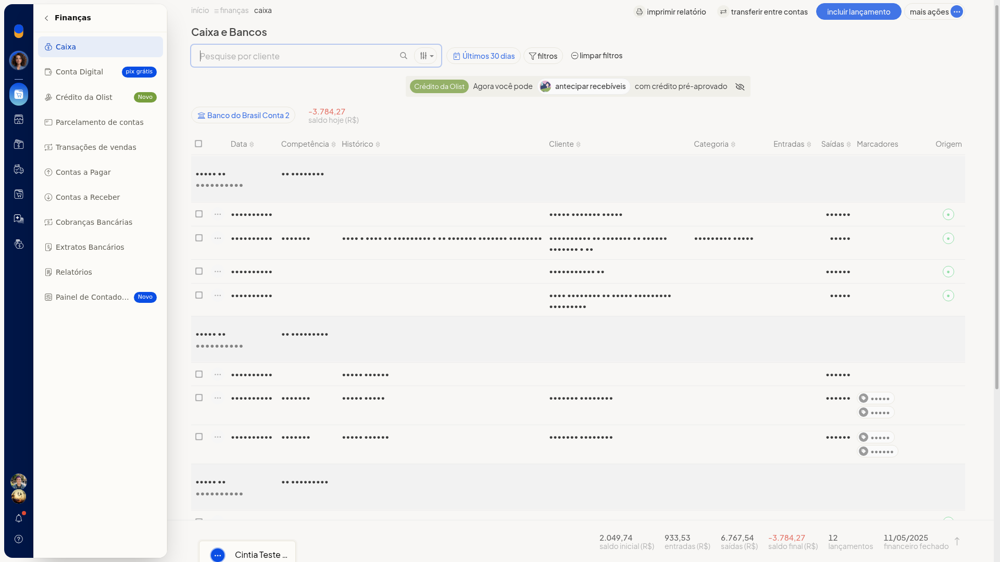
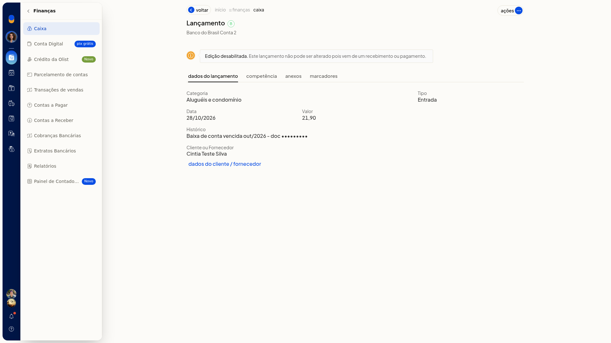

# Por que o lançamento de baixa não pode ser alterado no Caixa

No Caixa do ERP da Olist, a baixa de uma conta a receber ou a pagar aparece como um lançamento da conta financeira. Você reconhece esse lançamento pelo histórico e pelo vínculo de **Origem**.

Esse lançamento não se corrige pela edição no Caixa. A alteração fica desabilitada porque o lançamento vem de um recebimento ou de um pagamento.

## Pré-requisitos
- A baixa já precisa existir como lançamento na conta financeira do Caixa.

## Importante
- Não há coluna de **Status** na consulta do Caixa, nem ação de **Status** no menu da linha do lançamento de baixa.
- A ficha de edição exibe a mensagem **Edição desabilitada. Este lançamento não pode ser alterado pois vem de um recebimento ou pagamento.**

## Instruções
1. Acesse **Finanças > Caixa**.
2. Na conta financeira, localize o lançamento de baixa pelo histórico de baixa de conta vencida ou de liquidação de conta a pagar.
3. Abra o menu da linha do lançamento.

   

4. Clique em **Editar**.
5. Confira a mensagem de edição desabilitada, com as abas **Dados do lançamento**, **Competência**, **Anexos** e **Marcadores**, e clique em **Voltar** para retornar à lista, sem alterar nem salvar o lançamento.

   

## Informações adicionais
### O vínculo de origem mostra de onde veio a baixa

- O lançamento tem um controle de **Origem**, exibido como um ícone com a letra B.
- Para abrir o recebimento ou o pagamento, use esse controle. Não use a trilha do topo da página como caminho.
- Em uma baixa de conta a receber, **Origem** abre **Recebimentos**.
- Em uma liquidação de conta a pagar, **Origem** abre **Pagamentos**.
- Nessas listas, as colunas visíveis são **Data**, **Histórico**, **Categoria** e **Valor**. Não há coluna **Status**.
