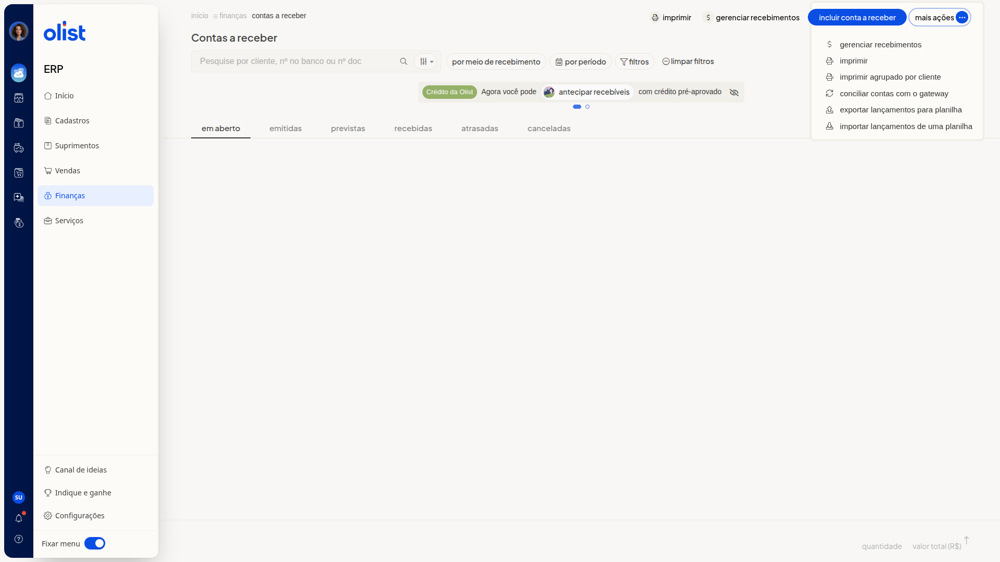

# Como exportar lançamentos de contas a receber para planilha

## Descrição

Na tela Contas a receber do ERP da Olist, você exporta os lançamentos para planilha. A ação fica na lista, no menu **Mais ações**.

O caminho até a lista é **Finanças > Contas a Receber**.

## Pré-requisitos

- Acesso ao menu **Finanças** no ERP
- Permissão de Contas a receber para acessar a tela
- Permissão de importação de registros para exportar os lançamentos para planilha

## Instruções

1. Acesse **Finanças > Contas a Receber**.

   

2. Clique em **Mais ações**.

   

3. Clique em **Exportar lançamentos para planilha**.

## Links relacionados

Se precisar de ajuda para exportar os lançamentos, fale com o suporte.
