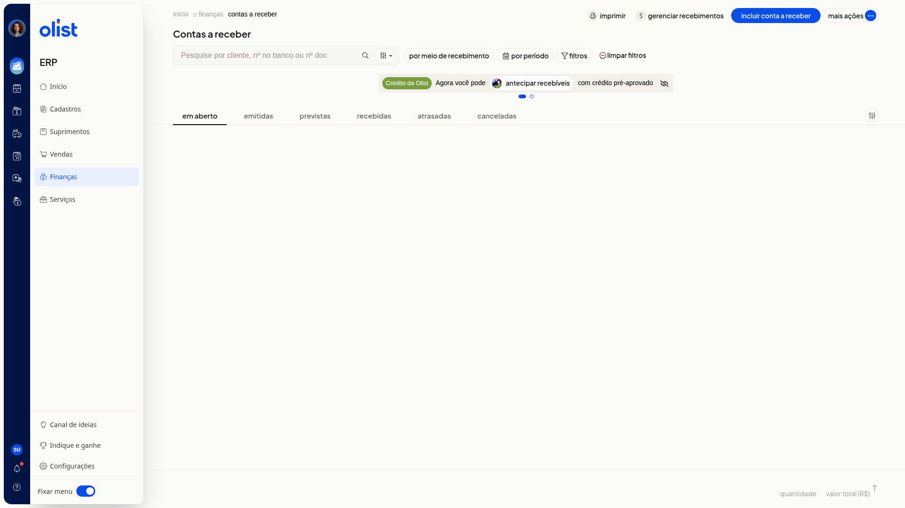

# Como gerar link de pagamento pela conta digital da Olist

## Descrição

No ERP da Olist, você pode receber com link de pagamento pela Conta Digital da Olist no formulário **Conta a receber**. O formulário mostra um aviso e o botão **link de pagamento**.

Acesse **Finanças > Contas a Receber** e clique em **Incluir conta a receber**.

## Pré-requisitos

- Você precisa de acesso ao menu **Finanças** no ERP.
- Você precisa da permissão de Contas a receber para acessar a tela.
- Você precisa da permissão para incluir em Contas a receber para usar **Incluir conta a receber**.
- A empresa precisa poder emitir o link de pagamento pela Conta Digital.

## Importante

- O aviso **Novidade. Agora você pode receber com link de pagamento pela conta digital da olist** só aparece se a **Forma de recebimento** for link de pagamento com a conta digital configurada, ou se o meio de recebimento for a Conta Digital da Olist.

## Instruções

1. Acesse **Finanças > Contas a Receber**.

   

2. Clique em **Incluir conta a receber**.

3. Informe **Histórico**. O campo não é obrigatório. Esta informação será exibida no link de pagamento.

4. Clique em **link de pagamento**.

## Links relacionados

Se precisar de ajuda, fale com o suporte.
