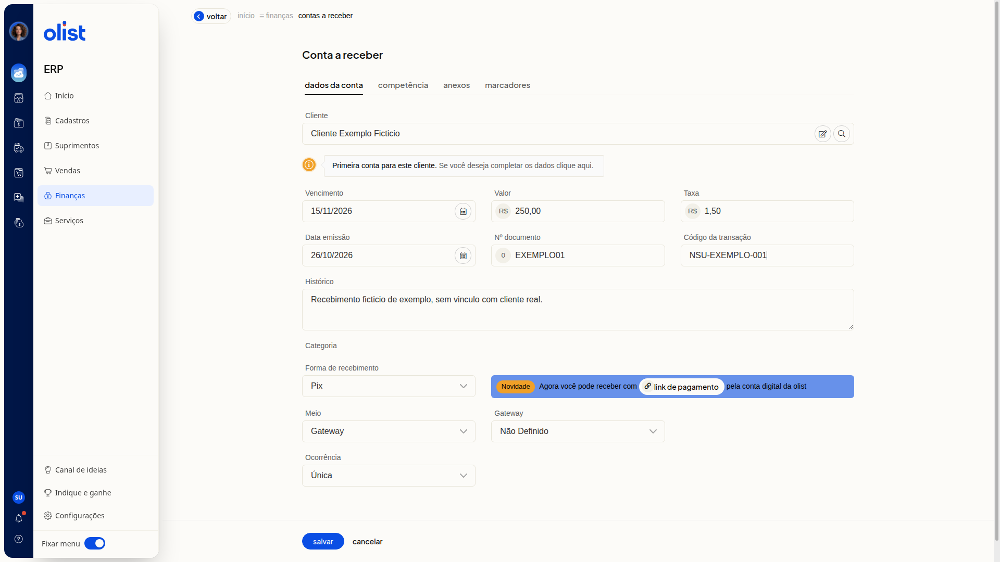
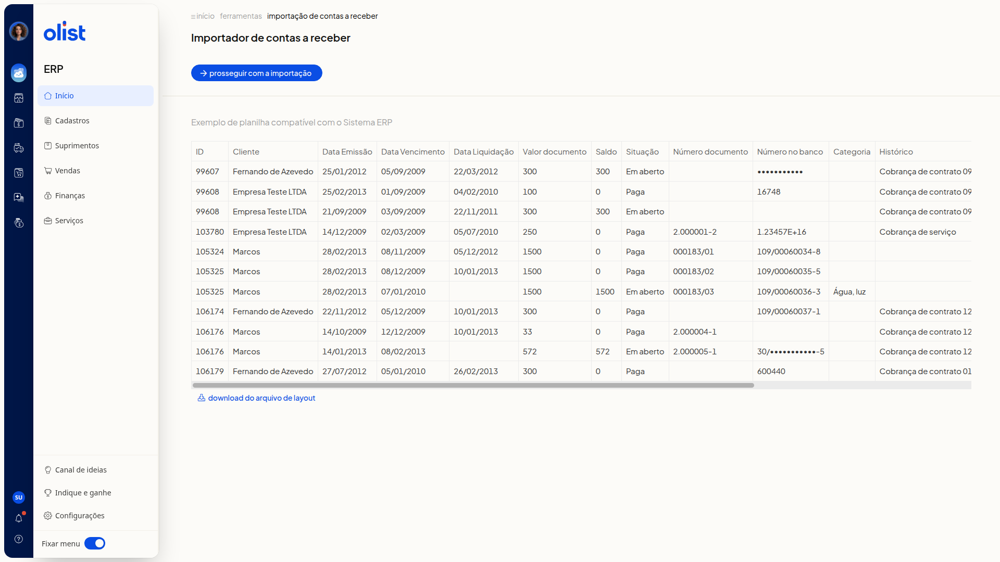

# Como incluir uma conta a receber

## Descrição

No ERP da Olist, você inclui uma conta a receber pela tela ou por planilha. Pela tela, o formulário reúne os dados da conta, a competência, o anexo e os marcadores. Por planilha, você importa os lançamentos com o arquivo de layout.

Acesse **Finanças > Contas a Receber**. Na lista, use **Incluir conta a receber** ou **Mais ações > Importar lançamentos de uma planilha**.

## Pré-requisitos

- Você precisa de acesso ao menu **Finanças** no ERP.
- Você precisa da permissão de Contas a receber para acessar a tela.
- Você precisa da permissão para incluir em Contas a receber para usar **Incluir conta a receber**.
- Para importar por planilha, você precisa da permissão de importação de registros e da permissão para incluir e editar em Contas a receber.
- O cliente não precisa já estar cadastrado. Um nome não encontrado pode ser informado, e a tela avisa que é a primeira conta desse cliente.

## Importante

- Nenhum campo do formulário é obrigatório.
- Na aba **Anexos**, o arquivo é limitado a 2Mb.
- Para anexar um arquivo, a empresa precisa ter espaço de armazenamento disponível.
- O link de pagamento pela Conta Digital da Olist no formulário depende de a empresa poder emitir esse link.
- O aviso da conta digital no formulário só aparece se a forma de recebimento for link de pagamento com a conta digital configurada, ou se o meio de recebimento for a Conta Digital da Olist.

## Instruções

### Pela tela

1. Acesse **Finanças > Contas a Receber**.

   

2. Clique em **Incluir conta a receber**.

#### Dados da conta

3. Informe **Cliente**. Pesquise pelas iniciais do nome, pelo CPF/CNPJ ou pelo email. Se precisar, clique em **Pesquisar contato** ou em **Visualizar dados do fornecedor**.
4. Leia o aviso **Primeira conta para este cliente. Se você deseja completar os dados clique aqui.** se o nome não estiver cadastrado.
5. Informe **Vencimento** no formato DD/MM/AAAA.
6. Informe **Valor** em reais, com vírgula decimal.
7. Informe **Data emissão** no formato DD/MM/AAAA.
8. Informe **Nº documento**.
9. Informe **Histórico**. Esta informação será exibida no link de pagamento.
10. Selecione a **Forma de recebimento**. A lista inicia em **Selecione**. As opções incluem:
   - **Dinheiro**
   - **Cartão de crédito**
   - **Cartão de débito**
   - **Boleto**
   - **Cheque**
   - **Depósito**
   - **Crediário**
   - **Vale-troca**
   - **Pix**
   - **Meli**
   - **Crypto - Bitcoin**
   - **Mercado pago**
   - **Cashback**
   - **Vale-presente**
   - outras formas cadastradas na conta

#### Campos ao selecionar Pix

11. Ao selecionar **Pix**, informe **Taxa** em reais, com vírgula decimal.
12. Informe **Código da transação** com o NSU ou o id da transação.
13. Selecione **Meio** como **Banco** ou **Gateway**.
14. Selecione **Gateway**. As opções são **Não Definido** e os gateways cadastrados.

   

#### Ocorrência

15. Selecione a **Ocorrência**. A ocorrência padrão é **Única**. As opções são **Única**, **Semanal**, **Quinzenal**, **Mensal**, **Trimestral**, **Semestral**, **Anual** e **Parcelada**.
16. Use o botão **link de pagamento** se o formulário mostrar o aviso **Novidade. Agora você pode receber com link de pagamento pela conta digital da olist**.

#### Competência

17. Abra a aba **Competência** e use as setas de **Competência** para escolher o mês.

#### Anexos

18. Abra a aba **Anexos** e clique em **Procurar arquivo** para enviar um arquivo de até 2Mb.

#### Marcadores

19. Abra a aba **Marcadores** e informe os marcadores separados por vírgula ou tab. O texto vira etiquetas.
20. Revise os dados e clique em **Salvar** para gravar a conta. Para descartar o preenchimento, clique em **Cancelar**.

### Por planilha

1. Acesse **Finanças > Contas a Receber**.
2. Clique em **Mais ações**.

   

3. Clique em **Importar lançamentos de uma planilha**.

   

4. Clique em **Download do arquivo de layout** para baixar o modelo.
5. Preencha a planilha. O exemplo traz as colunas **ID**, **Cliente**, **Data Emissão**, **Data Vencimento**, **Data Liquidação**, **Valor documento**, **Saldo**, **Situação**, **Número documento**, **Número no banco**, **Categoria** e **Histórico**.
6. Selecione o arquivo e clique em **Prosseguir com a importação**.

## Links relacionados

Fale com o suporte se precisar de ajuda para incluir a conta a receber.
