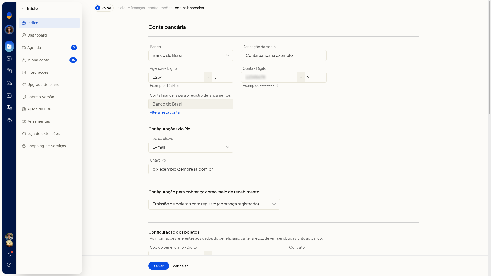
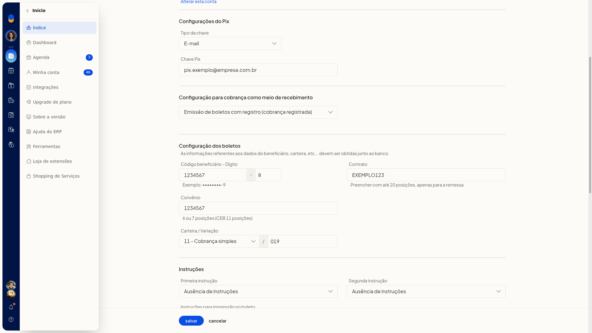
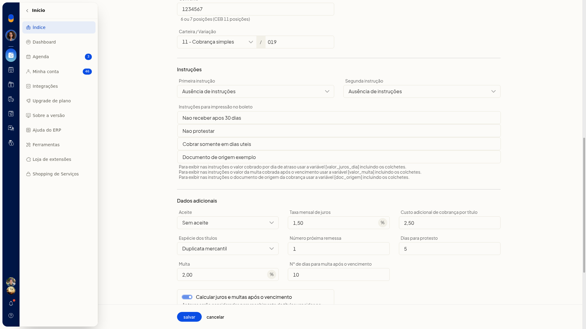
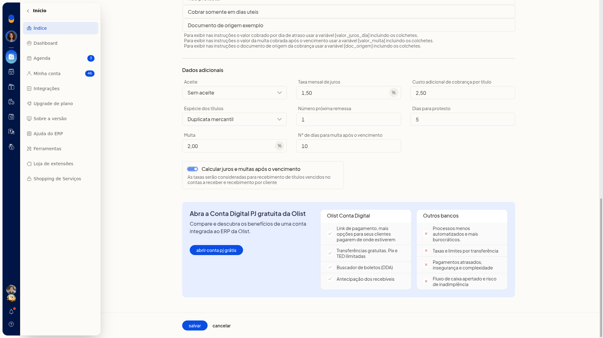

# Configurar a cobrança registrada do Banco do Brasil na conta bancária

No ERP da Olist, a cobrança registrada do Banco do Brasil define a conta bancária como meio de recebimento com boleto registrado. Você informa beneficiário, contrato, convênio, carteira, instruções do boleto, juros, multa, protesto e espécie do título.

O cadastro fica em **Configurações > Configurações ERP > Finanças > Cadastro de contas bancárias**.

## Importante
- Tenha em mãos o código do beneficiário, o contrato e o convênio informados pelo banco.
- **Contrato** aceita até 20 posições e vale apenas para a remessa.
- **Convênio** tem 6 ou 7 posições. No CEB, use 11 posições.
- Na última linha das instruções de impressão, para o juros diário, use a variável [valor_juros_dia], com os colchetes.
- A tela não marca esses campos com asterisco.

## Instruções
#### Dados da conta

1. Acesse **Configurações > Configurações ERP > Finanças > Cadastro de contas bancárias**.
2. Clique em **Incluir conta bancária**.
3. Em **Banco**, selecione **Banco do Brasil**.
4. Informe **Descrição da conta**, a agência e o dígito no campo **-**, a conta e o dígito no campo **-**.

   

5. Em **Conta financeira para o registro de lançamentos**, selecione uma conta já cadastrada ou **Criar nova conta**.

#### Cobrança registrada

6. Em **Configuração para cobrança como meio de recebimento**, selecione **Emissão de boletos com registro (cobrança registrada)**.
7. Informe **Código beneficiário** e o dígito no campo **-**, **Contrato** e **Convênio**.
8. Em **Carteira**, selecione a opção e informe **Variação** no campo **/**.
 - 11 - Cobrança simples
 - 12 - Cobrança indexada
 - 15 - Cobrança de prêmios de seguro
 - 16 - Cobrança direta
 - 17 - Cobrança simples
 - 18 - Cobrança direta pré-impressa
 - 21 - Cecred
 - 31 - Cobrança caucionada/vinculada
 - 51 - Carteira descontada
 - 11 - Cobrança descontada
 - 11 - Cobrança vinculada
 - 17 - Cobrança descontada
 - 17 - Cobrança vinculada

   

#### Instruções, juros e multa

9. Selecione **Primeira instrução** e **Segunda instrução**. As opções são as mesmas nos dois campos:
 - Ausência de instruções
 - Cobrar juros
 - Protestar no 3º, 4º ou 5º dia útil após o vencimento
 - Protestar em n dias
 - Não protestar
 - Protestar no 10º, 15º, 20º, 25º, 30º ou 45º dia corrido após vencimento
 - Conceder desconto só até a data estipulada
10. Preencha as quatro linhas de **Instruções para impressão no boleto**.
11. Em **Aceite**, selecione **Sem aceite** ou **Com aceite**.
12. Em **Espécie dos títulos**, selecione a espécie:
 - Duplicata mercantil
 - Nota promissória
 - Nota de seguro
 - Recibo
 - Letra de câmbio
 - Warrant
 - Cheque
 - Duplicata de serviço
 - Nota de débito
 - Apólice de seguro
 - Duplicata rural
 - Dívida ativa da união
 - Dívida ativa do estado
 - Dívida ativa do município
13. Informe **Número próxima remessa** e **Dias para protesto**.

   

14. Informe **Taxa mensal de juros** e **Custo adicional de cobrança por título** em valor numérico.
15. Informe **Multa** em percentual e **N° de dias para multa após o vencimento**.
16. Marque **Calcular juros e multas após o vencimento** se quiser que as taxas sejam consideradas no recebimento de títulos vencidos no contas a receber e no recebimento por cliente.

   

17. Clique em **salvar** para gravar a conta bancária com a cobrança registrada do Banco do Brasil.
