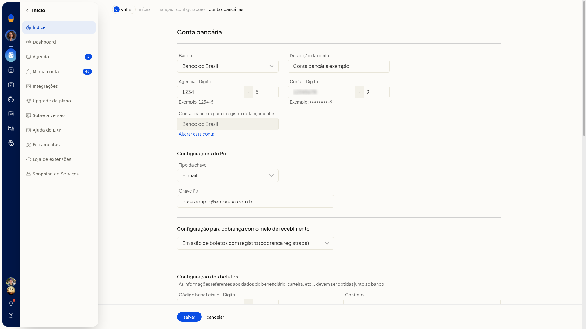
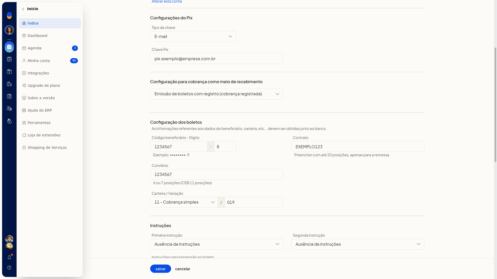
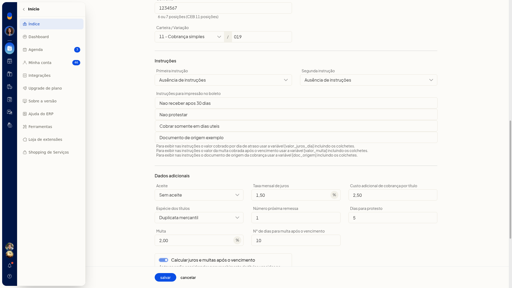
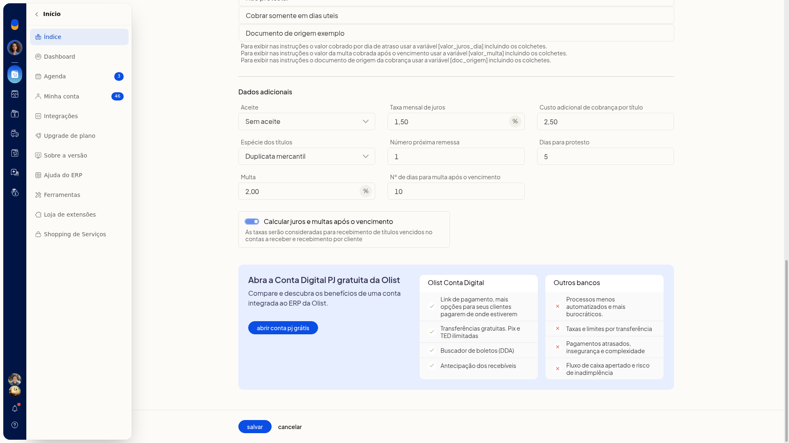

# Contas bancárias e contas financeiras

No ERP da Olist, as contas financeiras entram no caixa e as contas bancárias reúnem os dados usados na cobrança. Você cadastra a conta financeira, indica se ela entra no saldo do fluxo de caixa e no saldo inicial do caixa, e informa o número dela na contabilidade. Na conta bancária, você registra banco, agência, conta, chave Pix e a emissão de boleto, inclusive a cobrança registrada.

## Importante
- Beneficiário, contrato e convênio são informados pelo banco.
- Nenhum campo desses cadastros aparece marcado como obrigatório.
- Os dados de boleto com registro abaixo são os exibidos para **Banco do Brasil** com **Emissão de boletos com registro (cobrança registrada)**.

## Instruções
### Cadastrar conta financeira

1. Acesse **Configurações > Configurações ERP > Finanças > Cadastro de contas financeiras**.
2. Clique em **Incluir conta**.
3. Informe **Nome da conta**.
4. Marque **Não considerar esta conta no saldo para fluxo de caixa e no saldo inicial do caixa** se a conta não deve entrar nesses saldos.
5. Confirme o cadastro para gravar a conta. **Cancelar** devolve à lista sem gravar.

### Informar o número da conta na contabilidade

1. Na lista de contas financeiras, abra o menu de ações da linha.
2. Clique em **Informar número da conta**.
3. Preencha **Número da conta na contabilidade**.
4. Confirme para gravar o número. **Cancelar** fecha a edição sem gravar.

### Cadastrar conta bancária

1. Acesse **Configurações > Configurações ERP > Finanças > Cadastro de contas bancárias**.
2. Clique em **Incluir conta bancária**.
3. Em **Banco**, escolha uma opção: **Olist Conta Digital**, **Banco Inter**, **Banco Safra**, **Banco do Brasil**, **Banco do Nordeste**, **Banrisul**, **Bradesco**, **Caixa (SICOB)**, **Caixa (SIGCB)**, **HSBC**, **Itaú**, **Santander**, **Sicoob**, **Sicredi**, **Unicred Integração RS** ou **Outro**.
4. Informe **Descrição da conta**, a agência e o dígito no campo **-**, a conta e o dígito no campo **-**.
5. Em **Conta financeira para o registro de lançamentos**, selecione uma conta já cadastrada ou **Criar nova conta**.

   

6. Em **Tipo da chave**, escolha **E-mail**, **CPF**, **CNPJ**, **Telefone** ou **Chave aleatória**.
7. Informe a **Chave Pix**.
8. Em **Configuração para cobrança como meio de recebimento**, escolha **Não emite boletos através desta conta**, **Emissão de boletos sem registro** ou **Emissão de boletos com registro (cobrança registrada)**.
9. Com **Banco do Brasil** e **Emissão de boletos com registro (cobrança registrada)**, preencha o código do beneficiário e o dígito no campo **-**.
10. Preencha **Contrato** com até 20 posições. O valor serve apenas para a remessa.
11. Preencha **Convênio** com 6 ou 7 posições. No CEB, use 11 posições.
12. Em **Carteira**, escolha uma opção: **11 - Cobrança simples**, **12 - Cobrança indexada**, **15 - Cobrança de prêmios de seguro**, **16 - Cobrança direta**, **17 - Cobrança simples**, **18 - Cobrança direta pré-impressa**, **21 - Cecred**, **31 - Cobrança caucionada/vinculada**, **51 - Carteira descontada**, **11 - Cobrança descontada**, **11 - Cobrança vinculada**, **17 - Cobrança descontada** ou **17 - Cobrança vinculada**.
13. Informe a **Variação** no campo **/**.
14. Em **Primeira instrução** e **Segunda instrução**, escolha: **Ausência de instruções**, **Cobrar juros**, **Protestar no 3º dia útil após o vencimento**, **Protestar no 4º dia útil após o vencimento**, **Protestar no 5º dia útil após o vencimento**, **Protestar em n dias**, **Não protestar**, **Protestar no 10º dia corrido após vencimento**, **Protestar no 15º dia corrido após vencimento**, **Protestar no 20º dia corrido após vencimento**, **Protestar no 25º dia corrido após vencimento**, **Protestar no 30º dia corrido após vencimento**, **Protestar no 45º dia corrido após vencimento** ou **Conceder desconto só até a data estipulada**. A segunda instrução tem as mesmas opções.
15. Preencha as quatro linhas de **Instruções para impressão no boleto**. Na última linha, para o juros diário, use a variável [valor_juros_dia], com os colchetes.
16. Em **Aceite**, escolha **Sem aceite** ou **Com aceite**.

   

   

17. Informe **Taxa mensal de juros** e **Custo adicional de cobrança por título**.
18. Em **Espécie dos títulos**, escolha **Duplicata mercantil**, **Nota promissória**, **Nota de seguro**, **Recibo**, **Letra de câmbio**, **Warrant**, **Cheque**, **Duplicata de serviço**, **Nota de débito**, **Apólice de seguro**, **Duplicata rural**, **Dívida ativa da união**, **Dívida ativa do estado** ou **Dívida ativa do município**.
19. Informe **Número próxima remessa**, **Dias para protesto**, **Multa** e **N° de dias para multa após o vencimento**.
20. Marque **Calcular juros e multas após o vencimento** se quiser usar as taxas em títulos vencidos. A tela informa que as taxas serão consideradas para recebimento de títulos vencidos no contas a receber e recebimento por cliente.
21. Clique em **salvar** para gravar a conta bancária. **Cancelar** também fica disponível.

   

## Informações adicionais
- As listas de contas financeiras e de contas bancárias oferecem incluir. Não há importar nem exportar planilha nessas listas.
- Na conta financeira, o menu da linha inclui **Preferencial para movimentações**, **Informar número da conta**, **Inativar conta** e **Excluir conta**.
- Na conta bancária, o menu da linha mostra **Excluir conta bancária**.
