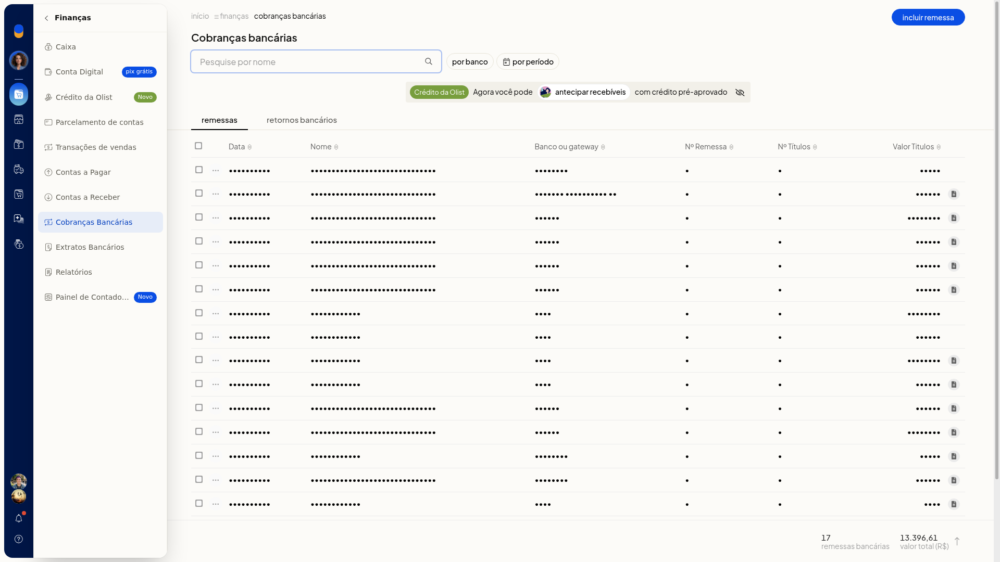
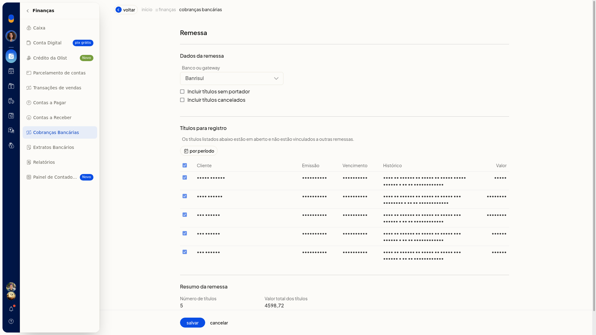
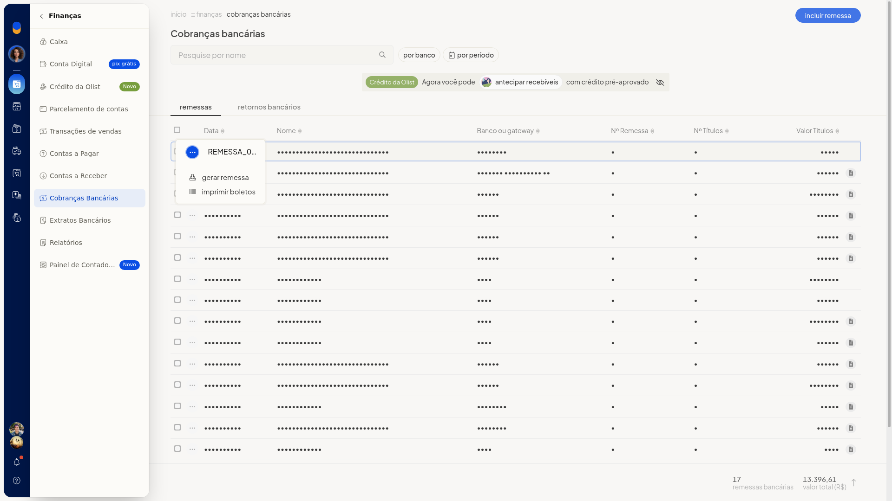
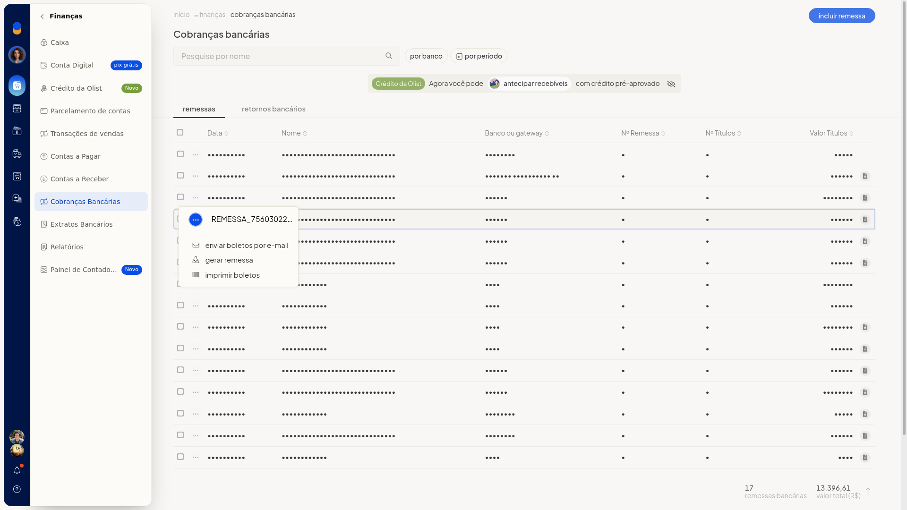
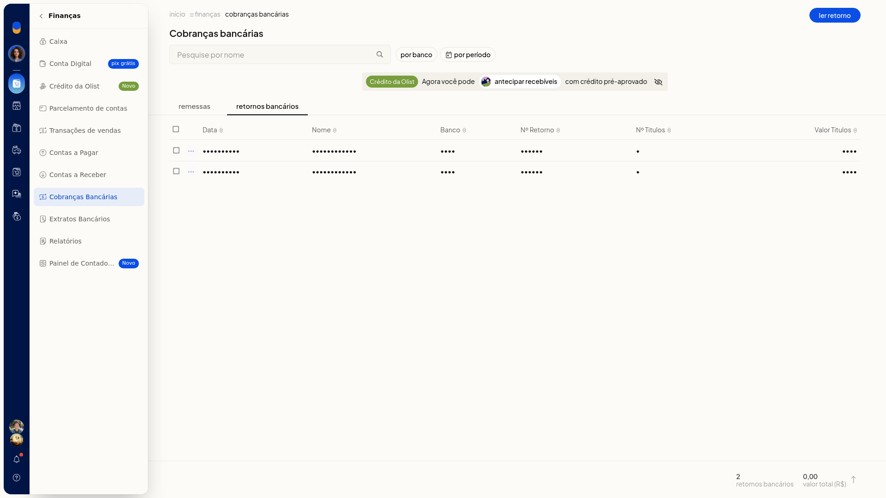
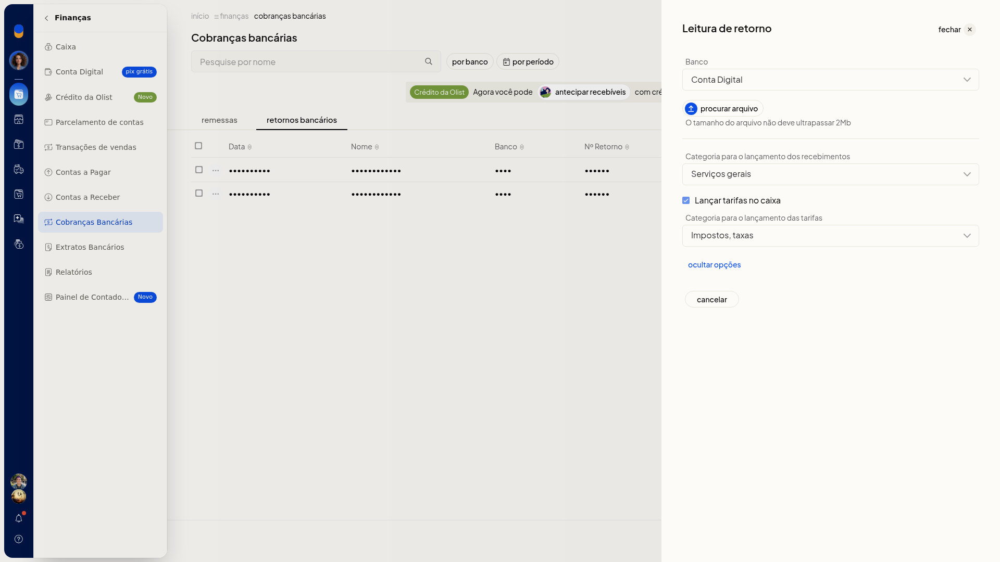
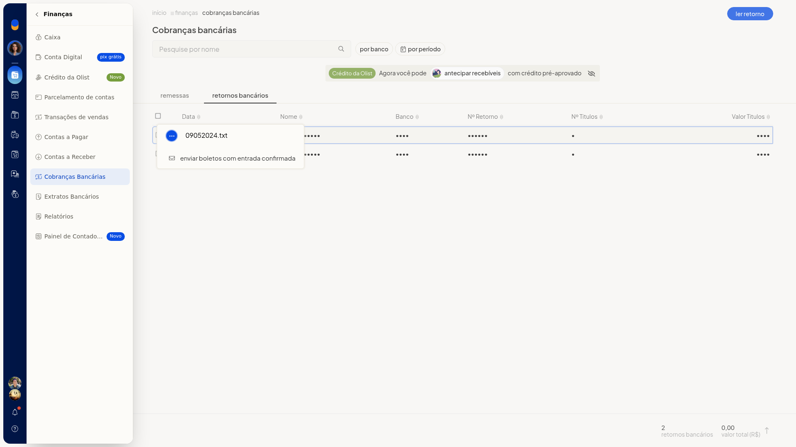

# Cobranças bancárias

## Pré-requisitos
- O banco ou gateway de cobrança precisa aparecer na lista do formulário de remessa ou de retorno.

## Importante
- A remessa lista títulos em aberto que ainda não estão ligados a outra remessa.
- Títulos sem portador ou cancelados só entram se você marcar **Incluir títulos sem portador** ou **Incluir títulos cancelados**.
- O arquivo de retorno tem no máximo 2Mb.

## Instruções
### Incluir uma remessa

1. Acesse **Finanças > Cobranças Bancárias**.
2. Na aba **Remessas**, confira **Incluir remessa**, a busca por nome, por banco e por período, e as colunas **Data**, **Nome**, **Banco ou gateway**, **Nº Remessa**, **Nº Títulos** e **Valor Títulos**.

   

3. Clique em **Incluir remessa**.
4. Selecione **Banco ou gateway**. O campo não é obrigatório.
5. Marque **Incluir títulos sem portador** ou **Incluir títulos cancelados** somente se quiser esses títulos. As duas opções não são obrigatórias.
6. Confira os títulos em aberto, com **Cliente**, **Emissão**, **Vencimento**, **Histórico** e **Valor**, e o resumo com o número de títulos e o valor total.

   

7. Clique em **Cancelar** para fechar sem gravar a remessa.

### Gerar o arquivo, imprimir ou enviar os boletos

1. Na aba **Remessas**, abra o menu da remessa.
2. Se o arquivo ainda não foi gerado, use **Gerar remessa** ou **Imprimir boletos**.

   

3. Se a linha indica remessa com arquivo gerado, use também **Enviar boletos por e-mail**.

   

### Ler um retorno bancário

1. Acesse **Finanças > Cobranças Bancárias**.
2. Abra a aba **Retornos bancários**.
3. Confira **Ler retorno**, a busca por nome, por banco e por período, e as colunas **Data**, **Nome**, **Banco**, **Nº Retorno**, **Nº Titulos** e **Valor Titulos**.

   

4. Clique em **Ler retorno**.
5. Selecione o banco ou gateway. O campo não é obrigatório.
6. Clique em **Procurar arquivo** e indique o arquivo de retorno, de no máximo 2Mb. O campo não é obrigatório.
7. Clique em **Mais opções**.
8. Selecione **Categoria recebimentos**. O campo não é obrigatório e usa uma categoria já cadastrada.
9. Marque **Lançar tarifas no caixa** se quiser lançar as tarifas no caixa. A opção não é obrigatória.
10. Selecione **Categoria tarifas** se for lançar as tarifas. O campo não é obrigatório e usa uma categoria já cadastrada.
11. Clique em **Ocultar opções** para recolher esse bloco.

   

12. Clique em **Cancelar** para sair sem processar o arquivo.

### Enviar boletos com entrada confirmada

1. Na aba **Retornos bancários**, abra o menu de um retorno já listado.
2. Clique em **Enviar boletos com entrada confirmada**.

   

## Resultado
Quando a remessa já tem arquivo gerado, ela consta na lista nessa condição e o menu também oferece **Enviar boletos por e-mail**.
