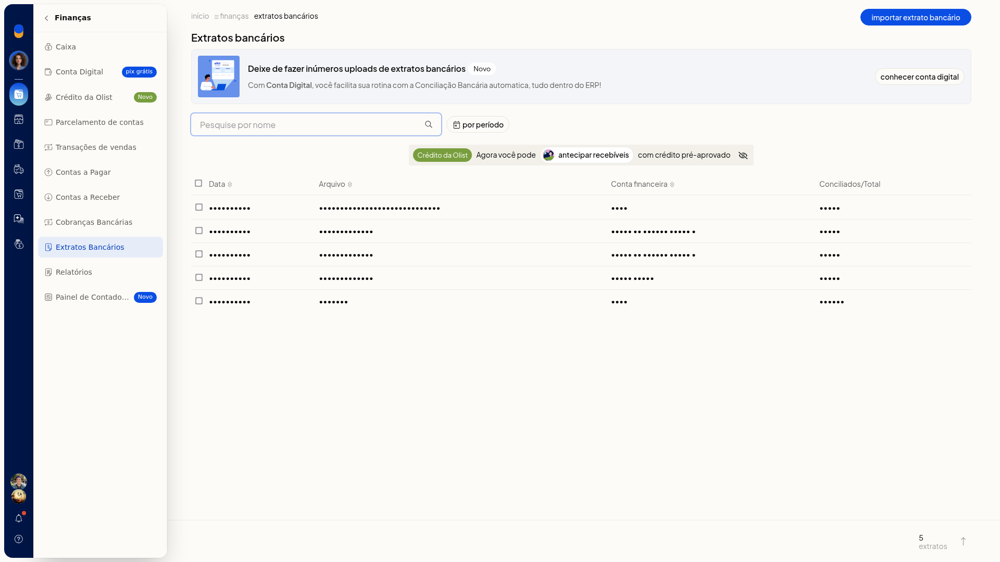
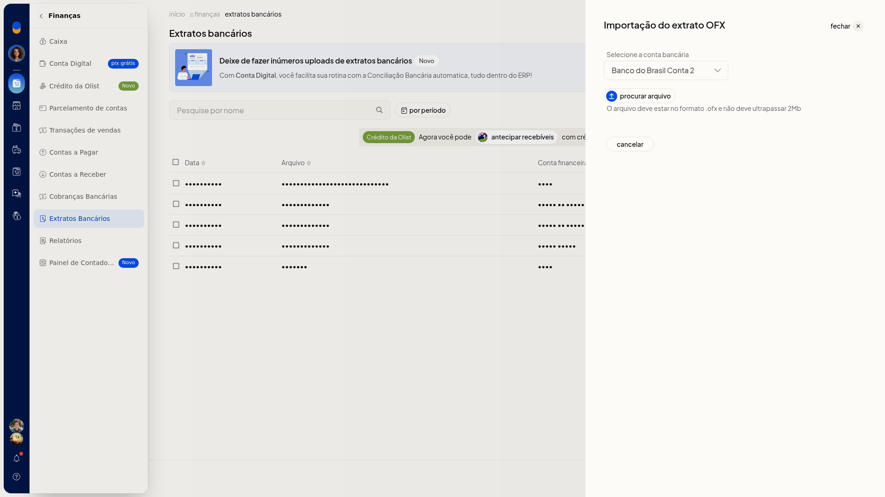
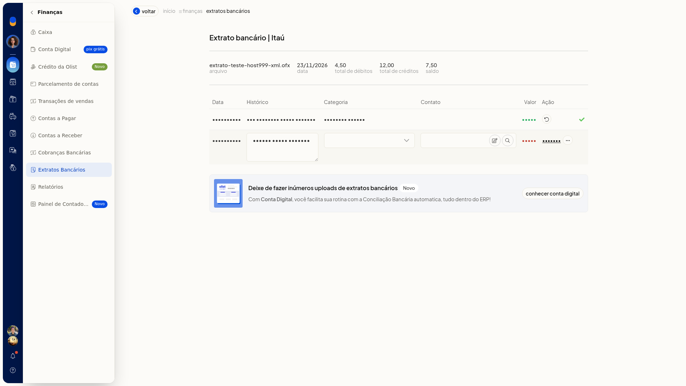
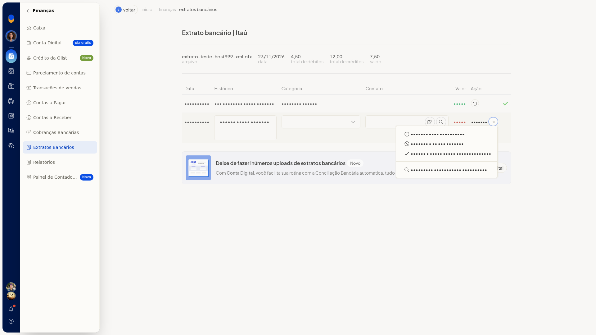
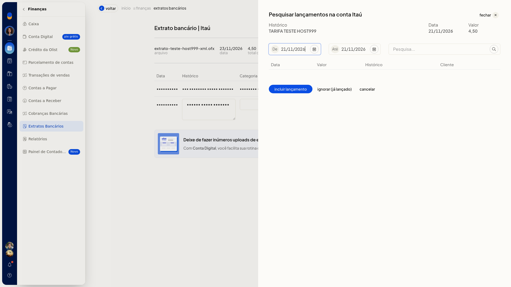

# Extratos bancários e conciliação

No ERP da Olist, você importa o extrato do banco em arquivo OFX e confere cada linha com os lançamentos do caixa. Dá para trazer o arquivo pelo caixa ou por **Extratos Bancários**. Em cada linha, você inclui o lançamento, ignora o que já foi lançado, lança e paga a conta correspondente ou consulta lançamentos já existentes.

## Pré-requisitos
- Tenha ao menos uma conta financeira cadastrada. A importação pede uma conta existente.
- Para conciliar, o extrato precisa já aparecer na lista de **Extratos Bancários**.

## Importante
- O extrato importado por essa tela é um arquivo.ofx de no máximo 2Mb.

## Instruções
### Pelo caixa

1. Acesse **Finanças > Caixa**.
2. Abra **Mais ações** e escolha **Importar extrato OFX**.
3. Selecione a conta financeira já cadastrada e indique o arquivo.ofx de no máximo 2Mb.

### Pela tela de extratos

1. Acesse **Finanças > Extratos Bancários**.
2. Na lista, use a busca por nome e por período. As colunas são **Data**, **Arquivo**, **Conta financeira** e **Conciliados/Total**.

   

3. Clique em **importar extrato bancário**.
4. Escolha a conta financeira e indique o arquivo.ofx de no máximo 2Mb.

   

### Conciliar uma linha do extrato

1. Acesse **Finanças > Extratos Bancários** e abra um extrato da lista.
2. Confira no cabeçalho a data do extrato e os totais de débitos, créditos e saldo. A linha já conciliada aparece com categoria e indicador de conferência.

   

3. Na linha ainda não conciliada, abra o menu e escolha uma opção: **Incluir este lançamento**, **Ignorar / já foi lançado**, **Lançar e pagar conta correspondente** ou **Consultar lançamentos existentes**.

   

4. Em **Consultar lançamentos existentes**, a busca usa a conta do extrato, o histórico, a data e o valor, com intervalo **De** e **Até**. Escolha **incluir lançamento**, **ignorar (já lançado)** ou **cancelar**.

   

## Resultado
A linha conciliada do extrato aparece com categoria e indicador de conferência. Na lista, a coluna **Conciliados/Total** mostra o andamento do arquivo.
